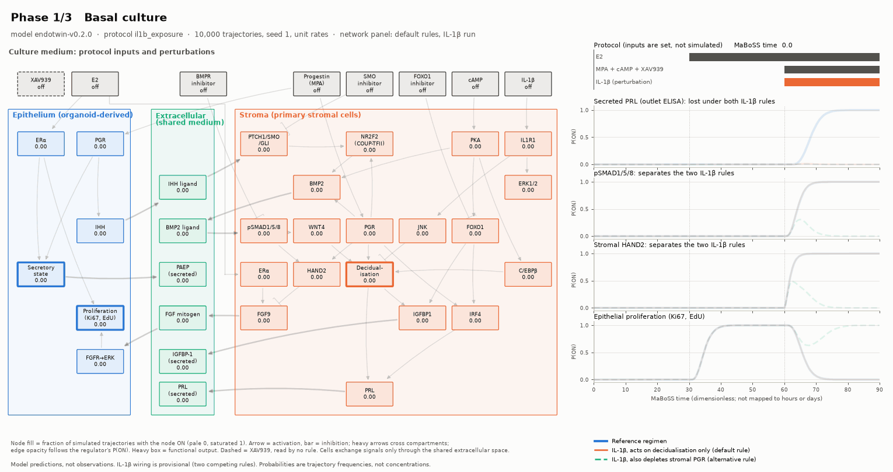
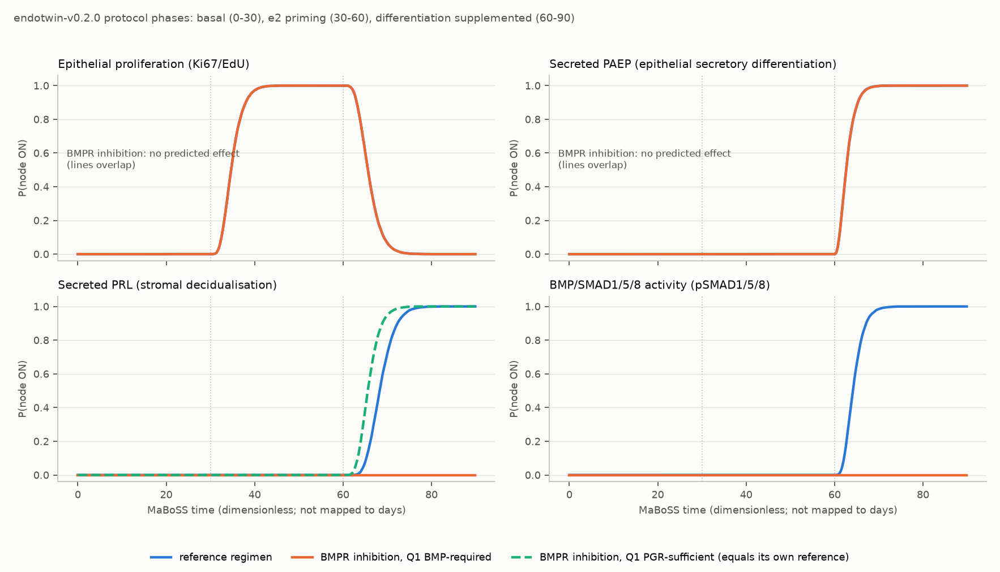
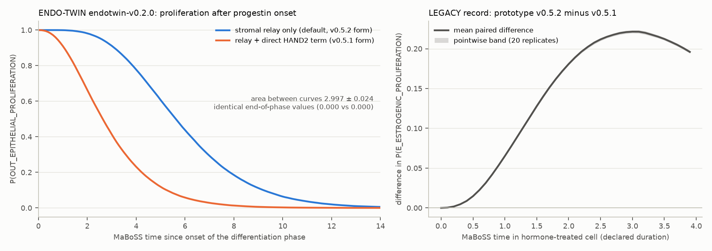

# ENDO-TWIN

A stochastic Boolean model of how ovarian hormones coordinate the epithelium
and the stroma of the human endometrium, built to be tested in ADOC, our
endometrium-on-chip.

This repository is the computational side of the ENDO-TWIN project (AEI
PID2026, Carlos Simón Foundation). It grew out of an earlier, private prototype
of the same group ([docs/ORIGIN.md](docs/ORIGIN.md)).



*`endotwin-v0.2.0` running the ADOC protocol: basal culture, E2 priming, then
differentiation with IL-1β. Node colour is the fraction of 10,000 MaBoSS
trajectories where the node is ON. Epithelium and stroma only talk through the
shared extracellular space in the middle. On the right, the reference regimen
against the two competing IL-1β rules. Model predictions, dimensionless time.
Rebuild with `pixi run endotwin-figures`.*

## The biological question

In the secretory phase progesterone stops the E2-driven proliferation of the
epithelium and makes the stroma decidualise. A lot of genes change. What is
much less clear is which interactions actually drive the switch, and how the
two compartments talk to each other.

We ask two questions:

- **Q1.** Does stromal decidualisation need BMP/SMAD signalling, or is
  progesterone receptor (PGR) signalling enough?
- **Q2.** Does progesterone stop epithelial proliferation through a stromal
  paracrine signal (the HAND2 route), or inside the epithelium itself?

Then we look at inflammation (IL-1β) and at endometrium from women with
endometriosis, where decidualisation is known to be impaired.

ADOC fits this well. Epithelium and stroma sit in seperate compartments, so we
can perturb one side and read the other.

## The model


`endotwin-v0.2.0` has 39 nodes in four compartments, simulated as one MaBoSS
network:

- **Culture medium:** E2, progestin, cAMP and XAV939 (the published regimen),
  a BMP receptor inhibitor, IL-1β, and two candidate inhibitors for WP2
  (Smoothened, FOXO1).
- **Epithelium:** ERα, PGR, IHH, FGFR→ERK1/2, the secretory state and
  proliferation (Ki67/EdU).
- **Shared extracellular space:** the ligands that cross the ADOC membrane
  (IHH, BMP2, the stromal FGF mitogen) and the proteins we measure in the
  outlets (PAEP, PRL, IGFBP-1).
- **Stroma:** ERα, PGR and cAMP/PKA; the decidual transcription module
  (C/EBPβ, FOXO1, IRF4); Hedgehog reception, NR2F2, BMP2, pSMAD1/5/8, WNT4,
  HAND2 and FGF9; IL-1 receptor signalling with its JNK and ERK1/2 branches;
  decidualisation and the PRL and IGFBP1 genes.

Every node and edge comes from the curated literature, and each one has a
readout or a perturbation the project can use. The RNA nodes map to the planned
bulk RNA-seq, and the secreted nodes to the outlet ELISAs. Some nodes have the
same Boolean function as their neighbour, for example a ligand and its secreted
pool. We keep them on purpose and list them in
[docs/model_construction.md](docs/model_construction.md).

We dont know the kinetic parameters of these pathways, and wont know them for a
while. A Boolean rule is something you can trace back to a paper. MaBoSS adds
stochastic timing on top, so we get dynamics and not only steady states.

## Hypotheses as alternative rules

The aproach is simple. Each open question becomes two or three rules for the
same node. We simulate every combination (4 families, 9 variants, 24
scenarios), then look for the experiment where the variants disagree.

**Q1: BMP in decidualisation**

```
S_BMP2      = (S_PGR and S_PKA) or S_NR2F2        // BMP2 expression
X_BMP2      = S_BMP2                               // secreted BMP2 ligand
S_BMP_SMAD  = X_BMP2 and not IN_BMPR_INHIBITOR     // receptor / SMAD1/5/8 activity
S_WNT4      = S_BMP_SMAD
OUT_STROMAL_DECIDUALIZATION = S_PGR and S_CEBPB and S_WNT4 and not S_JNK
```

The alternative, `Q1_pgr_sufficient`, drops the `S_WNT4` term. SMAD1/5
knockdown impairs human decidualisation, WNT4 drops, and BMP2 rescues it (Liao
et al. 2024). BMP2 works through Wnt4 (Li et al. 2007).

**Q2: stromal control of epithelial proliferation**

```
S_HAND2             = S_BMP_SMAD or S_PGR
S_PARACRINE_MITOGEN = S_ESR1 and not S_HAND2        // FGF9 expression
E_FGFR_ERK          = X_PARACRINE_MITOGEN
OUT_EPITHELIAL_PROLIFERATION = E_ESR1 and E_FGFR_ERK
```

E2 makes the epithelium proliferate through stromal ERα (Cooke et al. 1997).
Progesterone induces stromal Hand2, which represses the stromal FGFs, and FGFR
blockade lowers epithelial ERK and Ki67 (Li et al. 2011). In human stromal
cells only FGF9 responds (Murata et al. 2019). The alternative is
epithelial-autonomous: `E_ESR1 and not E_PGR`.

**FOX: does PRL need FOXO1?** (new in v0.2.0)

```
S_FOXO1  = S_PKA and not IN_FOXO1_INHIBITOR
S_IRF4   = S_PGR and S_FOXO1
S_IGFBP1 = OUT_STROMAL_DECIDUALIZATION and S_FOXO1
S_PRL    = OUT_STROMAL_DECIDUALIZATION and S_IRF4   // alternative: no S_IRF4
```

Every study agrees that IGFBP1 needs FOXO1. For PRL the papers disagree. IRF4
or FOXO1 knockdown lowers it (Vasquez et al. 2015, Grinius et al. 2006). A
FOXO1 activity inhibitor leaves it unchanged, though (Ujvari et al. 2017).

**IL-1β (provisional)**

IL-1β impairs decidualisation in human stromal cells through JNK (Taylor et
al. 2024). One study also finds ERK1/2-dependent loss of PR (Yu et al. 2019).
So we keep two rules: JNK only, or JNK plus PR depletion
(`S_PGR = IN_PROGESTIN and not S_ERK1_2`). These papers were read at abstract
level only.

Every edge has an evidence class and references in
[edges.tsv](endotwin/models/endotwin-v0.2.0/edges.tsv). More in
[docs/scientific_evidence.md](docs/scientific_evidence.md).

## What the model predicts



*Under BMP receptor inhibition both Q1 rules lose pSMAD1/5/8, but only the
BMP-required rule loses secreted PRL. 10,000 trajectories, seed 1, unit rates.*

Which experiment separates which hypothesis. These are exact results across
all 24 scenarios ([discrimination.tsv](endotwin/results/endotwin-v0.2.0/discrimination.tsv)):

| Perturbation | Readout | Separates | Predicted |
|---|---|---|---|
| BMP receptor inhibitor, differentiation | PRL, IGFBP-1 (secreted and RNA) | Q1 | down vs no change |
| Stromal HAND2 knockdown, differentiation | Ki67, EdU | Q2 | up vs no change |
| Paracrine block, E2 priming | Ki67, EdU | Q2 | down vs no change |
| Paracrine block, differentiation | Ki67, EdU | nothing | no change anywhere |
| IL-1β, differentiation | pSMAD1/5/8, HAND2, WNT4, IRF4 | IL-1β rules | no change vs down |
| IL-1β, differentiation | epithelial phospho-ERK1/2, FGF9 | IL-1β rules | no change vs up |
| FOXO1 inhibitor, differentiation | PRL (secreted and RNA) | FOX | down vs no change |

A few things are easy to miss:
- The paracrine block only helps with Q2 if you apply it during E2 priming;
  later, HAND2 already keeps the mitogen off.
- The Q1 experiment needs pSMAD1/5/8 to show the inhibitor actually worked.
- The FOXO1 experiment is cheap: one inhibitor and the PRL ELISA we already
  run, with IGFBP-1 as the target-engagement control.
- Blocking Hedgehog reception (SMO inhibitor) lowers NR2F2, but BMP2 holds in
  the supplemented regimen because cAMP backs it up. Without cAMP, BMP2 should
  fall. That makes a testable redundancy prediction.

## Steady states are not enough: the HAND2 relay



There are two ways to write the stromal route of Q2:

- relay only: `E_ESR1 and E_FGFR_ERK`
- relay plus a direct HAND2 term: `E_ESR1 and E_FGFR_ERK and not S_HAND2`
  (the prototype v0.5.1 form)

Both compute the same Boolean function, so all their steady states are
identical. The dynamics are different though. After progestin onset the relay
version keeps proliferation on for longer. Over 10 paired replicates, the area
between the curves is 3.00 ± 0.02, and all 10 are positive. The half-times are
5.7 vs 2.7 (dimensionless) and both curves end at 0.000. The delay was there in
all 20 random rate sets we tried.

In v0.1.0 the same area was 1.0. The signal now crosses the extracellular space
and an epithelial receptor step, and every extra hop costs time. Only a time
course can see that. Time-resolved Ki67/EdU after progestin onset would test
it. The current plan has no such time course, so for now it stays a model
prediction.

## Where this comes from

The earlier prototype, wich focused on embryo adhesion in ADOC, gave us the literature work,
the data integration and the tooling. We rebuilt the model around Q1 and Q2.
Embryo adhesion is not used: its three conditions cannot separate any of our
hypotheses ([docs/experimental_data.md](docs/experimental_data.md)). The old
models and analyses stay in the repository as legacy material
([docs/legacy/README.md](docs/legacy/README.md)).

The numbers below are recomputed from the repository by
`src/endotwin/foundation_metrics.py`. A test fails if the table drifts from
them. Full audit:
[docs/RESEARCH_FOUNDATION_AUDIT.md](docs/RESEARCH_FOUNDATION_AUDIT.md).

<!-- dashboard:start -->
| | |
|---|---|
| Literature | 147 papers screened (tiers A 52 / B 80 / C 15); 95 registered references, all 95 checked against Crossref; 62 read in full text; a re-audit report on a stated 163-PDF corpus, with 36 papers listed in it |
| Evidence | 276 edge-level evidence rows; 37 rows graded from full text on 27 edges; 39 citation adjudications (32 retracted, 7 attached) |
| Prototype network, v0.6.0 | 56 nodes, 89 dependencies (76 activating, 13 inhibitory); 29 distinct Boolean functions in 7 alias classes; 17 phenotype-inert nodes |
| Prototype history | 8 model versions; 25 completed analyses with results in the repository |
| ADOC data | 62 secreted-protein rows, 39 observed values (PRL, IGFBP-1, PAEP); scRNA-seq with 28,212 cells from 3 donors |
| ENDO-TWIN v0.2.0 | 39 nodes, 47 dependencies, 17 distinct Boolean functions; 4 hypothesis families, 9 rule variants, 24 scenarios; 12 protocol conditions, 9 comparisons |
| Robustness | 5,670 of 5,670 steady-state predictions unchanged under 30 random rate sets; all 840 simulated phases reach their exact fixed points |
| Tests | 2,587 automated tests in this repository (2,524 passed, 0 failed, 63 skipped) |
<!-- dashboard:end -->

Named nodes are not the same as distinct functions, and simulation runs are
not biological replicates.

## Data

The published ADOC study (Zaragozano et al. 2026) gives the regimen (E2
priming, then E2 + MPA + 8-Br-cAMP + XAV939), outlet ELISAs for PRL, IGFBP-1
and PAEP, and scRNA-seq (E-MTAB-15842). These were used to build the network,
so agreeing with them is not validation. We cant reconstruct which donor each
protein value came from. Details:
[docs/experimental_data.md](docs/experimental_data.md).

The project will produce 42 compartment-resolved bulk RNA-seq libraries, plus
Ki67/EdU, pSMAD1/5/8 and viability. Each RNA node of the model already has its
gene readout in
[observation_map.tsv](endotwin/config/observation_map.tsv). Schemas and
validators are ready in `endotwin/config/data_schemas/`. No new data exist yet.

## Status and limits

No calibration and no independent validation. Everything above is a model
prediction under the stated rules and unit rates.

- **Exploratory:** the network and the four hypothesis families (the IL-1β
  wiring especially).
- **Verified computationally:** exact structure, fixed points, MaBoSS runs,
  phase carry-over and the rate robustness of steady states.
- **Ready, not used yet:** prediction freezing for WP2/WP4 and the data
  interfaces.
- **Planned:** calibration and prospective validation (WP1–WP4).
- **Future, not funded:** multiscale coupling with PhysiBoSS
  ([notes](docs/architecture/future_multiscale_extension.md)). The compartment
  split already gives three networks coupled only through ligand pools.

Main limitations:

- One progestin input drives all PGR-dependant nodes. PGR, IHH and HAND2 cannot
  be told apart without compartment-specific perturbations.
- Where graded, the IHH–NR2F2–BMP2 edges are weakly supported by their papers.
  No human study shows that Hedgehog reception is needed for NR2F2.
- The SMO and FOXO1 inhibitors are candidates, not part of the funded protocol.
- XAV939 is in the regimen but no rule reads it, since we dont know which
  compartment it reaches.
- The IL-1β papers were read at abstract level only; no full text was
  reachable.
- The proliferation rule still requires epithelial ERα, which Cooke 1997
  (read in full) shows is not needed in mouse. The term changes no prediction
  and goes in the next model revision.
- **Nothing connects progestin to cAMP/PKA.** `S_PKA` reads only `IN_cAMP`, the
  8-Br-cAMP reagent, so the model says stromal decidualisation is impossible
  without it. Tamura 2014 (ET-011, read in full 2026-11-23) does not support
  that: it never tests a progestin arm, its basal C/EBPβ protein is non-zero,
  and it treats cAMP as the second messenger of progesterone (ET-030, ET-031),
  with C/EBPβ rising in late-secretory stroma in vivo without any exogenous
  cAMP. Unlike the ERα term above, this one **does** change a prediction: every
  hormone-only result should be read as a floor the model imposes, not as a
  finding. A progestin→PKA path is the first candidate for the next revision.
  Consequences for the grant's Task 1.1 and Task 1.4 are worked through in
  [endotwin/results/grant_v8_design_audit.md](endotwin/results/grant_v8_design_audit.md).
- Outputs are Boolean and time is dimensionless. Transients depend on unknown
  rates; steady states do not.

## Running it

Needs [pixi](https://pixi.sh) on linux-64. `pixi.lock` pins Python 3.12 and
MaBoSS 0.8.15.

```bash
pixi install
pixi run endotwin-test       # mainline tests, ~20 s
pixi run endotwin-simulate   # reference, BMP-inhibition, IL-1β and FOXO1-inhibition dynamics
pixi run endotwin-all        # every mainline result, figure and metric, ~7 min
pixi run test                # complete suite incl. legacy tests, ~16 min
```

From Python (`PYTHONPATH=src`):

```python
from endotwin.model import load_model
from endotwin.protocols import load_protocols
from endotwin.simulate import simulate_condition, SimulationSettings

model = load_model()
protocols = load_protocols(model)
run = simulate_condition(model, protocols.conditions["foxo1_inhibition"],
                         protocols.interventions,
                         model.selection_from_ids(["FOX_prl_foxo1_independent"]),
                         SimulationSettings(sample_count=5000, seed=1))
final = run.final("differentiation_supplemented")
final["X_IGFBP1"], final["X_PRL"]   # (0.0, 1.0)
```

Two WP2 drafts are ready and checked but not frozen: Smoothened inhibition
under the hormone-only regimen (pSMAD1/5/8 down, recommended) and FOXO1
inhibition (IGFBP-1 down). They get frozen at the end of WP1, once the WP1
donors are known ([docs/wp2_prediction_selection.md](docs/wp2_prediction_selection.md)).
`pixi run endotwin-freeze --check <spec>` runs the eligibility analysis without
freezing anything.

## Tests

Software correctness ≠ biological validation. The tests show the code does what
it says, reproducibly. They say nothing about whether the biology is right.

| Suite | Tests | Result |
|---|---|---|
| This repository, `pixi run test` | 2,587 | 2,524 passed, 0 failed, 63 skipped |
| of which mainline, `pixi run endotwin-test` | 116 | OK |
| Prototype at the source commit | 2,767 | 2,757 passed; the 10 others need local-only data |
| Prototype benchmark, 2026-10-16 | 2,415 | OK |

The 63 skips are legacy checks that need the prototype git history, wich this
repository does not have. They passed at the source commit. See
[docs/software_verification.md](docs/software_verification.md).

## Plan

| WP | What | Repository support |
|---|---|---|
| WP1 | Qualify the regimen in 4 G1 donors; RNA-seq and protein readouts; BMP inhibition and one paracrine perturbation | discrimination table, RNA readout map, data schemas |
| WP2 | One withheld perturbation in 5 new G1 donors, predictions frozen first | candidate perturbations (FOXO1, SMO inhibitors), `endotwin-freeze`, donor-leakage guard |
| WP3 | IL-1β (G2) and endometriosis (G3) against G1 | IL-1β hypothesis family |
| WP4 | Select one intervention with G2 data only, test in G2 and G3 | freezing with a G2-only selection record |

## Documentation

[Origin](docs/ORIGIN.md) ·
[foundation audit](docs/RESEARCH_FOUNDATION_AUDIT.md) ·
[literature curation](docs/literature_curation.md) ·
[evidence per rule](docs/scientific_evidence.md) ·
[model construction](docs/model_construction.md) ·
[data](docs/experimental_data.md) ·
[evaluation](docs/model_evaluation.md) ·
[WP2 prediction](docs/wp2_prediction_selection.md) ·
[software verification](docs/software_verification.md) ·
[legacy prototype](docs/legacy/README.md)

## References and licence

Full list with DOIs in
[endotwin/evidence/references.tsv](endotwin/evidence/references.tsv).

- Zaragozano S, et al. Modeling human embryo adhesion using a microfluidic platform. *Sci Adv* 2026;12:eadz2249. doi:10.1126/sciadv.adz2249
- Liao Z, et al. Impaired BMP signaling pathways disrupt decidualization in endometriosis. *Commun Biol* 2024;7:227. doi:10.1038/s42003-024-05898-z
- Li Q, et al. Bone morphogenetic protein 2 functions via a conserved signaling pathway involving Wnt4 to regulate uterine decidualization in the mouse and the human. *J Biol Chem* 2007. doi:10.1074/jbc.M704723200
- Cooke PS, et al. Stromal estrogen receptors mediate mitogenic effects of estradiol on uterine epithelium. *PNAS* 1997;94:6535–6540. doi:10.1073/pnas.94.12.6535
- Li Q, et al. The antiproliferative action of progesterone in uterine epithelium is mediated by Hand2. *Science* 2011. doi:10.1126/science.1197454
- Murata H, et al. Progestin-induced HAND2 inhibits angiopoietin 2 via FGF9 in human endometrial stromal cells. *Reprod Biol* 2019. doi:10.1016/j.repbio.2019.02.005
- Vasquez YM, et al. FOXO1 is required for binding of PR on IRF4, novel transcriptional regulator of endometrial stromal decidualization. *Mol Endocrinol* 2015. doi:10.1210/me.2014-1292
- Ujvari D, et al. Dysregulation of in vitro decidualization of human endometrial stromal cells by insulin via transcriptional inhibition of forkhead box protein O1. *PLoS ONE* 2017. doi:10.1371/journal.pone.0171004
- Taylor RN, et al. Interleukin-1β induces and accelerates human endometrial stromal cell senescence and impairs decidualization via the JNK pathway. *Cell Death Discov* 2024;10:288. doi:10.1038/s41420-024-02048-6
- Stoll G, et al. MaBoSS 2.0: an environment for stochastic Boolean modeling. *Bioinformatics* 2017;33:2226–2228. doi:10.1093/bioinformatics/btx123

MaBoSS and PyMaBoSS are installed dependencies (`docs/THIRD_PARTY_NOTICES.md`).
Developed at the Carlos Simón Foundation for Research in Women's Health.

**This repository is public** ([github.com/FCS-BioIT/ENDO-TWIN_prototype](https://github.com/FCS-BioIT/ENDO-TWIN_prototype);
despite the remote's name this is the ENDO-TWIN mainline, and the "prototype" of
[docs/ORIGIN.md](docs/ORIGIN.md) is a different, private repository).

**Public to read is not open source.** Copyright © 2026 Fundación Carlos Simón,
all rights reserved. [LICENSE](LICENSE) grants reviewers appointed by the
Agencia Estatal de Investigación the right to consult the code and to make the
copies and run the tests needed to evaluate ENDO-TWIN in the 2026 *Proyectos de
Generación de Conocimiento* call, and nothing further: no commercial use, no use
for other purposes, no modification (not even for your own use), no
incorporation into other products, no redistribution. Anything else needs the
rights holder's prior written permission. The Spanish text of `LICENSE` is the
authoritative one.

The licence covers this repository's own code and documentation. It does not
cover the installed dependencies (`docs/THIRD_PARTY_NOTICES.md`), nor `data/`, which
holds publisher PDFs, the Zaragozano manuscript files and the secreted-protein
workbook that are not the Foundation's to license. Since 2026-11-23 `data/` is
untracked (`.gitignore`): the files stay the immutable source layer on the
machines that hold them, pinned by SHA-256 in `config/data_manifest.tsv`, and a
clone obtains them out of band. Copies committed before that date remain in the
Git history; untracking does not retract them.
