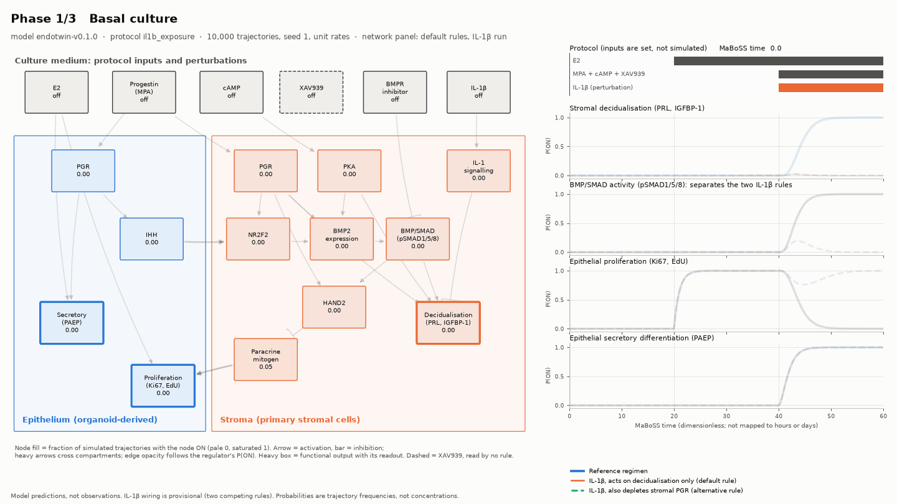

# ENDO-TWIN

A stochastic Boolean model of how ovarian hormones coordinate the epithelium
and the stroma of the human endometrium, built to be tested in ADOC, our
endometrium-on-chip.

This repository is the computational side of the ENDO-TWIN project (AEI
PID2026, Carlos Simón Foundation). It grew out of the prototype, an earlier prototype
of the same group ([docs/ORIGIN.md](docs/ORIGIN.md)).



*`endotwin-v0.1.0` running the ADOC protocol: basal culture, E2 priming, then
differentiation with IL-1β. Node colour is the fraction of 10,000 MaBoSS
trajectories where the node is ON. On the right, the reference regimen against
the two competing IL-1β rules. Model predictions, dimensionless time. Rebuild
with `pixi run endotwin-figures`.*

## The biological question

In the secretory phase progesterone stops the E2-driven proliferation of the
epithelium and makes the stroma decidualise. A lot of genes change. What is
much less clear is which interactions actually drive the switch, and how the
two compartments talk to each other.

We ask two questions:

- **Q1.** Does stromal decidualisation need BMP/SMAD signalling, or is
  progesterone receptor (PGR) signalling enough?
- **Q2.** Does progesterone stop epithelial proliferation through a stromal
  paracrine signal (the HAND2 route), or inside the epithelium itself?

Then we look at inflammation (IL-1β) and at endometrium from women with
endometriosis, where decidualisation is known to be impaired.

ADOC fits this well. Epithelium and stroma sit in seperate compartments, so we
can perturb one side and read the other.

## The model

`endotwin-v0.1.0` has 19 nodes, simulated as one MaBoSS network:

- **Inputs:** E2, progestin, cAMP, XAV939, a BMP receptor inhibitor, IL-1β.
- **Epithelium:** PGR and IHH.
- **Stroma:** PGR, PKA, NR2F2, BMP2, BMP/SMAD activity, HAND2, IL-1
  signalling and a paracrine mitogen.
- **Between compartments:** IHH goes to the stroma and the paracrine mitogen
  comes back to the epithelium.
- **Outputs:** proliferation (Ki67/EdU), secretory state (PAEP) and
  decidualisation (PRL, IGFBP-1). BMP/SMAD activity is read as pSMAD1/5/8.

We dont know the kinetic parameters of these pathways, and wont know them for a
while. A Boolean rule is something you can trace back to a paper. MaBoSS adds
stochastic timing on top, so we get dynamics and not only steady states.

The static network with node IDs is in
[endotwin_network_v0.1.0.png](docs/assets/endotwin/endotwin_network_v0.1.0.png).

## Hypotheses as alternative rules

The aproach is simple. Each open question becomes two or three rules for the
same node. We simulate every combination (3 families, 7 variants, 12
scenarios), then look for the experiment where the variants disagree.

**Q1: BMP in decidualisation**

```
S_BMP2      = (S_PGR and S_PKA) or S_NR2F2        // BMP2 ligand expression
S_BMP_SMAD  = S_BMP2 and not IN_BMPR_INHIBITOR     // receptor / SMAD1/5/8 activity
OUT_STROMAL_DECIDUALIZATION = S_PGR and S_PKA and S_BMP_SMAD and not S_IL1_SIGNALING
```

The alternative, `Q1_pgr_sufficient`, drops the `S_BMP_SMAD` term. SMAD1/5
knockdown impairs human decidualisation and BMP2 rescues it (Liao et al.
2024). Uterine Bmp2 is required in the mouse (Lee et al. 2007).

Splitting ligand expression from receptor/SMAD activity is new here. In
Prototype a SMAD node would only have been a copy of BMP2. The BMP receptor
inhibitor planned in WP1 is what makes it informative.

**Q2: stromal control of epithelial proliferation**

```
S_HAND2             = S_BMP_SMAD or S_PGR
S_PARACRINE_MITOGEN = not S_HAND2
OUT_EPITHELIAL_PROLIFERATION = IN_E2 and S_PARACRINE_MITOGEN
```

In the mouse, progesterone induces stromal Hand2, which represses stromal FGFs
(Li et al. 2011). In human stromal cells only FGF9 responds (Murata et al.
2019), so the node is named for its role and not for a ligand. The
alternative is epithelial-autonomous: `IN_E2 and not E_PGR`.

**IL-1β (provisional)**

Four studies in human stromal cells show that IL-1β impairs decidualisation.
The route is disputed (ERK or JNK). We keep two rules: IL-1β acts on
decidualisation only, or it also depletes stromal PGR
(`S_PGR = IN_PROGESTIN and not S_IL1_SIGNALING`). Three of these papers were
read at abstract level only.

Every edge has an evidence class and references in
[edges.tsv](endotwin/models/endotwin-v0.1.0/edges.tsv). The reasoning is in
[docs/scientific_evidence.md](docs/scientific_evidence.md) and
[docs/model_construction.md](docs/model_construction.md).

## What the model predicts


*Under BMP receptor inhibition both Q1 rules lose pSMAD1/5/8, but only the
BMP-required rule loses decidualisation. 10,000 trajectories, seed 1, unit
rates.*

Which experiment separates which hypothesis. These are exact results across
all 12 scenarios ([discrimination.tsv](endotwin/results/endotwin-v0.1.0/discrimination.tsv)):

| Perturbation | Readout | Separates | Predicted |
|---|---|---|---|
| BMP receptor inhibitor, differentiation | PRL, IGFBP-1 | Q1 | down vs no change |
| Stromal HAND2 knockdown, differentiation | Ki67, EdU | Q2 | up vs no change |
| Paracrine block, E2 priming | Ki67, EdU | Q2 | down vs no change |
| Paracrine block, differentiation | Ki67, EdU | nothing | no change anywhere |
| IL-1β, differentiation | pSMAD1/5/8 | IL-1β rules | no change vs down |

Two points are easy to miss. The paracrine block only helps with Q2 if you
apply it during E2 priming: later, HAND2 already keeps the mitogen off. And the
Q1 experiment needs pSMAD1/5/8, to show the inhibitor actually worked.

The animation adds one more prediction. If IL-1β depletes stromal PGR, HAND2
falls and epithelial proliferation comes back. That only holds under the
stromal-relay version of Q2, so it is a conditional prediction and not a
robust one.

## Steady states are not enough: the HAND2 relay


There are two ways to write the stromal route of Q2:

- relay only: `IN_E2 and S_PARACRINE_MITOGEN`
- relay plus a direct HAND2 term: `IN_E2 and S_PARACRINE_MITOGEN and not S_HAND2`
  (the prototype v0.5.1 form)

Both compute the same Boolean function, so all their steady states are
identical. The dynamics are different though. After progestin onset the relay
version keeps proliferation on for longer. Over 10 paired replicates, the area
between the curves is 1.005 ± 0.016, and all 10 are positive. The half-times
are 3.7 vs 2.7 (dimensionless) and both curves end at 0.000. The delay was
there in all 20 random rate sets we tried, and the prototype record (right panel)
shows the same.

So an extra intercellular step costs time, and only a time course can see it.
Time-resolved Ki67/EdU after progestin onset would test it. The current plan
has no such time course, so for now it stays a model prediction.

## Where this comes from

the prototype, wich focused on embryo adhesion in ADOC, gave us the literature work,
the data integration and the tooling. We rebuilt the model around Q1 and Q2.
Embryo adhesion is not used: its three conditions cannot separate any of our
hypotheses ([docs/experimental_data.md](docs/experimental_data.md)). The old
models and analyses stay in the repository as legacy material
([docs/legacy/README.md](docs/legacy/README.md)).

The numbers below are recomputed from the repository by
`src/endotwin/foundation_metrics.py`. A test fails if the table drifts from
them. Full audit:
[docs/RESEARCH_FOUNDATION_AUDIT.md](docs/RESEARCH_FOUNDATION_AUDIT.md).

<!-- dashboard:start -->
| | |
|---|---|
| Literature | 147 papers screened (tiers A 52 / B 80 / C 15); 95 registered references, all 95 checked against Crossref; 62 read in full text; a re-audit report on a stated 163-PDF corpus, with 36 papers listed in it |
| Evidence | 276 edge-level evidence rows; 37 rows graded from full text on 27 edges; 39 citation adjudications (32 retracted, 7 attached) |
| Prototype network, v0.6.0 | 56 nodes, 89 dependencies (76 activating, 13 inhibitory); 29 distinct Boolean functions in 7 alias classes; 17 phenotype-inert nodes |
| Prototype history | 8 model versions; 25 completed analyses with results in the repository |
| ADOC data | 62 secreted-protein rows, 39 observed values (PRL, IGFBP-1, PAEP); scRNA-seq with 28,212 cells from 3 donors |
| ENDO-TWIN v0.1.0 | 19 nodes, 23 dependencies, 11 distinct Boolean functions; 3 hypothesis families, 7 rule variants, 12 scenarios; 9 protocol conditions, 6 comparisons |
| Robustness | 720 of 720 steady-state predictions unchanged under 30 random rate sets; all 312 simulated phases reach their exact fixed points |
| Tests | 2,566 automated tests in this repository (2,503 passed, 0 failed, 63 skipped) |
<!-- dashboard:end -->

Named nodes are not the same as distinct functions, and simulation runs are
not biological replicates.

## Data

The published ADOC study (Zaragozano et al. 2026) gives the regimen (E2
priming, then E2 + MPA + 8-Br-cAMP + XAV939), outlet ELISAs for PRL, IGFBP-1
and PAEP, and scRNA-seq (E-MTAB-15842). These were used to build the network,
so agreeing with them is not validation. We cant reconstruct which donor each
protein value came from. Details:
[docs/experimental_data.md](docs/experimental_data.md).

The project will produce 42 compartment-resolved bulk RNA-seq libraries, plus
Ki67/EdU, pSMAD1/5/8 and viability. Schemas and validators are ready in
`endotwin/config/data_schemas/`. No new data exist yet.

## Status and limits

No calibration and no independent validation. Everything above is a model
prediction under the stated rules and unit rates.

- **Exploratory:** the network and the three hypothesis families (the IL-1β
  wiring especially).
- **Verified computationally:** exact structure, fixed points, MaBoSS runs,
  phase carry-over and the rate robustness of steady states.
- **Ready, not used yet:** prediction freezing for WP2/WP4 and the data
  interfaces.
- **Planned:** calibration and prospective validation (WP1–WP4).
- **Future, not funded:** multiscale coupling with PhysiBoSS
  ([notes](docs/architecture/future_multiscale_extension.md)).

Main limitations:

- One progestin input drives all PGR-dependant nodes. PGR, IHH, NR2F2 and HAND2
  cannot be told apart without compartment-specific perturbations.
- Where graded, the IHH–NR2F2–BMP2 edges are weakly supported by their papers.
- XAV939 is in the regimen but no rule reads it, since we dont know which
  compartment it reaches.
- Outputs are Boolean and time is dimensionless. Transients depend on unknown
  rates; steady states do not.
- PRL and IGFBP-1 share one node.

## Running it

Needs [pixi](https://pixi.sh) on linux-64. `pixi.lock` pins Python 3.12 and
MaBoSS 0.8.15.

```bash
pixi install
pixi run endotwin-test       # mainline tests, ~15 s
pixi run endotwin-simulate   # reference, BMP-inhibition and IL-1β dynamics
pixi run endotwin-all        # every mainline result, figure and metric, ~3 min
pixi run test                # complete suite with the prototype, ~16 min
```

From Python (`PYTHONPATH=src`):

```python
from endotwin.model import load_model
from endotwin.protocols import load_protocols
from endotwin.simulate import simulate_condition, SimulationSettings

model = load_model()
protocols = load_protocols(model)
run = simulate_condition(model, protocols.conditions["bmpr_inhibition"],
                         protocols.interventions,
                         model.selection_from_ids(["Q1_pgr_sufficient"]),
                         SimulationSettings(sample_count=5000, seed=1))
run.final("differentiation_supplemented")["OUT_STROMAL_DECIDUALIZATION"]   # 1.0
```

To freeze a prediction before WP2, fill in
`endotwin/predictions/templates/wp2_prediction_spec.template.yaml`, commit, and
run `pixi run endotwin-freeze <spec>`.

## Tests

Software correctness ≠ biological validation. The tests show the code does what
it says, reproducibly. They say nothing about whether the biology is right.

| Suite | Tests | Result |
|---|---|---|
| This repository, `pixi run test` | 2,566 | 2,503 passed, 0 failed, 63 skipped |
| of which mainline, `pixi run endotwin-test` | 97 | OK |
| Prototype at the source commit | 2,767 | 2,757 passed; the 10 others need local-only data |
| Prototype benchmark, 2026-10-16 | 2,415 | OK |

The 63 skips are legacy checks that need the prototype git history, wich this
repository does not have. They passed at the source commit. See
[docs/software_verification.md](docs/software_verification.md).

## Plan

| WP | What | Repository support |
|---|---|---|
| WP1 | Qualify the regimen in 4 G1 donors; RNA-seq and protein readouts; BMP inhibition and one paracrine perturbation | discrimination table, data schemas |
| WP2 | One withheld perturbation in 5 new G1 donors, predictions frozen first | `endotwin-freeze`, donor-leakage guard |
| WP3 | IL-1β (G2) and endometriosis (G3) against G1 | IL-1β hypothesis family |
| WP4 | Select one intervention with G2 data only, test in G2 and G3 | freezing with a G2-only selection record |

## Documentation

[Origin](docs/ORIGIN.md) ·
[foundation audit](docs/RESEARCH_FOUNDATION_AUDIT.md) ·
[literature curation](docs/literature_curation.md) ·
[evidence per rule](docs/scientific_evidence.md) ·
[model construction](docs/model_construction.md) ·
[data](docs/experimental_data.md) ·
[evaluation](docs/model_evaluation.md) ·
[software verification](docs/software_verification.md) ·
[legacy prototype](docs/legacy/README.md)

## References and licence

Full list with DOIs in
[endotwin/evidence/references.tsv](endotwin/evidence/references.tsv).

- Zaragozano S, et al. Modeling human embryo adhesion using a microfluidic platform. *Sci Adv* 2026;12:eadz2249. doi:10.1126/sciadv.adz2249
- Liao Z, et al. Impaired BMP signaling pathways disrupt decidualization in endometriosis. *Commun Biol* 2024;7:227. doi:10.1038/s42003-024-05898-z
- Lee KY, et al. Bmp2 is critical for the murine uterine decidual response. *Mol Cell Biol* 2007. doi:10.1128/MCB.00342-07
- Li Q, et al. The antiproliferative action of progesterone in uterine epithelium is mediated by Hand2. *Science* 2011. doi:10.1126/science.1197454
- Murata H, et al. Progestin-induced HAND2 inhibits angiopoietin 2 via FGF9 in human endometrial stromal cells. *Reprod Biol* 2019. doi:10.1016/j.repbio.2019.02.005
- Taylor RN, et al. Interleukin-1β induces and accelerates human endometrial stromal cell senescence and impairs decidualization via the JNK pathway. *Cell Death Discov* 2024;10:288. doi:10.1038/s41420-024-02048-6
- Stoll G, et al. MaBoSS 2.0: an environment for stochastic Boolean modeling. *Bioinformatics* 2017;33:2226–2228. doi:10.1093/bioinformatics/btx123

MaBoSS and PyMaBoSS are installed dependencies (`THIRD_PARTY_NOTICES.md`).
Developed at the Carlos Simón Foundation for Research in Women's Health. No
licence has been chosen yet and the repository is private; read
`docs/ORIGIN.md` before redistributing anything under `data/`.
