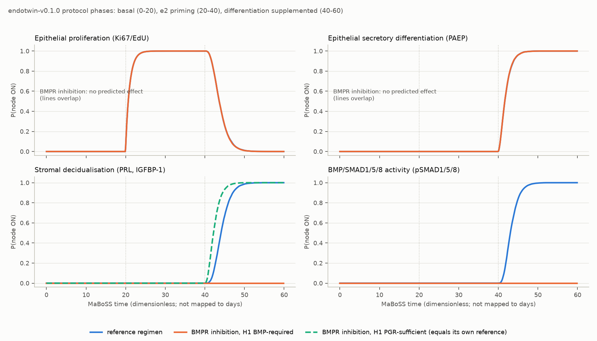
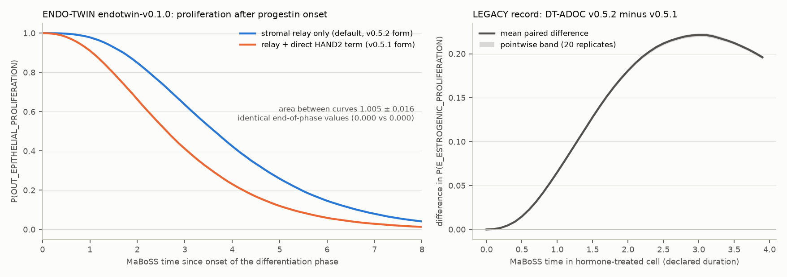

# ENDO-TWIN

**A mechanistic digital twin of human endometrial hormonal regulation in health and disease**

ENDO-TWIN is the computational component of an AEI PID2026 *Investigación
Orientada* project (Carlos Simón Foundation). It models how hormonal signals
coordinate epithelial and stromal differentiation in the human endometrium
during the proliferative-to-secretory transition. It also models how these
responses change under inflammation and in endometriosis, and tests the model's
predictions prospectively in ADOC, a human endometrium-on-chip.

> **ENDO-TWIN is not starting from an idea.** It builds on the prototype, a
> version-controlled MaBoSS prototype with eight model versions, a curated
> evidence base, completed simulation and identifiability studies and a test
> suite of 2,767 automated tests. That prototype is also critically evaluated:
> its own analyses document what it cannot yet distinguish. The grant supplies
> the experiments needed to turn this foundation into a prospectively tested
> mechanistic model.

## In two minutes

1. **The biological problem.** After oestrogen-driven proliferation,
   progesterone switches the endometrium to a secretory, decidualising state.
   The stroma decidualises (PRL, IGFBP-1), the epithelium stops proliferating
   and becomes secretory (PAEP). Which regulatory interactions *drive* these
   changes, rather than accompany them, and how the two compartments coordinate,
   remains unresolved. Decidualisation is impaired in the eutopic endometrium of
   women with endometriosis.
2. **Why ADOC.** ADOC combines organoid-derived epithelium and primary stroma in
   separately accessible microfluidic compartments with controlled inputs and
   compartment-resolved outputs. Perturbations can be applied, and responses
   read, per compartment. That is what a mechanistic model needs to tell
   competing mechanisms apart.
3. **Why stochastic Boolean modelling (MaBoSS).** Kinetic parameters for these
   pathways are unknown. A Boolean network encodes regulatory logic that can be
   traced to papers. MaBoSS adds stochastic dynamics, and competing hypotheses
   become alternative rules with different, testable predictions.
4. **What already exists** (section 1 and
   [`docs/RESEARCH_FOUNDATION_AUDIT.md`](docs/RESEARCH_FOUNDATION_AUDIT.md)):
   - a 56-node, 89-dependency executable network with exact structural analysis;
   - literature curation through screening (147 papers), registration (95
     Crossref-verified references) and edge-level grading (276 evidence rows);
   - integration of the published ADOC secreted-protein and single-cell data
     (28,212 cells);
   - pre-registered simulation studies and identifiability analyses;
   - and a frank record of what the prototype cannot do: no calibration, no
     validation, and alias classes that current assays cannot resolve.
5. **What ENDO-TWIN does next.** A new mainline model (`endotwin-v0.1.0`)
   recasts the network around the grant's two questions. **Q1:** is BMP/SMAD
   activity necessary for stromal decidualisation? **Q2:** does progesterone
   restrain epithelial proliferation through stromal paracrine signalling? Each
   question is executable as competing rules, and the model names the
   perturbation and readout that separate them. The grant then freezes a
   prediction, tests it in independent donors (WP2), extends the model to
   IL-1β-induced inflammation (WP3) and selects one intervention to test
   in inflammation and in patient-derived ADOCs (WP4).

---

## 1. Research foundation: quantitative dashboard

### Research and development completed before ENDO-TWIN

Every number is recomputed from committed files by
[`src/endotwin/foundation_metrics.py`](src/endotwin/foundation_metrics.py)
(`pixi run endotwin-metrics` writes
[`docs/research_foundation_metrics.json`](docs/research_foundation_metrics.json)),
and `tests/mainline/test_readme_dashboard.py` fails if this table and the JSON
disagree. Prototype figures refer to the version named; ENDO-TWIN figures to
`endotwin-v0.1.0`.

<!-- dashboard:start -->
| Category | Verified metrics |
|---|---|
| **Literature** | **129** candidate records from structured seed searches; **147** papers screened (2026-10-21 bundle; tiers A 52 / B 80 / C 15); a re-audit report covering a stated **163**-PDF corpus, with **36** papers enumerated in its recommended evidence set; **95** registered references, all **95** resolved against Crossref; **62** papers full-text inspected in the PDF manifest. The corpora overlap and are not summed |
| **Evidence provenance** | **276** edge-level evidence rows (one per edge, paper and experiment); **247** active rows on **85** edges citing **35** papers; **37** rows graded from full text on **27** edges; **74** of **85** declared v0.6.0 edges cite a non-review primary paper; **39** citation adjudications after full-text reading (**32** retractions, **7** attachments) |
| **Regulatory network** (prototype v0.6.0) | **56** nodes, **89** dependencies (**76** activating, **13** inhibitory); **29** distinct Boolean functions in **7** alias classes; **20** of 89 dependencies absorbed or never binding; **17** phenotype-inert nodes |
| **Boolean modelling** | **8** model versions (v0.1.0 to v0.6.0); **11** Gate 3a candidate rule variants; a **10**-member rule family evaluated; **14** candidate nodes adjudicated; **2** executable rules changed by the literature re-audit (v0.5.2 C1, C5) |
| **Experimental evidence** | ADOC secreted proteins: **62** rows, **39** observed values (PRL, IGFBP-1, PAEP); scRNA-seq E-MTAB-15842: **28,212** cells, **3** donors, **6** samples, **20,441** epithelial and **7,771** stromal cells, **7** cell-state labels |
| **Simulations and analyses** | **25** completed prototype analyses with committed results (including structural, identifiability, design, concordance, paired-transient, cascade and scRNA analyses) |
| **Sensitivity and identifiability** | Prototype: matched-unit design reaches **8** of 32 latent observation classes (v0.5.0); identifiability-driven design (v0.6.0) finds that no single perturbation de-aliases the model; transition-rate sensitivity not run. ENDO-TWIN: **720** of **720** steady-state predictions unchanged under **30** random rate sets |
| **Software verification** | **2,566** automated tests in this repository (**2,503** passed, **0** failed, **63** skipped); **2,767** at the prototype source commit; **2,415** on the 2026-10-16 benchmark |
| **Model evaluation** | Structural and software verification, and ordinal or directional comparison with ADOC data. **No calibration and no independent validation** (section 5) |
| **ENDO-TWIN mainline** | **19** nodes, **23** dependencies, **11** distinct Boolean functions; **3** competing-hypothesis families, **7** rule variants, **12** executable scenarios; **9** protocol conditions, **6** matched comparisons; all **312** simulated phases converge to their exact fixed points |
<!-- dashboard:end -->

"Declared dependencies" are not "effective dependencies", "named nodes" are not
"distinct functions", simulation runs are not biological replicates, and
software tests are not experimental validation.

---

## 2. From scientific literature to executable regulatory mechanisms

The prototype turned a large, heterogeneous literature into regulatory logic in
a staged, auditable way ([`docs/literature_curation.md`](docs/literature_curation.md)):

1. **Discovery and screening**: structured seed searches by mechanism, then a
   147-paper screen into evidence tiers.
2. **Full-text and figure-level reading**, with each PDF pinned by SHA-256
   (62 full-text inspected).
3. **Edge-level evidence**: one row per (edge, paper, experiment), recording
   species, system, perturbation, readout, controls and replicates. 37 rows were
   graded from full text for experimental strength, human/ADOC relevance and
   edge support. Of 27 graded edges, 5 have direct support.
4. **Adjudication**: 32 citations were retracted from edges the paper did not
   support (for example Kurihara 2007 never mentions HAND2) and 7 attached (for
   example the first human evidence for HAND2 repressing a stromal FGF).
5. **Re-audit and rule changes**: a literature-to-model reconciliation led to
   two executable changes (v0.5.2 C1, C5). Three times, the largest available
   structural gain was refused because the evidence did not support it.

ENDO-TWIN keeps the chain **paper -> finding -> interaction -> Boolean function
-> prediction -> readout** explicit, and gives every dependency an evidence
class ([`docs/scientific_evidence.md`](docs/scientific_evidence.md)). Three rules
from the executable network show the reasoning:

### Example 1: BMP signalling in stromal decidualisation (Q1)

```
S_BMP2      = (S_PGR and S_PKA) or S_NR2F2          // BMP2 ligand expression
S_BMP_SMAD  = S_BMP2 and not IN_BMPR_INHIBITOR       // receptor / SMAD1/5/8 activity
OUT_STROMAL_DECIDUALIZATION = S_PGR and S_PKA and S_BMP_SMAD and not S_IL1_SIGNALING
```

- **Mechanism and evidence.** SMAD1/5 knockdown impairs human decidualisation
  and BMP2 add-back rescues it (Liao et al. 2024). BMP2 enhances human stromal
  differentiation (Li et al. 2007). Uterine Bmp2 is required in mouse (Lee et
  al. 2007).
- **Modelling step.** the prototype refused a SMAD node, because without an
  independent determinant it would be an exact alias of BMP2. The BMP receptor
  inhibitor planned for WP1 is that determinant, so the node is now informative.
- **Assumptions.** Receptor availability and antagonists are not represented;
  the inhibitor acts on stroma only.
- **Competing hypothesis.** `Q1_pgr_sufficient` drops the BMP term.
- **Prediction and readout.** Under inhibition confirmed by pSMAD1/5/8, PRL and
  IGFBP-1 fall under the BMP-required rule and are unchanged under the
  PGR-sufficient rule, whatever the other hypotheses.

### Example 2: HAND2 and stromal control of epithelial proliferation (Q2)

```
S_HAND2             = S_BMP_SMAD or S_PGR
S_PARACRINE_MITOGEN = not S_HAND2
OUT_EPITHELIAL_PROLIFERATION = IN_E2 and S_PARACRINE_MITOGEN
```

- **Mechanism and evidence.** Progesterone induces stromal HAND2, which
  represses stromal FGFs and restrains epithelial proliferation (mouse; Li et
  al. 2011). In human stromal cells only FGF9 responds (Murata et al. 2019).
  That is evidence against an aggregate FGF node, so the node names a mechanism
  (`S_PARACRINE_MITOGEN`) rather than a ligand.
- **Assumptions.** The FGF-to-epithelium step is inferred in mouse, not shown.
- **Competing hypotheses.** An epithelial-autonomous rule
  (`IN_E2 and not E_PGR`), and the legacy v0.5.1 form with a redundant direct
  HAND2 term.
- **Predictions and readouts.** Stromal HAND2 knockdown raises Ki67/EdU only
  under the stromal hypotheses. Blocking the paracrine route discriminates only
  if it is applied during E2 priming.

### Example 3: IL-1β and decidualisation (provisional, WP3)

```
S_IL1_SIGNALING = IN_IL1B
S_PGR           = IN_PROGESTIN                         // default (variant: and not S_IL1_SIGNALING)
```

- **Evidence.** Four human stromal-cell studies report that IL-1β impairs
  decidualisation (PRL and IGFBP-1 reduced). The route is contested (ERK1/2 or
  JNK), and no NF-κB paper is in the corpus, so the node is generic IL-1
  receptor signalling. The papers outside the corpus were read at abstract
  level and DOI-verified.
- **Prediction and readout.** pSMAD1/5/8 separates a decidualisation-only
  effect from PGR depletion.

---

## 3. Experimental foundations and model–data integration

Details and every provenance caveat: [`docs/experimental_data.md`](docs/experimental_data.md).

**Published ADOC regimen** (Zaragozano et al. 2026): 48 h 10 nM E2, then 96 h
of E2 + 1 µM MPA + 250 µM 8-Br-cAMP + 10 µM XAV939. Its effects are
those of the whole supplement, not of ovarian hormones alone.

| Measurement | Assay | Data | Unit and provenance | Use |
|---|---|---|---|---|
| PRL | ELISA (manuscript Methods) | 18 rows: 10 observed, 8 not detected; days 0, 3, 6 | basal outlet, stromal-attributed; column-to-chip mapping lost | construction marker; provisional mapping |
| IGFBP-1 | ELISA (manuscript Methods) | 30 rows: 19 observed, 11 not detected; days 0, 3, 6 | apical and basal; compartment-ambiguous; chip mapping lost | diagnostic (non-inversion) |
| PAEP | ELISA per manuscript Methods; the source workbook does not name the assay | 14 rows: 10 observed, 4 missing; E2-only vs full regimen | outlet unverified | used to build the secretory rule, so agreement is circular |
| scRNA-seq E-MTAB-15842 | 10x single-cell RNA-seq | 28,212 cells; 3 donors × control/treated; 7 cell states | donor-level; states nearly determined by condition | node-support audit, KLF12 prior, RNA-endpoint concordance |

The manuscript reports three independent donors for the secreted-protein
measurements, but the committed data cannot reconstruct which donor each value
came from. Chips are not biological replicates.

**Construction versus evaluation.** The regimen, the scRNA expression programmes
and the three secreted markers were used to build the network. Only the
RNA-endpoint concordance was evaluation, and it found 0 concordant and 0
discordant predictions among 27 nodes.

**Embryo adhesion is not ENDO-TWIN data.** the prototype used the published adhesion
counts as an ordinal check. ENDO-TWIN uses them neither to build nor to validate
the model: in all three adhesion conditions every node reaches the same steady
state under all 12 hypothesis scenarios, so the data cannot separate them
([`docs/experimental_data.md`](docs/experimental_data.md), section 3).

**New data are planned, not generated.** ENDO-TWIN will produce 42
compartment-resolved bulk RNA-seq libraries, Ki67/EdU, pSMAD1/5/8 and viability
readouts. Schemas and validators are ready (`endotwin/config/data_schemas/`):
inferred deconvolution proportions are stored as relative state contributions,
never as cell fractions.

---

## 4. Completed simulations and mechanistic analyses

### prototype (legacy model versions, labelled)

| Analysis | Version | Result |
|---|---|---|
| Structural, identifiability and design audit | v0.5.0 | 59 nodes, 35 functions; a matched-unit design reaches 8 of 32 latent classes; PAEP and IGFBP-1 carry the same design information |
| Model-data concordance (60 curated rows) | v0.4.0 | 3 directional, 1 partial, 1 disagreement, 0 quantitative agreement |
| HAND2-relay paired transient (C5) | v0.5.1 vs v0.5.2 | Identical composed functions; proliferation difference +0.04 to +0.17 in 7 of 7 treated cells |
| Experiment selection, 112 candidate arms | v0.4.0, v0.5.1 | One prospective arm frozen (E2 dropout) |
| RNA-endpoint concordance | v0.5.1 | 0 concordant, 0 discordant of 27 nodes |

### ENDO-TWIN mainline (`endotwin-v0.1.0`)



> **Model predictions, `endotwin-v0.1.0`**, 10,000 trajectories, seed 1, unit
> rates, joint state carried across phases. Under BMP receptor inhibition the
> two Q1 hypotheses predict opposite decidualisation outcomes with the same
> pSMAD1/5/8 loss. Time is dimensionless. Not an observation. Data:
> `endotwin/results/endotwin-v0.1.0/dynamics_*.tsv`. Reproduce:
> `pixi run endotwin-all` (or `endotwin-simulate`, then `endotwin-figures`).

**Which experiment separates which hypothesis** (exact over all 12 rule-variant
scenarios; [`discrimination.tsv`](endotwin/results/endotwin-v0.1.0/discrimination.tsv)):

| Perturbation | Readout | Separates | Predicted directions |
|---|---|---|---|
| BMP receptor inhibition, differentiation phase | PRL, IGFBP-1 | Q1 BMP-required vs PGR-sufficient | down vs no change (robust) |
| Stromal HAND2 knockdown, differentiation phase | Ki67, EdU | Q2 stromal vs epithelial-autonomous | up vs no change (robust) |
| Paracrine-route block, **E2 priming** | Ki67, EdU | Q2 stromal vs epithelial-autonomous | down vs no change (robust) |
| Paracrine-route block, differentiation phase | Ki67, EdU | nothing | no change in every scenario |
| IL-1β, differentiation phase | pSMAD1/5/8 | INF decidual-only vs PGR depletion | no change vs down (robust) |

### A concrete mechanistic example: the HAND2 stromal relay



1. **Hypotheses.** Progesterone-HAND2 restrains epithelial proliferation only
   through a stromal relay (`IN_E2 and S_PARACRINE_MITOGEN`), or through the relay
   plus a direct term (`... and not S_HAND2`, the prototype v0.5.1 form).
2. **Boolean functions.** The two rules compute the same function (exhaustive
   check), so every steady state is identical.
3. **Simulation.** At progestin onset, 10 paired replicates of 5,000
   trajectories each: the relay keeps proliferation higher for longer. Area
   between the curves is 1.005 ± 0.016 (all 10 positive), half-times are 3.7 vs
   2.7 dimensionless units, and both end at 0.000. In 20 random sets of
   transition rates the delay persists every time. The prototype record (right
   panel, v0.5.2 minus v0.5.1, 20 replicates) shows the same effect in the
   prototype network.
4. **Why it matters.** An explicit intercellular relay carries a time cost.
   Steady-state readouts cannot reveal how a mechanism is wired; dynamics can.
5. **Discriminating measurement.** Time-resolved epithelial Ki67/EdU after
   progestin onset. The proposal plans no such time course, so this remains a
   model-generated hypothesis. It has not been tested biologically.

Reproduce: `pixi run endotwin-transient` and `pixi run endotwin-rate-sensitivity`,
then `pixi run endotwin-figures`.

---

## 5. Software verification and model evaluation

**Software correctness ≠ biological validation.** A large test suite shows
implementation maturity and reproducibility; it does not show that the
biological rules are correct.

| Suite | Tests | Outcome |
|---|---|---|
| This repository, `pixi run test` | 2,566 | 2,503 passed, 0 failed, 63 skipped (63 declared history-bound skips, 0 local-data skips) |
| of which ENDO-TWIN mainline (`pixi run endotwin-test`) | 97 | OK |
| Prototype at the source commit (fresh clone) | 2,767 | 2,757 passed, 1 failed, 9 skipped; all 10 non-passes need local-only data |
| Prototype benchmark, 2026-10-16 | 2,415 | OK (1 skip) |

The tests cover:
- Boolean-rule execution and exact structural identities, including an
  independent re-implementation that reproduces the recorded v0.6.0 counts;
- perturbation application and timing, including bit-identical pre-perturbation
  phases;
- joint-state carry-over across phases;
- seed reproducibility and seed spacing;
- the epithelial–stromal interface, where coupled compartment networks equal
  the integrated network;
- line-ending, data-manifest and provenance-digest guards;
- closed-phase immutability;
- regeneration of committed tables and figures;
- prediction freezing (tamper detection, donor-leakage and G3-selection guards);
- the planned data schemas.

Legacy checks that read the prototype Git history are skipped here with one
declared reason; they passed at the source commit. Details:
[`docs/software_verification.md`](docs/software_verification.md).

**Model evaluation** ([`docs/model_evaluation.md`](docs/model_evaluation.md)):

| Category | Meaning | Status |
|---|---|---|
| Structural verification | Internal properties of the model | Done (aliases, absorbed edges, identifiability, exact fixed points) |
| Software verification | Correct and reproducible execution | Done |
| Exploratory biological comparison | Consistency with available measurements | Prototype: ordinal or directional only; 0 quantitative agreement |
| Calibration | Parameters adjusted to observations | **Not done** |
| Independent validation | Predictions tested on withheld data | **Not done**; WP2 and WP4 |

---

## 6. Biological questions driving ENDO-TWIN

- **Q1, BMP-associated stromal decidualisation.** Is BMP/SMAD activity
  necessary for hormone-induced decidualisation? Or can progesterone-responsive
  pathways maintain it despite BMP inhibition? Readouts: pSMAD1/5/8 (target
  engagement), PRL, IGFBP-1.
- **Q2, stromal regulation of epithelial proliferation.** Does
  progesterone-associated suppression of epithelial proliferation depend on
  stromal paracrine signalling, or is it epithelial-autonomous? Readouts:
  Ki67, EdU. The ligand identity is left open.
- **Experimental groups.** G1, physiological reference (donors without known
  pathology). G2, IL-1β-induced inflammation in G1-type donors. G3,
  eutopic endometrium of women with ovarian endometriosis, without IL-1β.
  G2 is not assumed to reproduce G3.

## 7. Model architecture


> Default rules of `endotwin/models/endotwin-v0.1.0/network.bnd` (no
> simulation). Reproduce: `pixi run endotwin-figures`.

Five layers in one integrated MaBoSS model:
1. experimental inputs (E2, progestin, cAMP, XAV939, BMP receptor inhibitor,
   IL-1β);
2. epithelial intracellular regulation;
3. stromal intracellular regulation;
4. two intercompartmental signals (epithelial IHH, stromal paracrine mitogen);
5. three functional outputs (proliferation, secretory differentiation,
   decidualisation).

Code layout: [`src/endotwin/`](src/endotwin/) separates the network
(`model.py`, `structure.py`) from protocols (`protocols.py`), simulation
(`simulate.py`), analyses (`analysis.py`), the model–data contract
(`observations.py`), prediction freezing (`predictions.py`), data interfaces
(`data_interfaces.py`) and figures. The network can also be split into
stand-alone compartment networks behind a per-cell interface
(`regulatory_unit.py`). Full description: [`docs/model_construction.md`](docs/model_construction.md).

## 8. Current implementation status

| Component | Status |
|---|---|
| Prototype models v0.1.0–v0.6.0, analyses, evidence base | **Completed** (legacy, preserved) |
| `endotwin-v0.1.0` network, evidence table, lineage | **Implemented — exploratory**; not biologically validated |
| Exact structure, fixed-point predictions, discrimination table | **Computationally verified** |
| MaBoSS protocol simulation with joint carry-over, interventions, timing | **Computationally verified** |
| Q1, Q2 and inflammation hypotheses | **Implemented — exploratory**; IL-1β wiring provisional |
| Rate sensitivity | **Computationally verified** (steady state); transients rate-dependent |
| Prediction freezing and evaluation workflow (WP2, WP4) | **Implemented**; no prediction frozen yet |
| Bulk RNA-seq, deconvolution and functional-data interfaces | **Implemented** (schemas, validators); **no data yet** |
| Consistency with the published ADOC observations | **Supported by experimental observations** only for constructed rules (circular) |
| Calibration, prospective validation | **Planned** (WP1–WP4) |
| Multiscale (PhysiBoSS) coupling | **Future extension**, outside the funded plan |

## 9. Installation and execution

Requires [pixi](https://pixi.sh) on linux-64; `pixi.lock` pins Python 3.12, MaBoSS
0.8.15 (`cmaboss` backend), NumPy, pandas, matplotlib and ruff.

```bash
pixi install
pixi run endotwin-test          # ENDO-TWIN mainline tests (~10 s)
pixi run endotwin-all           # regenerate every mainline result, figure and the metrics (~3 min)
pixi run endotwin-simulate      # example simulation: reference and BMP-inhibition dynamics
pixi run test                   # complete suite, mainline and prototype (~35 min, single core)
pixi run lint && pixi run format-check
```

Example in Python:

```python
from endotwin.model import load_model
from endotwin.protocols import load_protocols
from endotwin.simulate import simulate_condition, SimulationSettings

model = load_model()                                   # endotwin-v0.1.0
protocols = load_protocols(model)
run = simulate_condition(model, protocols.conditions["bmpr_inhibition"],
                         protocols.interventions,
                         model.selection_from_ids(["Q1_pgr_sufficient"]),
                         SimulationSettings(sample_count=5000, seed=1))
run.final("differentiation_supplemented")["OUT_STROMAL_DECIDUALIZATION"]   # 1.0
```

(`PYTHONPATH=src`; the pixi tasks set it.) To freeze a prospective prediction:
fill in `endotwin/predictions/templates/wp2_prediction_spec.template.yaml`,
commit, and run `pixi run endotwin-freeze <spec>`.

## 10. Known limitations

- **No calibration and no validation.** No rate, threshold or magnitude is fitted.
  Every result is a conditional model prediction.
- **Inherited aliasing.** One progestin input drives every PGR-dependent node
  (a 7-member alias class). BMP inhibition now separates SMAD activity from it,
  but PGR, IHH, NR2F2 and HAND2 remain indistinguishable without
  compartment-specific perturbations.
- **Weak per-edge evidence for parts of the backbone.** Where graded, the
  IHH–NR2F2–BMP2 edges were not demonstrated by their cited papers.
- **XAV939 is read by no rule.** Its compartment and effect in ADOC are unknown.
- **Readouts.** PRL and IGFBP-1 map to one node, so their onset order cannot be
  represented. IGFBP-1 is compartment-ambiguous; the PAEP outlet is unverified.
  ADOC has no proliferation or pSMAD readout yet.
- **Time.** MaBoSS time is dimensionless. Transients depend on unknown rates;
  steady states do not.
- **Boolean outputs** cannot express graded or partial responses.
- **IL-1β wiring is provisional.** Three of its papers were read at abstract
  level only.
- **History-bound legacy checks** cannot run in this history-free repository
  (`docs/ORIGIN.md`).

## 11. Planned research and future extensions

| Work package | Plan | Repository support |
|---|---|---|
| WP1 (G1, 4 donors) | Qualify the regimen; compartment-resolved RNA-seq (24 libraries) and protein readouts; test BMP inhibition and one paracrine perturbation (Task 1.4); refine the network | Discrimination table, data schemas, observation map |
| WP2 (5 independent G1 donors) | One withheld perturbation; model version, predictions and criteria frozen before testing | `endotwin-freeze`, `endotwin-evaluate`, donor-leakage guard |
| WP3 (G2 n=5, G3 n=5) | Characterise IL-1β and endometriosis responses against G1 (18 libraries) | INF hypothesis family; G3 never used for selection |
| WP4 | Extend with G2 data, select one intervention, test in G2 (4 conditions) and G3 | Freezing workflow with a G2-only selection record |

Future (outside the grant): the architecture keeps a path to per-cell,
spatially explicit simulation with PhysiBoSS. The network loads independently,
compartments split behind explicit interfaces, and a per-cell regulatory-unit API
exists. Nothing multiscale is implemented
([`docs/architecture/future_multiscale_extension.md`](docs/architecture/future_multiscale_extension.md)).

## 12. Documentation map

| Question | Document |
|---|---|
| Where did this repository come from? | [`docs/ORIGIN.md`](docs/ORIGIN.md) |
| What was completed before ENDO-TWIN, and what may be claimed? | [`docs/RESEARCH_FOUNDATION_AUDIT.md`](docs/RESEARCH_FOUNDATION_AUDIT.md) |
| How was the literature curated? | [`docs/literature_curation.md`](docs/literature_curation.md) |
| Which evidence supports which rule? | [`docs/scientific_evidence.md`](docs/scientific_evidence.md) |
| How is the mainline model built? | [`docs/model_construction.md`](docs/model_construction.md) |
| Which data exist, and how reliable is their provenance? | [`docs/experimental_data.md`](docs/experimental_data.md) |
| How is the model evaluated? | [`docs/model_evaluation.md`](docs/model_evaluation.md) |
| How is the software verified? | [`docs/software_verification.md`](docs/software_verification.md) |
| Legacy prototype material | [`docs/legacy/README.md`](docs/legacy/README.md) |

## 13. References, acknowledgements and licence

Key references (full list with DOIs: [`endotwin/evidence/references.tsv`](endotwin/evidence/references.tsv)
and [`context/literature/references.tsv`](context/literature/references.tsv)):

- Zaragozano S, et al. Modeling human embryo adhesion using a microfluidic platform. *Sci Adv* 2026;12:eadz2249. doi:10.1126/sciadv.adz2249
- Liao Z, et al. Impaired BMP signaling pathways disrupt decidualization in endometriosis. *Commun Biol* 2024;7:227. doi:10.1038/s42003-024-05898-z
- Li Q, et al. Bone morphogenetic protein 2 functions via a conserved signaling pathway involving Wnt4 to regulate uterine decidualization. *J Biol Chem* 2007. doi:10.1074/jbc.M704723200
- Li Q, et al. The antiproliferative action of progesterone in uterine epithelium is mediated by Hand2. *Science* 2011. doi:10.1126/science.1197454
- Murata H, et al. Progestin-induced HAND2 inhibits angiopoietin 2 via FGF9 in human endometrial stromal cells. *Reprod Biol* 2019. doi:10.1016/j.repbio.2019.02.005
- Taylor RN, et al. Interleukin-1β induces and accelerates human endometrial stromal cell senescence and impairs decidualization via the JNK pathway. *Cell Death Discov* 2024;10:288. doi:10.1038/s41420-024-02048-6
- Stoll G, et al. MaBoSS 2.0: an environment for stochastic Boolean modeling. *Bioinformatics* 2017;33:2226–2228. doi:10.1093/bioinformatics/btx123

Software: MaBoSS and PyMaBoSS (installed dependencies). PROFILE and PROFILE_v2
were inspected as methodological references (`THIRD_PARTY_NOTICES.md`).

Developed at the Carlos Simón Foundation for Research in Women's Health. The
ADOC experimental data are from the group's published study. **Licence:** none
has been chosen yet; the repository is private. See `docs/ORIGIN.md` before any
redistribution of `data/`.
