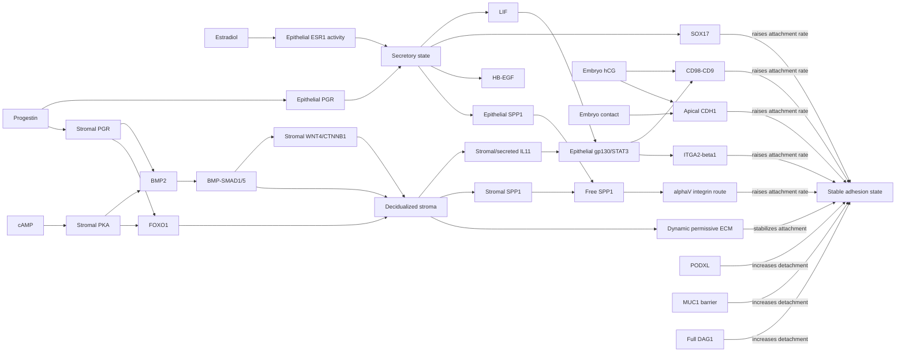
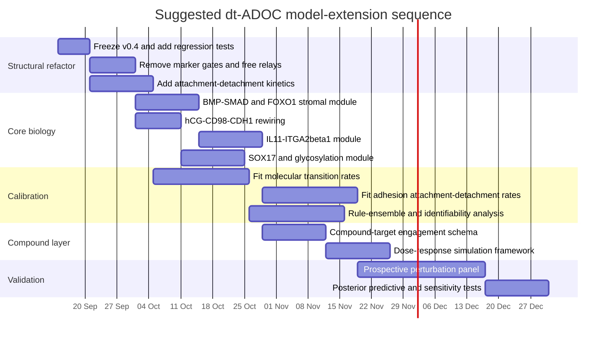

# Rigorous Review and Extension Strategy for `dt-ADOC_prototype` and the Current MaBoSS Embryo-Adhesion Model

## Executive summary

I reviewed the repository at its current `main` state on **11 September 2026**. The latest commit is `6bceaec7…`; its commit message states that it is a content-neutral merge, so the active scientific model remains **`adoc-literature-superset-v0.4.0`**. fileciteturn13file0L2-L2 The repository itself identifies this as a **59-node, 97-dependency** MaBoSS network intended to model hormone-conditioned human endometrial receptivity and stable embryo adhesion. fileciteturn12file0L2-L2

The central conclusion of this review is that **the model is already a useful mechanistic scaffold, but it is not yet a quantitative adhesion-probability model**. Its present absolute adhesion probability is dominated by four manually initialized relay variables rather than experimentally calibrated kinetics: the converged hormone-treated value of about **0.82** follows from the hand-set 0.70 SPP1 relay and 0.40 non-SPP1 relay, whereas the experimentally observed hormone-treated stable-adhesion fraction is **9/19 = 0.474**. The repository explicitly recognizes this and labels the active model *structural only*, not calibrated or biologically validated. fileciteturn12file0L2-L2 fileciteturn8file0L2-L2

The direct human ADOC data are unusually valuable for this problem. The 2026 Science Advances platform uses organoid-derived endometrial epithelium, primary stromal cells and human blastocysts and directly observes hormone-dependent embryo adhesion. citeturn12search1 In the repository, the experimental groups are 0/12 untreated, 9/19 hormone-treated and 1/8 hormone-treated plus mifepristone. fileciteturn20file0L2-L2 Exact 95% binomial confidence intervals are correspondingly broad: approximately **0–0.265**, **0.244–0.711** and **0.003–0.527**. Consequently, fitting to 0.474 exactly would overfit the assay.

My highest-priority recommendations are:

| Priority | Recommendation | Why it is more important than adding many more nodes |
|---|---|---|
| **P0** | Replace the hand-set adhesion relays with a **finite-time attachment/detachment hazard model** | Otherwise arbitrary compounds cannot generate meaningful quantitative changes in adhesion probability. |
| **P0** | Remove PAEP, PRL and IGFBP1 as mandatory causal gates of the phenotype and retain them as calibration observables | They are currently biomarkers/readouts, not demonstrated necessary causes of adhesion. |
| **P0** | De-alias stromal decidualization with **BMP-SMAD and FOXO1** pathway states and distinct PRL/IGFBP1 transition rates | Five progesterone-pathway nodes and six stromal outputs currently collapse into exact Boolean aliases. Human mechanistic data strongly support BMP-SMAD, WNT4 and FOXO1 as decidual regulators. citeturn10search9turn10search19turn11search2 |
| **P0** | Make the existing hCG input functional through CD98/CD9 and apical CDH1 | `IN_HCG` is currently unread, despite direct human experimental evidence linking hCG to CD98 and recent evidence linking embryo/hCG signaling to apical E-cadherin. citeturn10search3 |
| **P0/P1** | Add **IL11 → gp130/STAT3 → ITGA2β1/ECM** as a second experimentally supported adhesion pathway | Human primary epithelial experiments show IL11/LIF-dependent STAT3 signaling, α2-integrin induction and adhesion to fibronectin/collagen IV. citeturn10search1 |
| **P1** | Add **SOX17** and an explicit epithelial glycosylation/sLeX state | Both have direct human functional adhesion evidence. citeturn18search2turn18search0 |
| **P1** | Implement a compound-target layer in which dose modifies transition rates rather than simply switching Boolean nodes | This is necessary for dose-response prediction and for distinguishing partial inhibition from complete knock-out. MaBoSS explicitly supports node-specific transition rates and parameterized `.bnd`/`.cfg` models. citeturn15search0turn15search6 |
| **P2** | Add immune-cell modules only to an *in-vivo/implantation* extension, not the ADOC calibration model | ADOC contains epithelium and stroma but not uNK/macrophage/T-cell compartments; immune biology is real but would presently be unidentifiable. |

A particularly important modeling distinction is that the target quantity should initially be named something like:

\[
P(\text{stable adhesion after flush}\mid\text{ADOC protocol, embryo challenge, compound exposure})
\]

rather than “implantation probability” or “pregnancy probability.” Human implantation is a multistage epithelial, stromal and embryonic process extending beyond adhesion into invasion and post-implantation development. citeturn14search0turn12search2 Clinical transcriptomic “receptivity” is likewise not interchangeable with pregnancy prediction; in a randomized trial of 767 patients with euploid embryos, receptivity-test-guided transfer did not improve live birth compared with standard timing. citeturn20search0

**Confidence:** repository audit **9.5/10**; transcription of current rules **9.5/10**; biological pathway synthesis **8.5/10**; ranking of additions **8/10**; exact proposed Boolean rules **6.5/10** because several are deliberately testable modeling hypotheses rather than uniquely established biological equations; quantitative compound prediction from the current data **5.5/10** until new perturbation data are generated. **Overall confidence: 8/10.**

## Repository and current model audit

The repository is considerably more mature in provenance and model-governance terms than the phrase “prototype” might suggest. Its explicit objective is a stochastic Boolean digital-twin framework combining the ADOC hormone-response experiments, donor-resolved single-cell RNA-seq, secreted proteins and mechanistic literature. The repository correctly states that **no fitted or validated contraceptive target currently exists**. fileciteturn12file0L2-L2

The principal repository structure is:

| Path / format | Function |
|---|---|
| `models/` | Versioned MaBoSS networks and condition files |
| `models/superset/adoc-literature-superset-v0.4.0/network.bnd` | Active Boolean topology and logical rules |
| `baseline.cfg`, `conditions/*.cfg` | Initial states, simulation settings and experimental perturbations |
| `node_dictionary.tsv` | Node-to-biological-entity mapping, evidence and uncertainty |
| `topology.tsv`, `edge_evidence.tsv` | Executable dependencies and provenance |
| `complete_nodes.tsv`, `complete_edges.tsv`, `modules.tsv` | Structural model inventory |
| `rule_variants.tsv`, `ensemble_definition.tsv` | Alternative logical hypotheses |
| `drug_target_catalog.tsv` | Current compound/target intervention catalog |
| `phenotype_contract.tsv`, `interface_contract.tsv` | Output and embryo-interface semantics |
| `unresolved_mechanisms.tsv` | Candidate mechanisms deliberately excluded from execution |
| `provenance.toml` | Generator/version/hashes/claim boundary and simulation defaults |
| `context/literature/*.tsv` | Literature candidates, edges, mechanisms and references |
| `config/*.yaml`, `*.tsv` | Protocol, calibration, observation mapping and data lineage |
| `data/` | Immutable experimental/source data |
| `src/`, `scripts/`, `tests/` | Model generation, analysis and deterministic validation |
| `.mmd`, `.png`, `.gif`, `.json` | Structural/visualization artifacts and metadata |

The repository's own architecture document defines the intended abstraction as coupled epithelium and stroma, with the embryo initially represented as an external adhesion challenge rather than as a full third cellular model. It also explicitly prohibits inferring edges or kinetic rates directly from expression data. fileciteturn20file0L2-L2 This is the correct boundary for the current ADOC assay.

The exact structural diagnostics are unusually informative: **59 nodes, 97 dependencies, 19 free variables, 40 derived nodes, maximum logical depth 11, only 35 distinct Boolean functions, 8 exact-alias classes, 14 phenotype-inert nodes, 3 unread inputs and only 2 nodes with activated ADOC observation mappings**. fileciteturn18file0L2-L2

The largest problems are therefore not simply “missing biology.” They are **structural degeneracy and parameter non-identifiability**:

| Current property | Consequence |
|---|---|
| `E_PGR = E_IHH = S_PGR = S_NR2F2 = S_BMP2` as Boolean functions | An apparently multi-step epithelial→stromal progesterone cascade behaves as one variable at fixed point. fileciteturn18file0L2-L2 |
| `E_SECRETORY_STATE`, PAEP, PC6, SPP1, HBEGF, ANXA2, MUC1-sLeX, cleaved DAG1 and integrins occupy a large alias class | Many “different mechanisms” cannot respond independently to perturbations. fileciteturn18file0L2-L2 |
| `S_DECIDUALIZED`, PRL, IGFBP1, stromal SPP1 and TAZ are exact aliases | The experimentally reported difference in temporal appearance of IGFBP1 versus PRL cannot emerge from the model. fileciteturn12file0L2-L2 |
| `E_RECEPTIVE_SURFACE = OUT_EPITHELIAL_RECEPTIVE` | The phenotype wrapper contributes no independent biology. fileciteturn18file0L2-L2 |
| 14 nodes are phenotype-inert | Several biologically interesting nodes cannot change any model output under any clamp. fileciteturn18file0L2-L2 |
| `IN_XAV939`, `IN_HCG`, `IN_EMBRYO_CONDITIONED_SIGNAL` are unread | Three experimental/interface inputs literally do not influence the executable network. fileciteturn18file0L2-L2 |
| PODXL, full-length DAG1 and MUC1 barrier inhibitions are mathematically never binding | The supposedly anti-adhesive mechanisms cannot independently lower the phenotype in the current topology. fileciteturn18file0L2-L2 |
| No node-specific transition rates are declared | MaBoSS time has no calibrated correspondence to hours or days. fileciteturn8file0L2-L2 |
| Four relay states are initialized by hand | Graded endpoint probabilities largely come from chosen priors rather than experimentally inferred molecular stochasticity. fileciteturn9file0L2-L2 |

Baseline states are almost all OFF. The exceptions are the manually probabilistic latent relays: `X_MECHANICAL_STRESS_RELAY` has 0.30 probability ON, `X_INTERFACE_SPP1_RELAY` 0.70, `X_INTERFACE_REDUNDANT_RELAY` 0.40 and `X_INTERFACE_ANTIADHESIVE_RELAY` 0.20. fileciteturn9file0L2-L2 In the hormone-treated adhesion challenge, E2, progestin, cAMP, XAV939, embryo-present, trophectoderm-competent and contact are all set TRUE. fileciteturn21file0L2-L2 Thus **XAV939 is experimentally present but mechanistically invisible** in the current network.

The current topology file also contains three dependencies explicitly marked *unprovenanced*: `IN_E2 → E_ESTROGENIC_PROLIFERATION`, `E_SECRETORY_STATE → E_ITGAVB3_5`, and `S_PKA → S_BMP2`. fileciteturn10file0L2-L2 These deserve explicit ensemble testing rather than quiet retention as if equivalent to the better-supported edges.

Finally, there is a practical MaBoSS engineering issue. The standard MaBoSS build documented by the project supports networks up to **64 nodes** unless built with a larger `MAXNODES` value. citeturn15search0 Because the current model already has 59 nodes, blindly adding ten or twenty candidates is undesirable both biologically and computationally. A better v0.5 strategy is to **retire four artificial relay nodes while adding approximately six to eight high-information biological nodes**, keeping the first revised model near the existing size.

**Confidence: 9.5/10.**

## Complete current node and logical-rule inventory

The following table transcribes the active `network.bnd` rule set and maps each node to its intended biological abstraction using the repository's node dictionary. fileciteturn3file0L2-L2 fileciteturn6file0L2-L2 fileciteturn5file0L2-L2 `self` means that the node is an externally maintained/free Boolean variable.

| Node | Compartment / biological interpretation | Current logical rule |
|---|---|---|
| `IN_E2` | External estradiol treatment | `IN_E2` |
| `IN_PROGESTIN` | External progesterone/progestin treatment | `IN_PROGESTIN` |
| `IN_cAMP` | External cAMP decidualization stimulus | `IN_cAMP` |
| `IN_XAV939` | WNT-pathway inhibitor used in the ADOC conditioning protocol | `IN_XAV939` |
| `IN_MIFEPRISTONE` | Progesterone-receptor antagonist perturbation | `IN_MIFEPRISTONE` |
| `IN_ANTI_SPP1` | Neutralization/removal of available osteopontin | `IN_ANTI_SPP1` |
| `IN_EMBRYO_PRESENT` | Presence of embryo during challenge | `IN_EMBRYO_PRESENT` |
| `IN_TROPHECTODERM_COMPETENT` | Coarse embryo/trophectoderm competence gate | `IN_TROPHECTODERM_COMPETENT` |
| `IN_EMBRYO_CONTACT` | Physical embryo–epithelial contact | `IN_EMBRYO_CONTACT` |
| `IN_HCG` | Embryo-derived hCG cue | `IN_HCG` |
| `IN_EMBRYO_CONDITIONED_SIGNAL` | Generic embryo-conditioned signal | `IN_EMBRYO_CONDITIONED_SIGNAL` |
| `IN_HAND2_LOSS` | HAND2 loss-of-function intervention | `IN_HAND2_LOSS` |
| `IN_ER_STRESS_EXCESS` | Pathologically excessive stromal ER stress | `IN_ER_STRESS_EXCESS` |
| `IN_HIGH_ECM_STIFFNESS` | Pathologically stiff endometrial/ECM state | `IN_HIGH_ECM_STIFFNESS` |
| `E_PGR` | Epithelial progesterone-receptor activity | `IN_PROGESTIN and not IN_MIFEPRISTONE` |
| `E_IHH` | Epithelial Indian hedgehog | `E_PGR` |
| `E_SECRETORY_STATE` | Aggregate hormone-induced epithelial secretory differentiation | `IN_E2 and E_PGR` |
| `E_PAEP` | Epithelial PAEP/glycodelin; ADOC-measured readout | `E_SECRETORY_STATE` |
| `E_KLF12_HIGH` | High KLF12 anti-receptive state | `E_KLF12_HIGH` |
| `E_LIF` | Epithelial/glandular leukemia inhibitory factor | `E_SECRETORY_STATE and not E_KLF12_HIGH` |
| `E_GP130_STAT3` | Epithelial LIFR/gp130→STAT3 pathway activity | `E_LIF` |
| `E_ESTROGENIC_PROLIFERATION` | Persistent estrogen-driven epithelial proliferative state | `IN_E2 and S_FGF_MITOGENIC and not S_HAND2` |
| `E_PODXL` | Apical podocalyxin anti-adhesive barrier | `not E_SECRETORY_STATE` |
| `E_PC6` | PCSK5/proprotein convertase 5/6 | `E_SECRETORY_STATE` |
| `E_DAG1_FULL` | Full-length α-dystroglycan, modeled as anti-adhesive barrier | `not E_PC6` |
| `E_DAG1_CLEAVED` | PC6-cleaved α-dystroglycan, modeled as permissive | `E_PC6` |
| `E_MUC1_BARRIER` | Nonpermissive MUC1 glycocalyx state | `not E_SECRETORY_STATE` |
| `E_MUC1_SLEX` | Glyco-permissive MUC1/sialyl-Lewis-X-like state | `E_SECRETORY_STATE` |
| `E_HBEGF` | Epithelial HB-EGF | `E_SECRETORY_STATE` |
| `E_SPP1_EXPR` | Epithelial SPP1/osteopontin expression | `E_SECRETORY_STATE` |
| `E_ITGAVB3_5` | Aggregate epithelial αVβ3/αVβ5 integrin state | `E_LIF or E_HBEGF or E_SECRETORY_STATE` |
| `E_CD98_CD9` | CD98/SLC3A2–CD9 adhesive microdomain | `E_GP130_STAT3` |
| `E_ANXA2_ACTIN` | Annexin-A2/RHOA/F-actin adhesive remodeling | `E_SECRETORY_STATE` |
| `E_CDH1_APICAL` | Free-apical E-cadherin/CTNND1 adhesive state | `IN_EMBRYO_CONTACT` |
| `E_RECEPTIVE_SURFACE` | Composite latent epithelial adhesive surface | `E_GP130_STAT3 and not E_PODXL and not E_DAG1_FULL and not E_MUC1_BARRIER and not E_ESTROGENIC_PROLIFERATION and (E_CD98_CD9 or E_CDH1_APICAL or E_ANXA2_ACTIN or E_HBEGF or E_DAG1_CLEAVED or E_MUC1_SLEX or E_ITGAVB3_5 or X_SPP1_LUMEN_FREE)` |
| `S_PGR` | Stromal progesterone-receptor activity | `IN_PROGESTIN and not IN_MIFEPRISTONE` |
| `S_PKA` | cAMP/PKA activity | `IN_cAMP` |
| `S_NR2F2` | Stromal COUP-TFII/NR2F2 | `E_IHH and S_PGR` |
| `S_BMP2` | Stromal BMP2 state | `(S_PGR and S_PKA) or S_NR2F2` |
| `S_HAND2` | Stromal HAND2 | `(S_BMP2 or S_PGR) and not IN_HAND2_LOSS` |
| `S_FGF_MITOGENIC` | Aggregate stromal mitogenic FGF output | `not S_HAND2` |
| `S_DECIDUALIZED` | Aggregate decidualized stromal state | `S_PGR and S_PKA and S_BMP2` |
| `S_PRL` | Prolactin decidual marker | `S_DECIDUALIZED` |
| `S_IGFBP1` | IGFBP1 decidual marker; ADOC-measured | `S_DECIDUALIZED` |
| `S_SPP1` | Stromal/decidual osteopontin | `S_DECIDUALIZED` |
| `S_TAZ_ECM` | WWTR1/TAZ-associated stromal ECM-remodeling program | `S_DECIDUALIZED` |
| `X_MECHANICAL_STRESS_RELAY` | Manually probabilistic mechanical uncertainty relay | `X_MECHANICAL_STRESS_RELAY` |
| `X_MECHANICAL_PERMISSIVE_ECM` | Mechanically permissive decidual ECM | `S_DECIDUALIZED and S_TAZ_ECM and not ((IN_ER_STRESS_EXCESS or IN_HIGH_ECM_STIFFNESS) and X_MECHANICAL_STRESS_RELAY)` |
| `X_SPP1_LUMEN_FREE` | Free epithelial/stromal SPP1 pool available at interface | `(E_SPP1_EXPR or S_SPP1) and not IN_ANTI_SPP1` |
| `X_INTERFACE_SPP1_RELAY` | Manually probabilistic SPP1-interface relay | `X_INTERFACE_SPP1_RELAY` |
| `X_INTERFACE_REDUNDANT_RELAY` | Manually probabilistic assumed non-SPP1 adhesion relay | `X_INTERFACE_REDUNDANT_RELAY` |
| `X_INTERFACE_ANTIADHESIVE_RELAY` | Manually probabilistic anti-adhesion relay | `X_INTERFACE_ANTIADHESIVE_RELAY` |
| `X_ADHESION_ROUTE_SPP1` | SPP1-integrin adhesive route | `E_RECEPTIVE_SURFACE and X_SPP1_LUMEN_FREE and E_ITGAVB3_5 and X_INTERFACE_SPP1_RELAY` |
| `X_ADHESION_ROUTE_REDUNDANT` | Aggregate non-SPP1 adhesive route | `E_RECEPTIVE_SURFACE and (E_CD98_CD9 or E_CDH1_APICAL or E_ANXA2_ACTIN or E_HBEGF or E_DAG1_CLEAVED or E_MUC1_SLEX) and X_INTERFACE_REDUNDANT_RELAY` |
| `X_ANTIADHESIVE_ROUTE` | Aggregate PODXL/DAG1/MUC1 barrier route | `(E_PODXL or E_DAG1_FULL or E_MUC1_BARRIER) and X_INTERFACE_ANTIADHESIVE_RELAY` |
| `OUT_EPITHELIAL_RECEPTIVE` | Declared epithelial-receptivity output | `E_RECEPTIVE_SURFACE and E_PAEP` |
| `OUT_STROMAL_DECIDUALIZED` | Declared stromal-decidualization output | `S_DECIDUALIZED and S_PRL and S_IGFBP1` |
| `OUT_MATERNAL_ADHESION_COMPETENCE` | Maternal competence for stable adhesion | `OUT_EPITHELIAL_RECEPTIVE and S_DECIDUALIZED and X_MECHANICAL_PERMISSIVE_ECM and (X_ADHESION_ROUTE_SPP1 or X_ADHESION_ROUTE_REDUNDANT) and not X_ANTIADHESIVE_ROUTE` |
| `OUT_STABLE_ADHESION` | Stable embryo-adhesion phenotype | `OUT_MATERNAL_ADHESION_COMPETENCE and IN_EMBRYO_PRESENT and IN_TROPHECTODERM_COMPETENT and IN_EMBRYO_CONTACT` |

Several rule-level observations follow directly from this inventory.

First, `E_ITGAVB3_5 = E_LIF OR E_HBEGF OR E_SECRETORY_STATE` makes the LIF and HB-EGF routes largely irrelevant whenever the secretory state is ON. That is exactly the type of Boolean absorption that the structural audit detects. fileciteturn18file0L2-L2

Second, `S_BMP2 = (S_PGR AND S_PKA) OR S_NR2F2`, combined with `S_NR2F2 = E_IHH AND S_PGR` and `E_IHH = E_PGR = S_PGR` under the same external progestin/mifepristone inputs, causes `S_NR2F2` to bypass much of the intended cAMP dependence. This explains the five-node progesterone alias class. fileciteturn18file0L2-L2

Third, PAEP is used both as an ADOC calibration observation and a hard prerequisite for `OUT_EPITHELIAL_RECEPTIVE`; PRL and IGFBP1 are similarly hard requirements for the stromal output. The repository's own biological framing treats these primarily as experimentally observed molecular readouts. fileciteturn20file0L2-L2 I recommend separating **causal phenotype logic from observation-model logic**.

Fourth, anti-adhesive factors are required to be OFF upstream of `E_RECEPTIVE_SURFACE`, then appear again through `X_ANTIADHESIVE_ROUTE`. Because of this double conditioning, their downstream inhibition cannot become binding. The structural metadata confirms that the PODXL, full-DAG1 and MUC1 inhibitions and the final antiadhesive-route inhibition are never binding. fileciteturn18file0L2-L2

**Confidence: 9.5/10.**

## Literature synthesis for embryo adhesion and implantation biology

A useful organizing principle is to distinguish **endometrial differentiation**, **surface permissiveness**, **initial embryo–epithelial adhesion**, **stabilization/remodeling**, and **post-attachment invasion**. The current model is strongest for the first three and should not yet try to represent all later implantation biology. The 2023 Development review of human implantation emphasizes the coordinated embryonic and maternal stages, while the 2026 human implantation platforms now experimentally expose embryo–endometrium interactions that were previously inaccessible. citeturn14search0turn12search2turn12search0

| Mechanistic area | Evidence synthesis | Consequence for this model |
|---|---|---|
| **Steroid conditioning** | E2 and progesterone establish epithelial and stromal states, but progesterone actions are compartment-specific. Human PODXL is progesterone-responsive, while stromal decidualization requires progesterone plus cAMP and downstream transcriptional remodeling. citeturn19search0turn10search4 | Keep distinct epithelial and stromal PGR nodes. Add an ESR1 pathway state if estrogen-targeting compounds are to be screened. Avoid representing hormones only as direct switches of all downstream biology. |
| **PGR–IHH–NR2F2–BMP/HAND2** | This is an important uterine cross-compartment framework, but much of its strongest causal ordering comes from mouse genetics. Human stromal HAND2 and BMP/WNT/FOXO1 data strengthen parts of the pathway but do not justify collapsing the entire chain into one Boolean function. The repo itself labels substantial species-transfer uncertainty. fileciteturn16file0L2-L2 | Retain the biological backbone but de-alias it with kinetics and human-supported downstream pathway states. |
| **BMP/SMAD–WNT4–FOXO1 decidualization** | In primary human stromal cells, BMP2 induces WNT4; WNT4 knockdown impairs differentiation and WNT4 overexpression advances it. FOXO1 is an early PKA-regulated decidual factor and is required for progesterone-receptor occupancy at many genomic sites. Human endometriosis assembloids further show impaired BMP/SMAD signaling and rescue of decidual markers by BMP2. citeturn10search19turn10search9turn11search2 | **Highest-value missing stromal mechanism.** Add BMP-SMAD and FOXO1 before adding many peripheral markers. |
| **LIF/gp130/STAT3** | LIF remains a foundational implantation pathway, especially from genetic mouse evidence; in human epithelium, LIF activates STAT3 and increases adhesion to ECM. citeturn10search1 | Keep `E_GP130_STAT3`, but test a “hard LIF gate” and “soft/modulatory LIF route” as alternative model variants rather than assuming human adhesion is absolutely LIF-dependent. |
| **IL11** | In primary human endometrial epithelial cells, IL11 and LIF increase adhesion to fibronectin/collagen IV and act through STAT3; both induce α2-integrin, and IL11 increases trophoblast-to-epithelial adhesion. citeturn10search1 IL11 also affects human stromal decidualization. | Add an extracellular/stromal IL11 branch and `E_ITGA2B1`; this provides a biologically identified alternative to the hand-set “redundant relay.” |
| **SPP1–integrins** | SPP1/osteopontin and αV-containing integrins are well-established receptive-phase candidates, but αVβ3 is not a unique universal receptivity marker, and clinical/tissue associations vary. Human data support an adhesive role while indicating multiple integrin systems. citeturn16search9turn16search11 | Retain SPP1–αV integrin route but do not make it the sole adhesion mechanism. Add α2β1/ECM and keep ITGB1 candidates as independent routes. |
| **CD98/CD9** | Human primary epithelial CD98 is apically localized in the implantation window; hCG, E2, LIF and EGF induce it, and gain/loss experiments alter blastocyst adhesion. citeturn10search3 | The current CD98 node is well chosen, but its rule is too narrow. Wire the already-present `IN_HCG` to it. |
| **Apical E-cadherin** | Recent human work identifies free-apical CDH1/CTNND1 binding as an important embryo–endometrium adhesion mechanism; this is much more specific than treating all epithelial E-cadherin as the same junctional state. | Keep the specialized `E_CDH1_APICAL` abstraction, but change it from a trivial alias of `IN_EMBRYO_CONTACT` into an inducible effector influenced by embryo/hCG signaling. |
| **ANXA2/RHOA/F-actin** | Human epithelial ANXA2 inhibition reduces embryo/trophoblast adhesion, and ANXA2 regulates RHOA/ROCK/F-actin remodeling. citeturn10search14 | Excellent rate-modifying route, but not a sensible all-or-none hard gate. |
| **PODXL** | PODXL is one of the strongest human anti-adhesive surface candidates: it is selectively downregulated in receptive luminal epithelium, progesterone suppresses it, overexpression reduces attachment, and luminal positivity was associated with lower clinical pregnancy in a prospective-biopsy cohort. citeturn19search0turn19search1 | Retain PODXL, but make it increase detachment/decrease attachment rate rather than requiring it to be OFF twice in nested Boolean gates. |
| **MUC1 and surface glycans** | A binary “MUC1 bad” rule is too crude. Implantation depends on glycoform and local context. ST3GAL3 promotes sLeX production and endometrial adhesive capacity, and IL1β can induce FUT3→sLeX and trophoblast adhesion. citeturn18search0turn18search8 | Replace `E_MUC1_SLEX = E_SECRETORY_STATE` with an explicit surface-glycosylation state; do not assume all MUC1 disappears during receptivity. |
| **SOX17** | In human epithelial models, E2+progesterone increases SOX17; SOX17 accumulates near trophoblast contact, and CRISPR knockdown or chemical SOX-F inhibition strongly reduces spheroid adhesion. citeturn18search2 | High-priority new epithelial node with unusually direct functional evidence. |
| **JAG1/NOTCH3** | JAG1 is reduced in infertile receptive endometrium; JAG1 knockdown in primary human epithelial cells and Ishikawa cells reduces trophoblast-spheroid adhesion and affects NOTCH3/HEY1 signaling. citeturn18search1 | Strong P1 addition, particularly if Notch-directed compounds are in scope. |
| **Biochemical ECM** | Human epithelial adhesion involves fibronectin and collagen IV; COL4A1 knockdown itself impairs epithelial adhesive capacity. citeturn10search1turn18search10 | Current model contains mechanics but almost no biochemical ECM. Add a compact `X_ECM_FN1_COL4` state before many individual ECM genes. |
| **Mechanical ECM and ER stress** | The 2026 stromal nanomechanics study links proper decidualization to coordinated ER stress, senescence and mechanical remodeling; excessive ER stress creates a mechanically abnormal state and impairs trophoblast adhesion/expansion. citeturn20search1 | Current ER-stress/stiffness branch is directionally well motivated, but its stochastic relay should be replaced by a measurable mechanical rate/state. |
| **Decidual senescence** | Acute decidual senescence can contribute to transient inflammatory remodeling and is normally cleared by IL15-activated uterine NK cells. citeturn10search18 | A single Boolean “senescence good/bad” state is dangerous. Represent acute senescence plus persistence/clearance only in a time-resolved extension. |
| **TGFβ/SMAD** | Human evidence is genuinely context-dependent: TGFβ1 has been reported to activate ERK/SMAD and decidual features, but another primary stromal study found TGFβ1 suppresses PRL/IGFBP1. citeturn11search16turn11search9 BMP signaling, itself a TGFβ-superfamily branch, has more consistently useful human decidual evidence. citeturn11search2 | Do **not** create one simple “TGFβ = pro-receptive” Boolean edge. Use an ensemble or a pathological-high-TGFβ state. |
| **PI3K/AKT** | PI3K/AKT effects are also context-sensitive. In adenomyosis stromal cells, aberrant AKT activation promotes FOXO1 loss and decidual failure; human decidualization studies suggest that signaling balance, not simply “AKT ON,” matters. citeturn10search5turn10search7 | Prefer an `S_AKT_EXCESS` inhibitory modifier of FOXO1 over a generic positive AKT node in the first extension. |
| **MAPK** | ERK1/2 contributes to stromal decidualization and can intersect TGFβ/HB-EGF/LIF signaling. citeturn14search14turn11search16 | Add MAPK only after BMP/FOXO1/IL11 unless a tested compound directly targets the pathway. |
| **Embryo-derived signals** | Human blastocysts secrete signals capable of changing epithelial adhesion; for example embryo-secreted miRNAs can alter maternal epithelial adhesion, while CD98 responds to hCG. citeturn10search2turn10search3 | Replace the generic embryo-signal input progressively with measurable embryo signals. If compounds remain present during embryo challenge, an embryo-side module becomes necessary. |
| **Immune compartment** | uNK, macrophages and T cells influence implantation and stromal remodeling, but these cells are not present in the present ADOC system. Human RIF datasets also implicate altered immune states. citeturn10search18turn20search2 | Keep immune biology outside the **ADOC-calibrated adhesion model**. Add it later as an in-vivo/clinical extrapolation layer. |

One especially important conceptual point concerns WNT. Human stromal WNT4/β-catenin has strong decidualization evidence, while **XAV939 is already a component of the epithelial-conditioning ADOC protocol**. fileciteturn20file0L2-L2 It would therefore be unsafe to wire `IN_XAV939` directly as a global inhibitor of all stromal WNT signaling. The model first needs to establish which ADOC compartment receives XAV939, what its effective local exposure is and which WNT-dependent states it changes. The 2026 organoid literature further reinforces that WNT inhibition can affect epithelial hormone responses. citeturn16search8 Thus **epithelial WNT inhibition and stromal WNT4-dependent decidualization should be separate variables**.

The recent single-cell literature is also highly relevant but should be used correctly. Wang et al. found an abrupt epithelial transcriptional transition around the human implantation window accompanied by widespread stromal decidualization. citeturn13search0 HECA now integrates 313,527 single cells from 63 women plus an independent 312,246-nucleus dataset and identifies strong stromal–epithelial communication, including TGFβ-related signaling. citeturn13search4 Koel et al. profiled paired pre-receptive/receptive samples from 16 women and identified 558 prioritized embryo–endometrium interactions, highlighting SPP1, LGALS1/3, ITGB1 and BSG. citeturn13search1 These are excellent sources for **expression plausibility, compartment assignment and candidate prioritization**, but not sufficient evidence by themselves for a Boolean causal edge.

A compact set of priority literature links is below.

| Source | Why prioritize it | Link |
|---|---|---|
| Zaragozano et al., Science Advances 2026 | Direct ADOC human adhesion system; closest match to model phenotype | [PubMed 42430472](https://pubmed.ncbi.nlm.nih.gov/42430472/) citeturn12search1 |
| Muter et al., Development 2023 | High-quality synthesis of human implantation biology | [PubMed 37254877](https://pubmed.ncbi.nlm.nih.gov/37254877/) citeturn14search0 |
| Molè et al., Cell 2026 | Human embryo implantation in engineered receptive endometrium | [PubMed 41443191](https://pubmed.ncbi.nlm.nih.gov/41443191/) citeturn12search2 |
| Li et al., Cell 2026 | 3D implantation/endometrioid model including RIF and compound screening | [PubMed 41443192](https://pubmed.ncbi.nlm.nih.gov/41443192/) citeturn12search0 |
| Dominguez et al., PLoS ONE 2010 | Direct functional CD98/CD9 adhesion experiments | [PubMed 20976164](https://pubmed.ncbi.nlm.nih.gov/20976164/) citeturn10search3 |
| Garrido-Gómez et al., FASEB J 2012 | ANXA2→RHOA/F-actin and adhesion | [PubMed 22645245](https://pubmed.ncbi.nlm.nih.gov/22645245/) citeturn10search14 |
| Dimitriadis group, 2009 | IL11/LIF→STAT3→integrin/ECM adhesion | [PubMed 19213836](https://pubmed.ncbi.nlm.nih.gov/19213836/) citeturn10search1 |
| Wang et al., SOX17 | Direct human SOX17 adhesion perturbation | [PubMed 31664088](https://pubmed.ncbi.nlm.nih.gov/31664088/) citeturn18search2 |
| Paule et al., PODXL | Human anti-adhesive luminal surface mechanism | [PubMed 33822049](https://pubmed.ncbi.nlm.nih.gov/33822049/) citeturn19search0 |
| WNT4/BMP2 human decidualization | Strong human causal stromal pathway | [PubMed 23142810](https://pubmed.ncbi.nlm.nih.gov/23142810/) citeturn10search19 |
| FOXO1/PR cistrome | Mechanistic human decidualization regulator | [PubMed 25584414](https://pubmed.ncbi.nlm.nih.gov/25584414/) citeturn10search9 |
| HECA 2024 | Best large integrated human endometrial cell-state reference | [PubMed 39198675](https://pubmed.ncbi.nlm.nih.gov/39198675/) citeturn13search4 |
| Koel et al. 2022 | Compartment-specific embryo/endometrium interaction candidates; GSE97929 | [PubMed 36339249](https://pubmed.ncbi.nlm.nih.gov/36339249/) citeturn13search1 |
| Schafir et al. 2026 | ER stress, nanomechanics and trophoblast adhesion | [PubMed 42286790](https://pubmed.ncbi.nlm.nih.gov/42286790/) citeturn20search1 |

**Confidence: 8.5/10.** Confidence is highest for the direct human adhesion mechanisms and lower for transferring mouse uterine genetic networks into a quantitative human ADOC model.

## Gap analysis and prioritized extensions

The repository has already identified several unresolved mechanisms rather than silently omitting them: `S_STAT3`, balanced decidual senescence, `X_LGALS1_3`, `X_BSG_ITGB1` and a uterine WNT embryo cue are explicitly retained as catalog-only/external candidates. fileciteturn14file0L2-L2 The existing literature candidate table also already anticipates hCG→CD98/CDH1, stromal HAND2/FGF, PODXL, PC6/DAG1, MUC1 glycoforms, ANXA2, stromal SPP1 and TAZ mechanics. fileciteturn17file0L2-L2 Thus the main new value from this review is not simply a longer gene list; it is **which missing mechanisms resolve current model defects**.

I use the following evidence terminology: **High** = human functional perturbation and/or primary human embryo/endometrial evidence; **Moderate** = human tissue plus functional cell-model evidence or strong causal cross-species evidence; **Emerging** = predominantly computational, disease-specific, single-study or mechanistically ambiguous evidence.

| Candidate / change | Biological role | Evidence strength | Suggested first rule or implementation | Priority |
|---|---|---:|---|---:|
| **`S_BMP_SMAD`** | Converts BMP2 abundance into an active intracellular decidual signal | **High**; human BMP-SMAD mechanistic data and assembloid rescue. citeturn11search0turn11search2 | `S_BMP_SMAD = S_BMP2 and not IN_BMPRI_INHIBITOR` | **P0** |
| **`S_FOXO1`** | Core stromal decidual transcription factor; cooperates with PGR | **High**; human HESC perturbation/cistrome. citeturn10search9 | Initial variant: `S_FOXO1 = S_PGR and S_PKA`; later allow AKT-excess inhibition | **P0** |
| **Revise `S_DECIDUALIZED`** | Prevent progesterone alone from collapsing the entire stromal module | **High model need** | `S_PGR and S_PKA and S_BMP_SMAD and S_FOXO1` | **P0** |
| **`X_IL11`** | Decidual/paracrine IL11 signal to epithelium and stroma | **High–moderate**; direct human adhesion plus decidual data. citeturn10search1 | `X_IL11 = S_DECIDUALIZED` as first approximation, then fit its rate independently | **P0/P1** |
| **`E_ITGA2B1`** | α2β1 adhesion to collagen IV/ECM downstream of IL11/LIF | **High** human primary-cell functional evidence. citeturn10search1 | `E_ITGA2B1 = E_GP130_STAT3 or X_IL11` | **P0/P1** |
| **Revise `E_CD98_CD9`** | Uses an existing embryo-derived input currently ignored | **High**. hCG, E2, LIF and EGF induce CD98; functional gain/loss alters adhesion. citeturn10search3 | `E_GP130_STAT3 or IN_HCG or IN_E2` | **P0** |
| **Revise `E_CDH1_APICAL`** | Embryo-induced apical homophilic adhesion rather than trivial “contact=CDH1” | **High** human evidence | Use hCG/contact as upstream cues and move its quantitative effect into the attachment rate | **P0** |
| **`E_SOX17`** | Hormone-responsive epithelial factor required for trophoblast-spheroid adhesion | **High** human functional evidence. citeturn18search2 | `E_SECRETORY_STATE and not IN_SOXF_INHIBITOR` as perturbable first version | **P1** |
| **`E_SLEX_SURFACE`** replacing MUC1-specific sLeX | Adhesive glycan state integrating ST3GAL3/FUT3 and cytokine context | **High–moderate** human cell/tissue functional evidence. citeturn18search0turn18search8 | `E_SECRETORY_STATE and E_GLYCOSYLATION_PROGRAM`; do not force it to be MUC1-specific | **P1** |
| **`X_ECM_FN1_COL4`** | Biochemical ECM availability complementary to stiffness/mechanics | **High–moderate**. citeturn10search1turn18search10 | `S_DECIDUALIZED or E_SECRETORY_STATE`; primarily modifies integrin attachment rates | **P1** |
| **`E_ESR1_ACTIVITY`** | Required to model SERMs, SERDs and estrogen antagonists mechanistically | **High model necessity**; currently E2 acts directly | `IN_E2 and not IN_ESR_ANTAGONIST`; compartment-specific versions if needed | **P1** |
| **`E_JAG1_NOTCH3`** | Epithelial Notch adhesion/receptivity pathway | **High–moderate** direct human perturbation. citeturn18search1 | Prefer an experimentally fitted state rather than assuming it equals secretory state | **P1** |
| **`S_WNT4_CTNNB1`** | BMP-dependent stromal decidual differentiation | **High** human HESC data. citeturn10search19 | Downstream of `S_BMP_SMAD`; **do not automatically inhibit it with global XAV939** until ADOC compartment exposure is resolved | **P1** |
| **`S_AKT_EXCESS`** | Pathological hyper-AKT state capable of destabilizing FOXO1 | **Moderate** disease-context human evidence. citeturn10search5turn10search7 | `S_FOXO1 = ... and not S_AKT_EXCESS` | **P2** |
| **`S_ERK`** | Decidual/MAPK signaling and growth-factor response | **Moderate** human+mouse evidence. citeturn14search14turn11search16 | Rate modifier of decidual transition, not first-line hard gate | **P2** |
| **`S_TGFB_CONTEXT`** | TGFβ/SMAD2/3 context | **Moderate but conflicting**. citeturn11search9turn11search16 | Ensemble variants: physiological versus excess TGFβ; do not use one universal sign | **P2** |
| **`S_ACUTE_SENESCENCE` + `I_uNK_CLEARANCE`** | Dynamic decidual remodeling and clearance | **High biology, low ADOC identifiability**. citeturn10search18 | Separate later immune extension with explicit timing | **P2** |
| Existing **`X_LGALS1_3`** | Galectin-mediated interface interactions | **Moderate computational / invasion support**; already catalogued. citeturn18search6turn18search9 | Keep catalog-only until direct adhesion perturbation in ADOC | **P2** |
| Existing **`X_BSG_ITGB1`** | Candidate receptor/interface interaction | **Emerging**, predominantly transcriptomic interaction inference. citeturn18search6 | Experimental validation before execution | **P2** |
| **Embryo-side CDH1/integrin/viability module** | Necessary when a tested compound directly exposes the embryo | **High conceptual need; variable target-specific evidence** | Separate embryo network feeding `IN_TROPHECTODERM_COMPETENT` | **Conditional P1** |

Two existing nodes deserve **rule revision rather than expansion**. `E_ITGAVB3_5` should no longer contain a bare `OR E_SECRETORY_STATE`, because that term absorbs the mechanistic LIF/HB-EGF branches. `E_MUC1_BARRIER = NOT E_SECRETORY_STATE` is likewise too strong for human implantation biology; surface glycocalyx behavior is glycoform- and contact-dependent, not simply “MUC1 disappears when secretory.” The repository itself already acknowledges the latter ambiguity. fileciteturn17file0L2-L2

There are also nodes I would **not add yet**, despite interesting papers: HBP1, HMGB1–PPARGC1A, ENTPD3/P2Y2, ACTN1/NEBL, MYH10, individual miRNAs, NLRP3, WDR61, multiple individual FGFs and broad immune subtypes. Recent studies provide plausible biology for several of these, but adding them now would increase dimensionality much faster than identifiable data. For example, miR-124-3p has unusually compelling human epithelial adhesion data, including primary human embryo trophectoderm, but it is best treated as a later pathological-regulation module after the core adhesion routes are calibrated. citeturn10search0

**Confidence: 8/10 for priorities; 6.5–8/10 for individual proposed rule forms.** The biological evidence is often strong, but Boolean compression is not unique.

## Proposed MaBoSS architecture and rule updates

The decisive architectural change should be to stop asking the Boolean logic alone to generate a quantitative adhesion frequency. MaBoSS is specifically designed as a continuous-time stochastic Boolean simulator in which logical states and **transition rates** jointly determine probability trajectories. `.bnd` contains the Boolean network/rates and `.cfg` provides condition-specific parameters and initial states. citeturn15search0turn15search6 The current model is using the Boolean part extensively but barely using the kinetic part.

The proposed v0.5 conceptual network is:



The core rule changes I recommend are:

1. **Separate molecular biomarkers from phenotype causality.**

Current:

```text
OUT_EPITHELIAL_RECEPTIVE =
    E_RECEPTIVE_SURFACE and E_PAEP

OUT_STROMAL_DECIDUALIZED =
    S_DECIDUALIZED and S_PRL and S_IGFBP1
```

Proposed:

```text
OUT_EPITHELIAL_RECEPTIVE = E_RECEPTIVE_SURFACE
OUT_STROMAL_DECIDUALIZED = S_DECIDUALIZED
```

`E_PAEP`, `S_PRL` and `S_IGFBP1` remain extremely important **observation nodes**, but their measured values should constrain the hidden biological state through the likelihood/observation model rather than serve as necessary causes of it. This also reduces calibration circularity. The repository already describes PAEP, PRL and IGFBP1 as phase-1 molecular observations. fileciteturn20file0L2-L2

2. **De-alias stromal decidualization.**

A minimal rule family is:

```text
S_BMP2      = S_NR2F2 and S_PGR and S_PKA      # hypothesis variant
S_BMP_SMAD  = S_BMP2
S_FOXO1     = S_PGR and S_PKA
S_DECIDUALIZED =
    S_PGR and S_PKA and S_BMP_SMAD and S_FOXO1
```

The requirement that cAMP participate in `S_BMP2` should be treated as a **model variant to calibrate**, not as an established direct regulatory equation. Human HESCs induce BMP2 during steroid/cAMP decidualization and BMP2→WNT4 is functionally supported, but the exact logical integration of PKA with BMP2 is not uniquely determined. citeturn10search19 The current direct `S_PKA → S_BMP2` relation is already marked unprovenanced in the repository. fileciteturn10file0L2-L2

More importantly, assign **different transition rates**:

```text
$u_BMP2
$u_BMP_SMAD
$u_FOXO1
$u_IGFBP1
$u_PRL
```

so that IGFBP1 and PRL no longer rise identically. This is the most parsimonious way to reproduce the measured temporal ordering without inventing unnecessary intermediate genes.

3. **Activate hCG biology already present in the model.**

A defensible first variant is:

```text
E_CD98_CD9 = E_GP130_STAT3 or IN_HCG or IN_E2
E_CDH1_APICAL = IN_HCG or IN_EMBRYO_CONDITIONED_SIGNAL
```

with embryo contact retained at the final adhesion gate. CD98 induction by hCG, E2, LIF and EGF is directly demonstrated in human endometrial epithelial cells. citeturn10search3 For CDH1, I would ultimately replace the generic conditioned-signal term with a more specific embryo pathway once the relevant data are available.

4. **Replace the free “redundant relay” with identified biology.**

The strongest first non-SPP1 branch is:

```text
X_IL11 = S_DECIDUALIZED
E_ITGA2B1 = X_IL11 or E_GP130_STAT3
```

Then include `E_ITGA2B1`, CD98/CD9, CDH1 and ANXA2 as individually weighted contributors to attachment rather than collapsing them into an `OR` and multiplying by a hand-set 0.40 relay. Human primary-cell experiments directly support this cytokine/integrin route. citeturn10search1

5. **Stop using anti-adhesive surface molecules twice as hard Boolean gates.**

A less saturating epithelial rule would be something like:

```text
E_RECEPTIVE_SURFACE =
    not E_ESTROGENIC_PROLIFERATION
    and
    (E_GP130_STAT3
     or E_SOX17
     or E_CD98_CD9
     or E_CDH1_APICAL
     or E_ANXA2_ACTIN
     or E_ITGAVB3_5
     or E_ITGA2B1
     or E_SLEX_SURFACE)
```

PODXL, MUC1-barrier and full-length DAG1 would then influence **attachment and detachment rates**, not veto the receptive state and then redundantly inhibit it again. The strength of PODXL's negative effect can be large because its human functional evidence is strong. citeturn19search0turn19search1

6. **Make adhesion a stochastic binding state rather than a logical fixed point.**

Schematic MaBoSS-like formulation:

```text
Node OUT_STABLE_ADHESION {
    logic =
        OUT_MATERNAL_ADHESION_COMPETENCE
        and IN_EMBRYO_PRESENT
        and IN_TROPHECTODERM_COMPETENT
        and IN_EMBRYO_CONTACT;

    rate_up =
        @logic ?
        (
            $k_base
          + $k_spp1 * X_ADHESION_ROUTE_SPP1
          + $k_cdh1 * E_CDH1_APICAL
          + $k_cd98 * E_CD98_CD9
          + $k_anxa2 * E_ANXA2_ACTIN
          + $k_itga2 * E_ITGA2B1
          + $k_sox17 * E_SOX17
        ) : 0.0;

    rate_down =
          $k_off
        + $k_podxl * E_PODXL
        + $k_muc1 * E_MUC1_BARRIER
        + $k_dag1 * E_DAG1_FULL
        + $k_bad_mechanics * IN_HIGH_ECM_STIFFNESS;
}
```

This is a modeling template rather than tested drop-in syntax; it should be validated against the repository's cMaBoSS version. The underlying approach is fully aligned with MaBoSS's continuous-time transition-rate framework. citeturn15search0turn15search6

This change has several advantages simultaneously: anti-SPP1 can produce a partial rather than all-or-none loss; CDH1 blockade and CD98 blockade become distinguishable; a compound can change an adhesion hazard without changing an entire Boolean phenotype; detachment under flushing becomes representable; and an experimentally meaningful finite-time adhesion probability can exist without relying on an arbitrary relay prior.

7. **Retire artificial relay nodes.**

I would remove or demote:

`X_INTERFACE_SPP1_RELAY`, `X_INTERFACE_REDUNDANT_RELAY`, `X_INTERFACE_ANTIADHESIVE_RELAY`, and preferably `X_MECHANICAL_STRESS_RELAY`.

This frees four node slots. A minimal v0.5 can then add approximately:

`S_BMP_SMAD`, `S_FOXO1`, `X_IL11`, `E_ITGA2B1`, `E_SOX17`, `E_SLEX_SURFACE`, and optionally `E_ESR1_ACTIVITY`.

That gives approximately **62 active nodes**, still within the standard 64-node MaBoSS limit documented by the upstream project. citeturn15search0 A subsequent richer model should use a MaBoSS build configured for >64 nodes.

8. **Use alternative rule ensembles for genuinely uncertain biology.**

The repository already has `rule_variants.tsv` and `ensemble_definition.tsv`. fileciteturn8file0L2-L2 Use them aggressively for:

- LIF as a hard versus soft epithelial gate;
- stromal BMP2's exact PGR/PKA/NR2F2 integration;
- MUC1 barrier versus glyco-permissive forms;
- TGFβ physiological versus excess signaling;
- HAND2→FGF family versus human-specific FGF9;
- WNT4 requirement and XAV939 compartment specificity.

Model uncertainty should therefore produce a **distribution of adhesion predictions across plausible networks**, not a single unjustifiably precise Boolean topology.

Initial conditions should likewise change. New biological pathway states should usually start from the propagated state of the previous protocol phase, not from independent all-OFF conditions. The protocol should run sequentially through basal → E2 priming → hormone conditioning → embryo challenge, preserving the state distribution between phases. The current repository already uses this conceptual phase structure, but its time units remain relative and its published convergence runs explicitly do not reproduce declared experimental duration. fileciteturn12file0L2-L2

For embryo-derived hCG I would **not** initialize hCG to TRUE at time zero of the adhesion challenge. Instead, model either a delayed/scheduled embryo signal or an embryo-dependent stochastic activation whose timing can be informed by measured β-hCG. The 2026 ADOC paper shows maintained trophoblast function and β-hCG secretion by human embryos in this system. citeturn12search1

**Confidence: 7.5/10 for architecture, 6.5/10 for any single proposed Boolean equation.** The architecture follows directly from current structural defects and MaBoSS semantics; exact Boolean compression should be selected by calibration and perturbation data.

## Calibration, validation and compound parameterization

The most important calibration decision is to use the **assay time**, not the logical fixed point. The current repository itself shows that the fixed-point endpoint and the declared protocol-duration endpoint differ enormously and that the converged 0.82 is an arithmetic consequence of relay priors rather than a calibrated frequency. fileciteturn12file0L2-L2 A probabilistic adhesion model should therefore have a physically interpretable kinetic scale fitted jointly to molecular and adhesion timing.

A suitable likelihood hierarchy is:

\[
y_c \sim \mathrm{Binomial}\left(n_c,
p_{\mathrm{adh},c}(\theta)\right)
\]

for the existing aggregate adhesion groups, progressing to a hierarchical embryo/chip/donor formulation whenever the provenance permits:

\[
\operatorname{logit}(p_{e}) =
\eta_{\mathrm{condition}}
+ u_{\mathrm{epithelial\ donor}}
+ v_{\mathrm{stromal\ donor}}
+ w_{\mathrm{embryo/batch}} .
\]

This matters because the repository explicitly notes that chips can share patient sources, epithelial and stromal cells within a chip can come from different patients and some secretion column-to-chip mappings have been lost. fileciteturn12file0L2-L2 Chips must not be treated as independent donors.

The data hierarchy I recommend is:

| Dataset | Calibration/validation role | Main variables |
|---|---|---|
| **ADOC 2026 stable adhesion** | Primary calibration target for adhesion kinetics | 0/12 untreated, 9/19 hormone, 1/8 mifepristone; ideally embryo-level timing/contact/flush information. fileciteturn20file0L2-L2 |
| **ADOC PAEP, PRL, IGFBP1** | Kinetic calibration of epithelial and stromal transitions | Distinct temporal trajectories; especially IGFBP1 vs PRL |
| **ADOC scRNA-seq** | Compartment/state priors and node-presence checks | Repository has a 61,843-cell intermediate object from three donors under control/hormone conditions; donor-aware analysis is essential. fileciteturn20file0L2-L2 |
| **Wang et al. 2020 atlas** | External state/context reference | Epithelial WOI transition and stromal decidualization. citeturn13search0 |
| **HECA 2024** | Strong external compartment/cell-state reference | 63-woman integrated atlas plus independent nuclei dataset. citeturn13search4 |
| **Koel/GSE97929** | Interface candidate prioritization | Paired pre-receptive/receptive epithelium/stroma and embryo interaction network. citeturn13search1 |
| **Ruan/CDH1 human assay** | Orthogonal mechanism validation | Apical CDH1 perturbation/contact mechanics |
| **IL11/LIF primary-cell assay** | Orthogonal cytokine/integrin validation | STAT3, ITGA2, fibronectin, collagen IV, adhesion. citeturn10search1 |
| **Molè et al. 2026** | External implantation/interface validation | Human embryo/blastoid interaction with engineered receptive endometrium. citeturn12search2 |
| **Li et al. 2026 endometrioid** | External disease and drug-screen validation | RIF-derived tissue and compound responses. citeturn12search0 |
| **Rawlings/assembloid + Schafir mechanics** | Mechanical/senescence validation | Matrix dynamics, ER stress and trophoblast interaction. citeturn20search1 |

For the stochastic kinetic parameters, I recommend Bayesian calibration or likelihood-free inference rather than point fitting. ABC-SMC, synthetic likelihood, or surrogate-assisted Bayesian optimization are appropriate because each parameter vector produces a simulated probability distribution rather than a deterministic number. Parameters should have biologically bounded priors, and posterior predictive checks should be performed at the molecular and adhesion levels simultaneously.

The model should **not** use normalized RNA expression directly as a transition rate. The repository already enforces this principle. fileciteturn20file0L2-L2 Instead:

- expression can set a prior probability that a node is available;
- phosphoprotein/pathway assays can inform pathway-state priors;
- time-resolved protein/secretion data can inform transition-rate ratios;
- direct perturbation-response data can inform edge/rule choice;
- adhesion trajectories constrain final attachment/detachment hazards.

For compounds, the current `drug_target_catalog.tsv` is a good provenance foundation but is explicitly only structural and currently contains mainly mifepristone, anti-SPP1 and candidate targets. fileciteturn19file0L2-L2 It should be turned into a **target-engagement layer**, not expanded into hundreds of Boolean `IN_DRUG_X` nodes.

For inhibitory compound \(d\), target \(t\) and local free concentration \(C\), a practical abstraction is:

\[
I_{d,t}(C)=E_{\max}
\frac{C^h}{EC_{50}^h+C^h}.
\]

Then, for example,

\[
k_{\mathrm{up},t}^{(d)}
=
k_{\mathrm{up},t}
[1-I_{d,t}(C)]
\]

or the corresponding down-transition rate can be increased. A near-complete genetically equivalent perturbation can still be modeled by a hard clamp, but a pharmacological concentration should usually not be converted automatically into Boolean 0/1.

This is especially important for **mifepristone**. A human 3D endometrial model found a dose-dependent effect: 0.5 μM mifepristone prevented all attachments in that experiment, whereas 0.05 μM permitted 4/10 compared with 7/10 controls. citeturn16search3 An earlier human blastocyst/endometrium model also found mifepristone inhibited attachment while levonorgestrel did not produce the same effect. citeturn16search1 Treating every hormone-active compound as the same Boolean “PGR off” perturbation would therefore discard useful pharmacology.

For target annotation, use a three-layer evidence requirement:

**compound → molecular target** from curated pharmacology; **target → expressed/accessibly active endometrial compartment** from ADOC/HECA; and **target perturbation → adhesion or mechanistic phenotype** from human experiments. ChEMBL is an appropriate primary compound-target resource: current ChEMBL 36 is manually curated and contains 2.8 million distinct compounds and 17,803 targets. citeturn17search0turn17search2 Open Targets can supplement target-disease/drug evidence but should not substitute for endometrial mechanistic validation. citeturn17search4turn17search11 ChEBI can supply stable chemical identifiers. citeturn17search13

Prioritized database links:

- [ChEMBL](https://www.ebi.ac.uk/chembl/) — curated compound/target/bioactivity relationships. citeturn17search2
- [Open Targets Platform](https://platform.opentargets.org/) — target, disease and drug evidence integration. citeturn17search4
- [ChEBI](https://www.ebi.ac.uk/chebi) — stable chemical entities/ontology. citeturn17search13
- [MaBoSS upstream repository](https://github.com/maboss-bkmc/MaBoSS) — rate/configuration semantics and simulation engine. citeturn15search0

Each modeled compound record should minimally contain:

`compound_id`, ChEBI/ChEMBL identifier, target gene/protein, target compartment, mechanism (agonist/antagonist/inhibitor/degrader), potency distribution, Hill coefficient if known, free experimental concentration, exposure period, washout status, embryo exposure yes/no, target-confidence grade and source.

A critical split is **maternal pretreatment versus continued embryo exposure**. The current maternal-only network can reasonably predict a compound that is washed out before embryo introduction if its lasting endometrial effects are modeled. If compound remains in the device while the blastocyst is present, any drug with plausible embryonic/trophoblast targets invalidates the maternal-only assumption. Such experiments require either an explicit embryo module or a conservative external `IN_TROPHECTODERM_COMPETENT` modifier.

For validation, I would not treat the existing mifepristone result as fully independent if mifepristone/PGR evidence has already been used to construct the rule—an evidence-leakage point the repository itself explicitly recognizes. fileciteturn20file0L2-L2 The strongest validation data will therefore be **new prospective perturbations** whose outcomes are hidden until the model is frozen.

The first prospective validation panel should include graded anti-SPP1, IL11 blockade or supplementation, α2β1 blockade, CD98 blockade, CDH1 blockade, SOX17 perturbation, a stromal BMP-receptor perturbation, and at least one double perturbation such as SPP1+CDH1 or SPP1+IL11/ITGA2. The double perturbations are particularly informative because they test whether the model's predicted redundancy is real rather than merely an artifact of `OR` gates.

Finally, clinical data should be treated as external contextual validation rather than direct calibration of `OUT_STABLE_ADHESION`. The clinical endpoint incorporates embryo genotype, transfer procedure, invasion, placentation and maternal factors far beyond this model. The negative randomized receptivity-testing trial reinforces the danger of treating a molecular receptivity signature as an automatically validated clinical predictor. citeturn20search0

**Confidence: 8/10 for calibration strategy; 7.5/10 for the compound framework; 5.5/10 for quantitative extrapolation to new compounds before prospective perturbation data exist.**

## Prioritized implementation roadmap and simulation program

I would implement the work as an incremental **v0.5 core**, followed by a larger **v0.6 interface/compound extension**, rather than immediately turning the 59-node network into a 100-node literature catalog.

The order should be:

| Order | Work package | Definition of done |
|---|---|---|
| **P0** | Freeze current v0.4.0 and create v0.5 branch | Existing 59-node model remains byte-reproducible; all changes versioned |
| **P0** | Separate biological phenotype nodes from PAEP/PRL/IGFBP1 observation gates | Adhesion can be predicted without making measured biomarkers tautological causes |
| **P0** | Remove four hand-set relay nodes | No endpoint probability is directly determined by arbitrary 0.7/0.4 relay initialization |
| **P0** | Introduce finite-time adhesion `rate_up`/`rate_down` | Stable-adhesion probability is read at experimentally defined time/flush condition, not fixed-point convergence |
| **P0** | Give PRL and IGFBP1 independent transition rates | Model can represent their observed temporal separation |
| **P0** | Add BMP-SMAD and FOXO1 | Stromal branch is no longer a single progesterone Boolean variable |
| **P0** | Wire hCG to CD98/CDH1 | Existing unread embryo input becomes biologically testable |
| **P1** | Add IL11/ITGA2β1 | Identified human non-SPP1 route replaces anonymous “redundancy” |
| **P1** | Add SOX17 and surface-glycosylation state | High-evidence epithelial adhesion mechanisms |
| **P1** | Create compound-target rate layer | Dose and partial inhibition become representable |
| **P1** | Fit kinetic model jointly to molecular + adhesion observations | Posterior predictive distributions reproduce untreated/hormone states without overfitting 9/19 |
| **P1** | Prospective wet-lab perturbation validation | At least several previously unseen single and double perturbations tested |
| **P2** | Add JAG1/Notch, biochemical ECM, WNT4 and contextual MAPK/AKT/TGFβ | Only where data materially improve predictions |
| **P2** | Add embryo/immune models | Separate version; only when exposure or intended prediction requires them |

The simulation matrix should be designed to identify mechanisms, not merely rank arbitrary knockouts.

| Simulation | Perturbation | Principal readouts | Purpose |
|---|---|---|---|
| **Protocol reproduction** | untreated → E2 priming → hormone conditioning → embryo challenge | PAEP, PRL, IGFBP1, decidual state, receptive surface, stable adhesion | Establish kinetic baseline |
| **Mifepristone dose response** | partial PGR target engagement 0→1 | molecular trajectories + adhesion | Verify graded hormonal pharmacology |
| **XAV939 ablation/add-back** | ±XAV939, compartment-specific alternatives | epithelial differentiation, stromal decidual states, adhesion | Resolve currently unread protocol input |
| **SPP1 series** | 0–100% neutralization | attachment hazard and stable adhesion | Calibrate SPP1 route strength |
| **CD98 blockade** | single perturbation | adhesion, epithelial state | Test predicted non-SPP1 contribution |
| **CDH1 blockade** | single perturbation | initial contact/dwell time/stable adhesion | Validate direct contact branch |
| **IL11 / α2β1 perturbation** | ligand and receptor/integrin perturbations | pSTAT3, ECM adhesion, stable adhesion | Establish cytokine-integrin route |
| **SOX17 inhibition** | graded | epithelial adhesion and downstream state | Validate new node |
| **BMP-SMAD / FOXO1 perturbation** | stromal-specific | PRL, IGFBP1, IL11, mechanics, adhesion | Distinguish stromal competence from epithelial adhesion |
| **SPP1 + CDH1** | double inhibition | stable adhesion | Test route redundancy |
| **SPP1 + IL11/ITGA2β1** | double inhibition | stable adhesion | Test whether non-SPP1 rescue is mechanistically identified |
| **PODXL forced high** | gain of antiadhesive state | attachment vs detachment rates | Calibrate barrier strength |
| **ER-stress/stiffness challenge** | graded | AFM/mechanical state, stromal markers, adhesion | Calibrate mechanical branch |
| **Washout versus continuous drug** | same compound/dose | maternal state, embryo competence, adhesion | Separate persistent maternal from acute embryo effects |
| **Compound screen** | target-engagement profiles rather than hard KO | posterior \(P_{\rm adhesion}\), barrier/homeostasis outputs | Final intended application |

The wet-lab readout set should extend beyond one binary adhesion number. At minimum, collect **time to first stable contact, fraction attached before flush, fraction retained after standardized flush, contact area or spreading, detachment under controlled flow, PAEP, PRL, IGFBP1, pSTAT3, pSMAD1/5, nuclear FOXO1, surface CD98/CD9, apical CDH1, αVβ3/5, α2β1, PODXL and cell viability**. Where feasible, AFM or another mechanical measurement should accompany the ER-stress/stiffness conditions because recent human data directly connect decidual dysfunction to abnormal nanomechanics. citeturn20search1

Before non-hormonal target discovery, I would add three explicit **safety/homeostasis outputs** that are currently missing: an epithelial barrier/homeostasis state, stromal viability/decidual-support state and excessive inflammatory/stress state. This is consistent with the repository's stated long-term objective of reducing adhesion while preserving viability, barrier function and homeostasis. fileciteturn20file0L2-L2 A perturbation that simply kills the epithelium should not score as a successful “anti-adhesion target.”

Sensitivity analysis should be performed at five levels:

1. **Monte-Carlo uncertainty:** demonstrate convergence across seeds and trajectory counts.
2. **Kinetic uncertainty:** global sensitivity of attachment/detachment and pathway transition rates.
3. **Initial-state uncertainty:** especially donor-specific probabilities and unmeasured pathway states.
4. **Logical uncertainty:** repeat predictions across pre-declared rule ensembles for LIF, BMP, MUC1, WNT and TGFβ.
5. **Pharmacological uncertainty:** propagate IC50/EC50, free exposure, Emax, off-target and embryo-exposure uncertainty into adhesion predictions.

For global quantitative sensitivity, rank not only changes in mean \(P(\mathrm{adhesion})\) but changes in **posterior variance**, because an intervention whose predicted effect changes sign across plausible rule variants should be explicitly labeled non-robust. A practical target-prioritization score could combine:

\[
\text{score}
=
\Delta P_{\rm adhesion}
\times
P(\Delta P_{\rm adhesion}<0)
\times
\text{cross-model robustness}
\times
\text{homeostasis preservation}.
\]

This is preferable to ranking simple knockout effects.

A realistic suggested implementation timeline is:



The **first milestone** I would consider scientifically meaningful is not “more nodes.” It is a model in which the untreated, hormone-treated and mifepristone protocols are reproduced using the **same topology**, PAEP/IGFBP1/PRL trajectories have independent kinetics, and the hormone-treated adhesion probability at the experimental readout time emerges from calibrated attachment/detachment processes rather than from manually initialized relay probabilities.

The **second milestone** is mechanistic generalization: anti-SPP1, CD98/CDH1 and IL11/integrin perturbations should move adhesion in prospectively correct directions and approximate magnitudes without refitting the topology.

The **third milestone** is compound prediction: for a previously unseen compound with a defined endometrial target-engagement profile, the model should output a posterior distribution for adhesion together with uncertainty attributable separately to experimental sampling, kinetic parameters, rule structure and pharmacology.

Several limitations should remain explicit. Human implantation biology is substantially richer than ADOC; the current direct adhesion samples are small; the repository has only three donors in its local scRNA intermediate; the embryo is not mechanistically modeled; immune cells are absent; many classical uterine pathways have their strongest causal evidence in mouse rather than human; and several human “receptivity” associations are not validated functional predictors. fileciteturn20file0L2-L2 citeturn20search0 The safest scientific goal is therefore **a calibrated mechanistic predictor of the ADOC stable-adhesion assay under defined endometrial perturbations**, followed by increasingly explicit tests of whether that predictor transfers to independent human implantation systems such as the 2026 Cell platforms. citeturn12search0turn12search2

**Confidence: 8/10 for the implementation sequence and experimental design; 6/10 for the expected portability of the final model from ADOC stable adhesion to clinical implantation without additional embryo, immune and patient-level validation.**