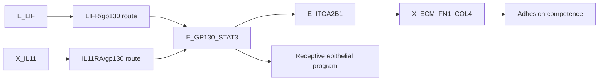
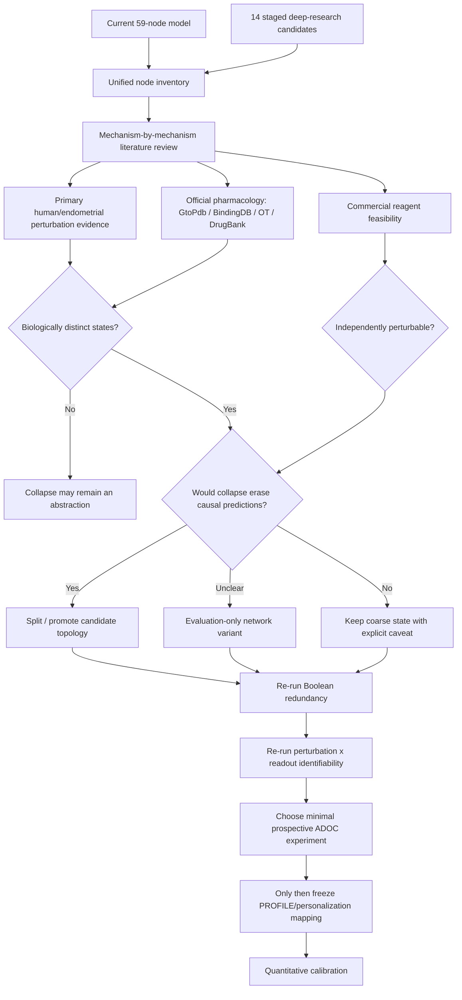

# ADOC Mechanism–Perturbation Catalog Review

## Executive summary

I reviewed the live repository at `main` commit **`3715da1` (16 September 2026)**, the executable v0.4 node dictionary, the current v0.4 drug-target catalog, the September deep-research staging catalog, the staged candidate-node set, and the new coupling-adjudication artifact. There is **not yet a separate executable v0.5 node dictionary on `main`**, so for this review I treated the relevant universe as **59 current v0.4 states + 14 staged deep-research candidates = 73 distinct current/candidate states**. fileciteturn12file0L2-L2 fileciteturn6file0L2-L2 fileciteturn7file0L2-L2 fileciteturn8file0L2-L2

The principal conclusion is that the existing `drug_target_catalog.tsv` should **not** be used as an authority for deciding whether two nodes may be biologically collapsed. Its current role is much closer to a manually assembled perturbation list: many executable nodes have no actual agent assigned, every row disclaims efficacy, and the newer staging catalog has only nine candidate mechanisms. fileciteturn4file0L2-L2 fileciteturn5file0L2-L2

The deep review changes several topology conclusions materially:

| Topology question | Verdict after review | Priority |
|---|---|---:|
| `E_LIF` = `E_GP130_STAT3` | **Split. Current collapse is not defensible for an intervention-capable DT.** | Very high |
| Add `X_IL11` | **Yes, strong promotion candidate.** | Very high |
| `IN_cAMP` = `S_PKA` | **Reconsider. Human endometrial evidence shows an EPAC/RAP1 arm in addition to PKA.** | Very high |
| `E_SPP1_EXPR` = secretory state | Keep expression separable from receptor/signalling; current identity is too strong | High |
| `E_ITGAVB3_5` = receptive program | **Split; current integrin node is functionally vacuous.** | Very high |
| `S_BMP2` = upstream progesterone relay | **Split BMP2 from BMP-receptor/SMAD activity. Promote `S_BMP_SMAD`.** | Very high |
| `S_WNT4_CTNNB1`, `S_FOXO1` | Strong mechanistic candidates downstream of BMP2 | High |
| `S_PRL` = `S_IGFBP1` | **Definitely split as outputs; do not “drug” either marker.** | Very high |
| `E_PC6` = `E_DAG1_CLEAVED` | **Split enzyme from substrate state.** | High |
| `E_CD98_CD9` = GP130/STAT3 | **Split. Multiple non-LIF inducers and direct knockdown evidence exist.** | Very high |
| `E_MUC1_SLEX` | Prefer `glycosylation program → sLeX surface` rather than MUC1-specific identity | High |
| `S_TAZ_ECM` / stiffness | Keep mechanics distinct; perturb physically before adding a “TAZ drug” abstraction | High |
| Hand-set interface relays | **No pharmacological target mapping; replace/defer, don't drug-target them.** | Very high |

The strongest new result is the LIF/IL11 distinction. In **primary human endometrial epithelial cells**, both LIF and IL11 increase adhesion and signal through STAT3, but they are not phenotypically identical: IL11 increased trophoblast-to-endometrial adhesion whereas LIF did not in that assay, and α2β1 blockade specifically reduced LIF-induced collagen-IV adhesion. citeturn16search0 Official IUPHAR pharmacology also shows that the cytokines enter **different ligand-specific receptor complexes that converge on gp130/IL6ST**, rather than LIF being synonymous with gp130/STAT3. citeturn1view1 Human endometrial cells can activate STAT3 through additional cytokines as well. citeturn16search1turn16search7

Accordingly, I would rename the artifact conceptually from **drug-target catalog** to **mechanism–perturbation catalog**. Small molecules are only one probe class. For this model, recombinant ligands, neutralizing antibodies, receptor-blocking antibodies, RNA interference/CRISPR, glycan blockade, ECM composition and mechanical perturbations are often much cleaner mechanistic tests.

## Repository baseline and catalog coverage

The current v0.4 catalog already has sensible conceptual boundaries: anti-SPP1 acts on the free-ligand layer rather than deleting SPP1-producing cell states; mechanical stiffness is treated as a boundary/context perturbation; PGR is mapped to mifepristone; and several uncertain states are explicitly only `catalog_only`. But most molecular rows have `unspecified_modulation` and no actual probe. fileciteturn4file0L2-L2

The staged September catalog adds BMP-SMAD, FOXO1, IL11, α2β1, SOX17, sLeX, biochemical ECM, ESR1 and JAG1-NOTCH3, but it was explicitly created as candidate material rather than a validated pharmacology resource. fileciteturn5file0L2-L2 The associated candidate-node table is broader still, adding WNT4/β-catenin, AKT, ERK and TGFβ-context states. fileciteturn8file0L2-L2

### Node-level disposition

I would partition the 73-state current/candidate universe into four catalog classes rather than forcing every state to have a drug:

**Direct or experimentally perturbable mechanisms.** These deserve explicit perturbation entries: `E_PGR`, `S_PGR`, `E_LIF`, `E_GP130_STAT3`, `X_IL11`, `E_ITGA2B1`, `E_SPP1_EXPR`, `S_SPP1`, `X_SPP1_LUMEN_FREE`, `E_ITGAVB3_5`, `S_BMP2`, `S_BMP_SMAD`, `S_WNT4_CTNNB1`, `S_FOXO1`, `S_HAND2`, `S_FGF_MITOGENIC`, `E_PC6`, `E_DAG1_FULL/CLEAVED`, `E_CD98_CD9`, `E_ANXA2_ACTIN`, `E_SOX17`, `E_GLYCOSYLATION_PROGRAM`, `E_SLEX_SURFACE`, `E_MUC1_*`, `E_HBEGF`, `E_JAG1_NOTCH3`, `E_ESR1_ACTIVITY`, `S_TAZ_ECM`, `X_ECM_FN1_COL4`, and mechanical context states. Their perturbations are reviewed below. Current repository definitions for the v0.4 members are in the node dictionary. fileciteturn6file0L2-L2 fileciteturn7file0L2-L2

**Protocol/context variables.** `IN_E2`, `IN_PROGESTIN`, `IN_cAMP`, `IN_XAV939`, `IN_MIFEPRISTONE`, `IN_ANTI_SPP1`, embryo-presence/contact/competence inputs, `IN_HCG`, `IN_EMBRYO_CONDITIONED_SIGNAL`, `IN_HAND2_LOSS`, `IN_ER_STRESS_EXCESS`, and `IN_HIGH_ECM_STIFFNESS` are interventions/boundaries, not biological drug targets themselves. They should point to a mechanism or experimental manipulation rather than be mistaken for molecular states. fileciteturn6file0L2-L2

**Readouts/composite states.** `E_PAEP`, `S_PRL`, `S_IGFBP1`, `E_SECRETORY_STATE`, `S_DECIDUALIZED`, `E_RECEPTIVE_SURFACE`, route aggregators and the four `OUT_*` phenotypes should normally be *observed*, not assigned drugs. For example, the repository already identifies the exact PRL/IGFBP1 coupling as structurally contradicted by the ADOC time course. fileciteturn10file0L2-L2

**Structural-uncertainty relays.** `X_MECHANICAL_STRESS_RELAY`, `X_INTERFACE_SPP1_RELAY`, `X_INTERFACE_REDUNDANT_RELAY`, and `X_INTERFACE_ANTIADHESIVE_RELAY` should have **no drug-target entry whatsoever**. The repository now correctly recognizes them as hand-initialized uncertainties rather than named mechanisms. fileciteturn10file0L2-L2

That partition prevents a dangerous inference:

> **No selective drug exists ≠ two nodes are biologically equivalent.**

Lack of a probe means **currently difficult to perturb independently**, not **safe to collapse**.

## Reviewed mechanism–perturbation catalog

The table below is the recommended **TSV-ready scientific core** of the updated catalog. “Direct” refers to the modeled state, not necessarily molecular binding. Potencies are included only where I found an authoritative assay sufficiently interpretable to report; I would leave the field blank rather than fill it with heterogeneous values from unrelated cell systems.

| Target/state | Preferred agent or perturbation | Modality / direction / directness | Potency or selectivity caveat | Human/endometrial evidence and compartment | ADOC readout → expected effect | Availability | Model discrimination / collapse implication | Confidence |
|---|---|---|---|---|---|---|---|---:|
| `E_PGR`, `S_PGR` | **Mifepristone**, plus PGR RNAi as orthogonal control | Small molecule antagonist; direct receptor target | **Not PGR-selective**: GtoPdb reports high-affinity GR, AR and PGR activity; PXR also engaged | Existing ADOC treatment-context perturbation; cannot distinguish epithelial from stromal PGR merely by whole-chip exposure | PGR target program → reduced hormone response | Available drug/research reagent | Supports perturbing PGR, **not collapsing E- and S-PGR** | High |
| `E_LIF` | Recombinant human LIF; **neutralizing anti-LIF** | Ligand addition / ligand neutralization; direct | Commercial anti-LIF AF-250-NA has ND50 ~0.04–0.08 µg/mL in vendor bioassay, but ADOC dose must be established | Primary human endometrial epithelial evidence; epithelial/glandular relevance | LIF → pSTAT3, ITGA2, adhesion | Commercial recombinant + neutralizing antibody | Separates **ligand availability** from common STAT3 activity | **Very high** |
| `E_LIF` receptor arm | LIFR-blocking antibody or soluble LIFR | Receptor blockade; more pathway-specific than downstream JAK block | LIFR blockade still leaves IL11RA–gp130 signalling available | Receptor biology officially curated; human endometrial LIF pathway evidence | pSTAT3 after LIF challenge → decrease | Commercial research reagents | Particularly strong test of LIF-specific vs shared gp130 state | High |
| `X_IL11` | Recombinant human IL11; **anti-IL11 neutralizing antibody** | Ligand addition / inhibition; direct | Vendor anti-IL11 reagents are neutralizing; concentration requires ADOC titration | **Primary human endometrial epithelial cells**; IL11 increased ECM adhesion and trophoblast attachment | pSTAT3, ITGA2, FN/COL4 adhesion | Commercial | Strong argument to promote `X_IL11`; breaks `LIF = STAT3` identity | **Very high** |
| `E_GP130_STAT3` | STAT3 siRNA/CRISPR; JAK inhibitor only as pharmacologic secondary probe | Genetic direct; JAK inhibitor indirect | JAK inhibition is not STAT3-specific and will hit several cytokine pathways | STAT3 inhibition reduced LIF- and IL11-mediated adhesion in human endometrial epithelium; tofacitinib reduces pSTAT3 in primary human endometrial epithelial/stromal cells | pSTAT3 / STAT3 targets → common pathway suppression | Routine RNAi; JAK inhibitors available | Separates common convergence node from individual cytokines | **Very high** |
| `E_ITGA2B1` | **α2β1 blocking antibody** | Receptor-blocking antibody; direct | Prefer functional blocking antibody over generic RGD peptide | Human primary EEC: α2β1 blockade reduced LIF-induced collagen-IV adhesion | surface α2β1, COL4 adhesion → selective loss | Commercial class; exact clone must be validated | Strongly supports staged `E_ITGA2B1` and ECM-receptor separation | **Very high** |
| `E_SPP1_EXPR`, `S_SPP1`, `X_SPP1_LUMEN_FREE` | Anti-SPP1 neutralization; recombinant SPP1 as rescue/activation | Ligand neutralization/addition | SPP1 engages several integrins; antibody epitope/function must be validated | Human endometrium expresses SPP1 and αvβ3 but they are **differentially regulated** | free SPP1 and adhesion response | Commercial reagents exist; clone-specific validation needed | Keep expression source(s), free ligand, and receptor as separate layers | High |
| `E_ITGAVB3_5` | **αvβ3 blocking antibody** preferred; cilengitide as secondary pharmacologic probe | Receptor blockade | Cilengitide is potent at αv integrins but is not a clean αvβ3-only perturbation; BindingDB/GtoPdb also show αvβ5/other integrin activity | Human implantation-model αvβ3 antibody blockade reduces trophoblast attachment; human endometrium shows αvβ3/SPP1 functional association | integrin occupancy/focal adhesion → reduced attachment | Antibodies and cilengitide obtainable | **Current node is vacuous; must be de-aliased before screening** | **Very high** |
| `S_BMP2` | Recombinant human BMP2 | Ligand addition; direct | Ligand acts through multiple BMP receptor combinations | Human endometrial stromal/decidual cells show BMP2-dependent SMAD1/5/8 activation | pSMAD1/5 → downstream decidual program | Commercial active ligand | Distinguishes BMP2 availability from intracellular pathway state | **Very high** |
| `S_BMP_SMAD` | ALK3/BMPR1A RNAi; SMAD1/5 RNAi; DMH-1 as secondary probe | Genetic receptor/pathway block; pharmacologic BMPR inhibition | DMH-1/dorsomorphin are pathway tools, not perfectly selective node-specific drugs | In human stromal/decidual cells, BMP2→ALK3→SMAD1/5 is experimentally separable | pSMAD1/5, WNT4, downstream differentiation | Routine genetic tools; inhibitors available | **Strongly supports adding `S_BMP_SMAD`** | **Very high** |
| `S_WNT4_CTNNB1` | WNT4 siRNA; β-catenin siRNA; DKK1; WNT4 overexpression | Genetic/pathway modulation | DKK1 affects canonical Wnt broadly; not WNT4-specific | Primary human HESC experiments place WNT4/β-catenin downstream of BMP2 | nuclear β-catenin, FOXO1, decidual differentiation | Routine research tools | Gives BMP2 a genuine downstream pathway rather than identity with PGR | **Very high** |
| `S_FOXO1` | FOXO1 siRNA/CRISPR | Genetic inhibition; direct | Prefer genetic perturbation over nominal “FOXO1 inhibitors” for causal work | Human HESC knockdown studies establish FOXO1 as a core decidual regulator downstream of cAMP/PR/BMP-WNT pathways | nuclear FOXO1, IGFBP1/PRL/WNT4 → reduced differentiation | Routine | Strong staged node; should not be collapsed into marker outputs | **Very high** |
| `IN_cAMP` / `S_PKA` | PKA-selective cAMP analog **plus EPAC-selective analog / EPAC-RAP1 knockdown** | Pathway decomposition | Exogenous db-cAMP is not biologically synonymous with PKA | Human ESC study shows EPAC1/2/RAP1 contributes to decidual responses and potentiates PKA-driven IGFBP1/PRL | PKA vs RAP1 activity, IGFBP1/PRL | Research reagents | **Directly challenges current `IN_cAMP = S_PKA` “biological collapse”** | **Very high** |
| candidate `S_EPAC_RAP1` | EPAC1/2 or RAP1 RNAi | Genetic inhibition | **New staging candidate**, not automatic promotion | Human endometrial stromal evidence | RAP1 activation, decidual markers | Routine RNAi | Consider only if cAMP-pathway discrimination is important for v0.5 | High |
| `S_HAND2` | HAND2 siRNA/CRISPR | Genetic loss | No clean pharmacological HAND2 probe recommended | Primary human stromal evidence links progestin/PGR to HAND2 | HAND2, FGF9/FGF output | Routine genetic | Provides genuine intermediate in PGR→stromal paracrine branch | High |
| `S_FGF_MITOGENIC` | Recombinant FGF9; FGF9 RNAi; broad FGFR inhibitor only secondarily | Ligand/gene perturbation | Avoid interpreting pan-FGFR inhibitor as “FGF9-specific” | Human ESC studies place FGF9 downstream of HAND2 repression | pFGFR / FGF response | Commercial ligand; genetic tools | Supports testing whether family-level FGF node can eventually refine toward FGF9 | High |
| `S_PRL` | **No direct drug-target mapping recommended** | Readout | PRL here is a decidual output, not a treatment target | ADOC and human HESC evidence show temporal/regulatory separation from IGFBP1 | Measure PRL secretion over time | ELISA already feasible | **Must split from IGFBP1 dynamically** | **Very high** |
| `S_IGFBP1` | **No direct drug-target mapping as first step**; recombinant IGFBP1/RGD blockade only as mechanistic follow-up | Readout; possible functional effector | Human primary stromal evidence suggests IGFBP1 itself can signal through an RGD/integrin-dependent route, so “pure marker” status may be incomplete | Human primary ESCs | IGFBP1 secretion; α5β1-linked effects | Recombinant protein available | Split from PRL; consider whether an outgoing functional edge deserves staging | High |
| `E_PC6` | PCSK5/PC6 siRNA/CRISPR | Genetic enzyme inhibition; direct | Avoid assuming a broad proprotein-convertase inhibitor is PC6-specific | Human endometrial epithelium: PC6 knockdown retains full-length α-DG and reduces blastocyst adhesion | PC6 activity / α-DG-N shedding → adhesion | Genetic feasible | **Enzyme must not be identical to cleavage product** | **Very high** |
| `E_DAG1_FULL`, `E_DAG1_CLEAVED` | Cleavage-resistant DAG1 construct; DAG1 manipulation | Substrate-level genetic perturbation | Not sensibly represented by a “drug against cleaved DAG1” | Human endometrial epithelial study directly manipulated PC6 cleavage site | surface full-length α-DG / shed α-DG-N | Genetic/research | Strong evidence for distinct enzyme and substrate states | **Very high** |
| `E_CD98_CD9` | SLC3A2/CD98 or CD9 siRNA; hCG/LIF/EGF stimulation as upstream challenges | Genetic inhibition + ligand induction | CD98/CD9 is not a LIF-specific endpoint | Primary human endometrial epithelial cells: hCG, E2, LIF and EGF induce CD98; depletion reduces blastocyst adhesion | surface CD98/CD9 → adhesion | Routine RNAi | **Current identity with GP130/STAT3 should be broken** | **Very high** |
| `E_ANXA2_ACTIN` | ANXA2 RNAi/inhibition; RHOA/ROCK manipulation as mechanistic secondary probe | Genetic/direct vs pathway-indirect | Cytoskeletal inhibitors are intrinsically pleiotropic | Human endometrial epithelial adhesion evidence supports ANXA2–RHOA–actin contribution | ANXA2, RHOA-GTP, F-actin architecture | Feasible | Can be a rate/support route rather than hard Boolean gate | Medium-high |
| `E_SOX17` | SOX17 RNAi/CRISPR preferred; MCC177 only secondary | Genetic inhibition; small-molecule family probe | MCC177 is a SOX-family tool and was used at relatively high micromolar concentrations; selectivity/toxicity need expert review | Human endometrial epithelial implantation-model perturbation reduces spheroid adhesion | SOX17 targets → adhesion | Genetic easy; MCC177 research-only | Supports staged node, but **do not calibrate it from MCC177 alone** | High |
| `E_JAG1_NOTCH3` | **JAG1 RNAi/CRISPR** | Direct genetic perturbation | Gamma-secretase inhibition is broad across Notch biology | Primary human endometrial epithelial/JAR model: JAG1 knockdown reduced adhesion and affected NOTCH3/HEY1 | JAG1/NOTCH3/HEY1 → adhesion | Routine | Good mechanistic node; pharmacological Notch inhibition less discriminating | High |
| `E_GLYCOSYLATION_PROGRAM` | FUT3 / ST3GAL3 RNAi | Direct genetic perturbation | Glycosylation enzymes affect many glycoproteins | Human endometrial epithelial models support FUT3/ST3GAL3–sLeX regulation | FUT3/ST3GAL3, glycomics → sLeX | Routine | Separates machinery from terminal glycan and from MUC1 | **High** |
| `E_SLEX_SURFACE` | Functional anti-sLeX blockade | Surface-glycan blockade | Clone specificity/function must be validated; anti-CD15 is not automatically anti-sLeX | Human implantation models show sLeX blockade reduces trophoblast attachment | surface sLeX → adhesion | Research antibodies available; exact functional clone requires review | Supports replacing `MUC1_SLEX` with scaffold-agnostic surface glycan state | **High** |
| `E_MUC1_BARRIER` / `E_MUC1_SLEX` | MUC1 RNAi plus glycoform-resolved assay | Genetic + glycan analysis | Total MUC1 abundance cannot stand in for adhesive glycoform | Human studies show context-dependent MUC1 roles and local/glycoform effects | MUC1 abundance + glycoforms → attachment | Feasible | **Do not encode barrier and permissive glycoform as forced complements** | High |
| `E_HBEGF` | Recombinant HB-EGF; HBEGF RNAi/neutralization; EGFR inhibitor only secondary | Ligand modulation | EGFR blockade affects many ligands | Human endometrial evidence supports a receptive/decidual role, but less cleanly than LIF/IL11 | EGFR/ERBB response → adhesion-support program | Commercial | Keep supportive route, not hard gate | Medium |
| `E_ESR1_ACTIVITY` | E2 activation; ESR1 RNAi preferred for specificity; fulvestrant as secondary probe | Nuclear-receptor modulation | Pharmacological ER agents can engage ERβ and/or other estrogenic mechanisms | Endometrial pathway is biologically central but whole-chip drug exposure does not provide compartment specificity | ESR target program, Ki67 | Routine | Useful future state distinct from the protocol bit `IN_E2` | High |
| `X_ECM_FN1_COL4` | Defined FN/COL4 coating/composition perturbation | **Physical biochemical matrix manipulation** | No drug required | Human LIF/IL11 study directly used FN and collagen IV adhesion endpoints | ECM-specific adhesion | Very feasible in vitro | Strong candidate for discriminating cytokine/integrin routes | **Very high** |
| `IN_HIGH_ECM_STIFFNESS` / `X_MECHANICAL_PERMISSIVE_ECM` | Defined hydrogel/device stiffness; cyclic stretch | **Mechanical perturbation** | Avoid using YAP/TAZ inhibitor as surrogate for stiffness | Human endometrial stromal studies show mechanical stretch/stiffness can alter decidual programs | AFM/modulus, morphology, FOXO1/PRL/IGFBP1 | Requires device/material control | Mechanics should remain distinct from molecular ECM composition | High |
| `S_TAZ_ECM` | Matrix perturbation + nuclear TAZ/WWTR1 readout; WWTR1 genetic perturbation if needed | Physical first, genetic second | “TAZ inhibitors” are too indirect for a clean first causal test | Recent human/mouse work supports TAZ–ECM coupling, but human quantitative causal calibration remains limited | nuclear TAZ, collagen/matrix program | Feasible but more involved | Do not equate TAZ state with decidualization itself | Medium |
| `S_AKT_EXCESS` | AKT RNAi or validated AKT inhibitor | Pathway inhibition | Highly pleiotropic; disease-context dependent | Human endometrial evidence links pathological AKT activity to FOXO1 regulation, but staged evidence is weaker than BMP/WNT/FOXO1 | pAKT / FOXO1 localization | Feasible | **Keep staged**, not a v0.5 admission solely because inhibitors exist | Medium-low |
| `S_ERK` | MEK/ERK inhibition or genetic perturbation | Pathway inhibition | Broad signalling node | Endometrial signalling evidence exists but phenotype is highly context dependent | pERK | Feasible | Secondary sensitivity node, not topology-driving evidence | Medium-low |
| `S_TGFB_CONTEXT` | TGFβ ligand; receptor/SMAD2/3 genetic perturbation; SB431542 only as broad tool | Activation/inhibition | Biphasic/contextual; SB431542 not TGFβ-only | Context dependence remains substantial | pSMAD2/3 | Feasible | Keep staged until sign/context can be bounded | Low-medium |
| `E_KLF12_HIGH` | Genetic perturbation only if experimentally motivated | Genetic | **No quantitative prior or validated ADOC threshold currently justified** | Repository's own scRNA analysis correctly declined to activate a prior | KLF12 + downstream LIF/adhesion markers | Technically feasible | No reason to spend further calibration effort before topology freeze | Medium |
| interface `X_*_RELAY` states | **None** | N/A | These are uncertainty variables, not biological targets | No named molecular mechanism | N/A | N/A | **Remove/replace/defer; never infer druggability from them** | Very high |

Several specific pharmacology points underlying the table are especially important. GtoPdb reports mifepristone with high-affinity activity at **GR, AR and PGR**, so the existing ADOC mifepristone arm is a valid experimental condition but should not be treated as a perfectly selective PGR knockout. citeturn15search14 GtoPdb and BindingDB likewise make clear that cilengitide is an αv-integrin probe rather than a perfect αvβ3-only switch. citeturn15search5turn6search0

Commercial research-grade recombinant human LIF and IL11 are available, and neutralizing anti-LIF reagents have low-sub-µg/mL neutralization activity in manufacturer bioassays; recombinant cytokine product potency is readily characterized, but those vendor assay values should **not** be imported as ADOC doses without chip-specific titration. citeturn12search0turn12search2turn12search12

For BMP, official receptor pharmacology identifies BMPR1A/ALK3 as a BMP2/4 receptor, while primary human endometrial experiments directly show BMP2-induced SMAD1/5/8 activation and reversal by BMPR-pathway inhibition or ALK3/SMAD perturbation. citeturn15search8turn14search0turn14search6

I used IUPHAR/GtoPdb and BindingDB preferentially for quantitative/selectivity statements. Open Targets and DrugBank were useful as target/drug cross-references, but I would **not** make endometrial mechanistic claims from either database alone: they do not substitute for perturbational evidence in the relevant tissue, and public DrugBank access exposes less quantitative detail than GtoPdb/BindingDB for several of these questions. The catalog should retain database identifiers as cross-references while making primary human experiments the evidential anchor for topology.

## Topology-impact findings

### LIF, IL11 and STAT3 should form a convergent motif, not one Boolean identity

This is the clearest catalog-driven topology correction.

The current coupling adjudication says `E_LIF` and `E_GP130_STAT3` are `BIOLOGICALLY_COLLAPSED`, with the explicit proviso that evidence for a non-LIF activator such as IL11 would change that conclusion. fileciteturn9file0L2-L2 That evidence exists and is strong.

In primary human endometrial epithelium, **both IL11 and LIF activate STAT3 and increase ECM adhesion, but they produce distinguishable phenotypes**. IL11 enhanced trophoblast-to-endometrial epithelial attachment whereas LIF did not in that experiment; α2β1 blockade differentially affected the LIF collagen-IV response. citeturn16search0 In human endometrial epithelium, IL11, LIF, IL10, oncostatin M and leptin can all feed STAT3 signalling. citeturn16search1 Official receptor pharmacology independently confirms the architecture: LIFR–gp130 and IL11RA–gp130 are distinct ligand-receptor complexes sharing the IL6ST/gp130 signalling subunit. citeturn1view1

The minimal v0.5 architecture I would test is therefore:



You do **not necessarily need to add separate `E_LIFR` and `E_IL11RA` Boolean nodes immediately**. The parsimonious version can retain separate LIF and IL11 ligand nodes feeding a common `E_GP130_STAT3` state. Receptor states become worthwhile only if receptor-specific expression or blockade is going to be measured.

### The cAMP–PKA collapse deserves reopening

This was an unexpected but important result.

The current adjudication calls `IN_cAMP` and `S_PKA` biologically collapsed and says that evidence for a cAMP effector other than PKA would be the condition for revisiting the decision. fileciteturn9file0L2-L2

There is direct **human endometrial stromal evidence** for exactly that. An EPAC-selective cAMP analogue potentiated PKA-selective cAMP signalling, and knockdown of EPAC1, EPAC2 or RAP1 attenuated decidual IGFBP1/PRL responses. citeturn14search13

That does not mean v0.5 must immediately gain three more nodes. It means the statement:

> `cAMP input ≡ PKA state`

is an **intentional simplifying abstraction**, not biological equivalence.

I would add `S_EPAC_RAP1` to the staging catalogue and ask whether splitting it produces useful experimental/identifiability value before promoting it.

### BMP2 should be separated from BMP pathway activity

The staged `S_BMP_SMAD` candidate is strongly justified. Human endometrial stromal/decidual experiments distinguish extracellular BMP2, ALK2/ALK3 receptor activity and SMAD1/5/4 signalling experimentally. citeturn14search0turn14search6

More importantly, primary human HESC experiments support a mechanistic chain:

**BMP2 → WNT4/β-catenin → FOXO1 → decidual differentiation**,

with WNT4 knockdown, β-catenin knockdown, DKK1 and WNT4 overexpression providing causal separation of layers. citeturn14search14 FOXO1 knockdown independently compromises the human decidual transcriptional programme. citeturn14search8

This gives you a biologically much better route for breaking the current `PGR/IHH/NR2F2/BMP2` alias than merely inventing slightly different Boolean rules. The repository already recognizes that the present IHH→stromal channel is effectively vacuous because several relay states reduce to the same progestin function. fileciteturn10file0L2-L2

A reasonable candidate architecture is:

```text
E_PGR
  ↓
E_IHH
  ↓
S_NR2F2
  ↓
S_BMP2
  ↓
S_BMP_SMAD
  ↓
S_WNT4_CTNNB1
  ↓
S_FOXO1
  ↓
decidual program
```

This chain should **not** all be promoted merely because the literature permits it. But `S_BMP_SMAD`, `S_WNT4_CTNNB1` and `S_FOXO1` now have unusually good human mechanistic evidence and experimentally separable interventions. citeturn14search0turn14search14turn14search8

### PRL and IGFBP1 may differ by more than timing

The repo already has compelling internal evidence that synchronous `S_PRL = S_IGFBP1 = S_DECIDUALIZED` is wrong, because the ADOC measurements show strong temporal separation. fileciteturn10file0L2-L2

The external evidence makes the distinction stronger. FOXO1-dependent decidual programs regulate both outputs, but they need not be interchangeable. citeturn14search8turn14search1 Moreover, primary human stromal experiments reported that exogenous IGFBP1 itself could promote decidualization through an RGD-sensitive, integrin-associated mechanism. citeturn14search11 Older human endometrial tissue data also place IL11 before PRL in the secretory/decidual sequence. citeturn16search4

I would therefore:

- split PRL and IGFBP1 kinetics now;
- retain both as measured outputs initially;
- **stage, but not immediately implement**, the possibility that IGFBP1 has a functional feedback route.

This is exactly the kind of finding deep research should generate: not “another drug target,” but a warning that a variable currently treated as a passive reporter may participate causally.

### SPP1 and its integrin receptor must remain separate

The repository already shows that `E_ITGAVB3_5` is functionally absorbed in the SPP1 route, meaning an integrin blockade is mathematically unrepresentable despite the route being described as integrin-mediated. fileciteturn10file0L2-L2

Human endometrial biology argues strongly against the collapse: osteopontin/SPP1 and β3 integrin are **differentially regulated**, and αvβ3 was the main SPP1 receptor in an Ishikawa adhesion assay. citeturn13search9 Independent human implantation-model experiments show dose-dependent reduction in trophoblast spheroid attachment when αvβ3 is blocked. citeturn13search10 GtoPdb also records SPP1 interactions with multiple integrins, making “SPP1 state = αvβ3/5 state” pharmacologically unjustified. citeturn0search1turn0search2

For v0.5, I would retain at least:

```text
E_SPP1_EXPR ─┐
             ├→ X_SPP1_LUMEN_FREE → integrin receptor state → adhesion
S_SPP1 ──────┘
```

with `IN_ANTI_SPP1` acting at the **free-ligand** layer, as the repository already does correctly. fileciteturn4file0L2-L2

### PC6 and DAG1 are experimentally separable

Human endometrial epithelial experiments provide unusually direct causal evidence: PC6 knockdown reduces removal of the α-dystroglycan N-terminus and reduces blastocyst adhesion, while mutation of the PC6 cleavage site retains full-length α-DG and impairs adhesiveness. citeturn13search3

That means the current exact logical identity between enzyme and cleavage product is acceptable only as a coarse one-step abstraction; it should **not** survive if v0.5 aims at perturbation prediction.

The mechanistic distinction is experimentally actionable:

**PC6 activity → DAG1 cleavage → barrier release**

rather than:

**PC6 = cleaved DAG1**.

### CD98/CD9 should definitely leave the LIF/STAT3 alias class

This is another high-confidence repair. Human endometrial epithelial CD98 is induced not only by LIF but also by **hCG, estradiol and EGF**, and siRNA depletion of CD98/CD9 reduces blastocyst adhesion. citeturn13search0turn16search3

The repository's own Gate-2 audit already identifies the present `E_CD98_CD9 = E_GP130_STAT3` rule as artificially coupled and notes that hCG/embryo-conditioned inputs are currently declared but not wired. fileciteturn10file0L2-L2

The pharmacology/perturbation review therefore confirms that repair rather than introducing a new speculative one.

### Glycosylation should be separated from MUC1 identity

Human implantation-model experiments show that suppression of ST3GAL3 or FUT3, or functional blockade of sialyl-Lewis-X, decreases epithelial receptivity/trophoblast attachment. These findings support the staged `E_GLYCOSYLATION_PROGRAM → E_SLEX_SURFACE` decomposition. citeturn8search4turn8search11

That is cleaner than assuming the adhesive glycan state is intrinsically `MUC1_SLEX`. Human MUC1 can have context- and glycoform-dependent adhesive or anti-adhesive properties, which is precisely why total MUC1 abundance should not dictate a Boolean adhesive state. citeturn8search2turn8search3

### Mechanics should be perturbed as mechanics

The current mechanical branch should not be “validated” merely by finding a YAP/TAZ compound. Human endometrial stromal experiments show that actual mechanical perturbations such as cyclic stretch change FOXO1, PRL, IGFBP1 and WNT4 during decidualization. citeturn14search2 Recent work also supports ECM/TAZ coupling, but that does not make TAZ a proxy for every mechanical property. citeturn11search6turn11search8

For ADOC, **defined stiffness, ECM composition and mechanical loading are the clean perturbations**. TAZ/WWTR1 should be a proximal molecular readout or secondary genetic intervention. This reinforces the repository's existing instinct that part of the mechanics belongs ultimately in PhysiBoSS rather than being expanded indefinitely as Boolean relays. fileciteturn10file0L2-L2

## High-value perturbations for experimental distinguishability

I would not use the catalog to select a contraceptive target yet. I would use it first to select **causal discriminators** capable of deciding which topology is correct.

My highest-value shortlist is:

| Rank | Perturbation package | Readouts | What it distinguishes | Why it is unusually valuable |
|---:|---|---|---|---|
| **A** | **LIF vs IL11 vs common STAT3 inhibition** | pSTAT3, ITGA2, adhesion to FN/COL4, trophoblast attachment | ligand-specific route vs shared convergence | Direct primary-human evidence; attacks current LIF/STAT3 collapse |
| **A** | **α2β1 blockade ± LIF/IL11** | COL4/FN adhesion, attachment | cytokine-specific receptor/ECM execution | Primary human study already shows differential response |
| **A** | **BMP2 ± BMPR/SMAD blockade** | pSMAD1/5, WNT4, FOXO1, IGFBP1, PRL | BMP ligand vs pathway vs decidual outputs | Repairs major stromal alias with human causal chain |
| **A** | **anti-SPP1 vs αvβ3 blockade** | free SPP1, receptor state, adhesion | ligand availability vs receptor competence | Current model cannot represent the distinction properly |
| **A** | **PC6 loss + DAG1 cleavage assay** | PC6, full/cleaved α-DG, adhesion | enzyme vs substrate state | Very clean mechanistic chain in human epithelium |
| **A** | **CD98/CD9 knockdown ± hCG/LIF** | CD98/CD9 surface, pSTAT3, adhesion | embryo cue/LIF induction vs adhesion effector | Breaks known artificial alias |
| **B** | **PKA-selective vs EPAC/RAP1 perturbation** | PKA/RAP1, FOXO1, IGFBP1, PRL | whether cAMP needs >1 intracellular branch | Directly challenges another current “biological collapse” |
| **B** | **FUT3/ST3GAL3 loss or sLeX blockade** | surface sLeX, MUC1 glycoform, adhesion | glycosylation machinery vs protein scaffold | Tests staged replacement of MUC1-sLeX abstraction |
| **B** | **matrix composition × stiffness** | FN/COL4, modulus, TAZ, decidual markers, adhesion | biochemical ECM vs mechanical ECM | Prevents two fundamentally different processes becoming one node |
| **B** | **HAND2 loss ± recombinant FGF9** | HAND2, FGF9, downstream epithelial proliferation | PGR/HAND2/FGF causality | Human stromal mechanistic evidence supports direction |

The LIF/IL11 package has the best combination of **human relevance, causal specificity, existing commercial reagents and topology discrimination**. The core primary study already establishes the relevant directions in human primary endometrial epithelium. citeturn16search0 Commercial LIF, IL11 and anti-LIF reagents mean the axis is experimentally tractable without inventing exotic chemistry. citeturn12search0turn12search2turn12search12

The BMP arm is almost as compelling because it connects directly into the current stromal structural defect and because the chain is experimentally decomposable in human HESCs. citeturn14search0turn14search14turn14search8

The SPP1/integrin experiment is also attractive, but **only after the topology is repaired enough that an integrin perturbation actually changes the model**. The repository currently proves that `E_ITGAVB3_5` is absorbed and therefore does no work in its own nominal adhesion route. fileciteturn10file0L2-L2 Running an expensive αvβ3 experiment against a model mathematically incapable of representing αvβ3 blockade would be backwards.

## Pharmacology review flags

Several candidate agents require explicit expert pharmacology review before they become ADOC screening reagents.

**Mifepristone.** Keep it because it is part of the existing experimental system, but label it **multi-receptor**, not a clean PGR knock-out. GtoPdb reports high-affinity interactions with glucocorticoid, androgen and progesterone receptors. citeturn15search14

**Cilengitide.** Useful as an αv-integrin pharmacological probe, but not a clean `E_ITGAVB3` switch. GtoPdb/BindingDB document activity beyond αvβ3, including αvβ5 and related integrin binding. citeturn15search5turn6search0 A functional αvβ3-blocking antibody is preferable for topology adjudication.

**DMH-1/dorsomorphin.** Valuable pathway tools, but genetic ALK3/SMAD1/5 perturbation should provide the specificity control. The human endometrial experiments themselves use the combination of pharmacological and genetic evidence, which is why they are strong. citeturn14search0turn14search6

**JAK/STAT inhibitors.** Tofacitinib demonstrably lowers pSTAT3 in primary human endometrial epithelial and stromal cells, but it is a JAK inhibitor, not a STAT3-specific probe. citeturn16search11 For deciding whether `E_GP130_STAT3` is a convergence state, STAT3 RNAi plus ligand-specific blockade is scientifically cleaner.

**MCC177/SOX17.** The human implantation-model result is interesting, but a SOX-family small-molecule probe at tens of micromolar should not be interpreted as a SOX17-specific perturbation without orthogonal genetic confirmation. citeturn8search1

**Gamma-secretase/Notch inhibitors.** They are poor first-line tools for proving a specific `JAG1→NOTCH3` edge because they affect multiple Notch receptor/ligand contexts. JAG1 knockdown already has direct human implantation-model support. citeturn8search0

**Anti-sLeX antibodies.** The exact clone matters. A commercial antibody that merely stains Lewis-X or sLeX is not automatically a function-blocking reagent. The catalog should require `functional_blocking_validated=yes` before such a reagent earns high confidence. Primary functional blockade studies provide the correct standard. citeturn8search4turn8search11

**Anti-SPP1.** Require a functional neutralization assay, known epitope and rescue with recombinant SPP1. Because SPP1 interacts with multiple integrins, a positive anti-SPP1 result cannot by itself identify which receptor executes the phenotype. Human endometrial data already show differential regulation of SPP1 and αvβ3. citeturn13search9

**TAZ/YAP pharmacology.** Do not use nominal YAP/TAZ inhibitors as substitutes for a matrix-stiffness experiment. For the DT's topology question, mechanical perturbation plus TAZ readout has a much cleaner causal interpretation. citeturn14search2turn11search6

## Recommended catalog structure and validation workflow

I would replace the current narrow catalog schema with something like:

```text
target_state
target_gene_or_complex
compartment
agent_or_perturbation
modality
directness
direction
molecular_target
potency_value
potency_unit
potency_assay
selectivity_notes
off_target_notes
human_evidence
endometrial_evidence
model_system
epithelial_relevance
stromal_relevance
adoc_delivery_feasibility
timing_requirements
proximal_readout
phenotype_readout
availability
reagent_or_agent_status
primary_evidence_id
pharmacology_database_id
confidence
model_discrimination_value
collapse_implication
expert_review_required
claim_boundary
```

Two fields deserve special emphasis.

**`model_discrimination_value`** should ask whether the intervention distinguishes mechanistic states that the model currently aliases. Anti-LIF and anti-IL11, for example, have **very high** discrimination value because both can converge on STAT3 while remaining independently perturbable. citeturn16search0turn1view1

**`collapse_implication`** should contain an explicit machine-readable statement such as:

```text
SPLIT_REQUIRED
SPLIT_SUPPORTED
NO_COLLAPSE_INFERENCE
COLLAPSE_ACCEPTABLE_AS_ABSTRACTION
NO_TOPOLOGY_IMPLICATION
STRUCTURAL_NODE_NOT_A_TARGET
```

That prevents a future agent from turning `no_agent_found` into `safe_to_collapse`.

The review pipeline should be:



This is also the right order relative to PROFILE_v2. A node-specific personalization mapping is premature while the underlying biological state can still be split, replaced or redefined.

### Recommended immediate changes to the repository

I would make the following updates before Gate 3 topology decisions become permanent:

**Reclassify `E_LIF`/`E_GP130_STAT3`.** The current `BIOLOGICALLY_COLLAPSED` adjudication should be changed to something like `ARTIFICIALLY_OR_COARSELY_COLLAPSED / SPLIT_CANDIDATE`, because the exact condition stated in `what_would_change_it`—another human-relevant GP130/STAT3 activator—is satisfied by IL11 and other cytokines. fileciteturn9file0L2-L2 citeturn16search0turn16search1

**Promote `X_IL11` to a high-priority evaluation variant.** Its human perturbational evidence is stronger than many nodes already present in v0.4. citeturn16search0turn16search15

**Reopen `IN_cAMP`/`S_PKA`.** Do not necessarily add EPAC immediately, but update the adjudication to acknowledge that human endometrial cAMP signalling is not PKA-only, and stage `S_EPAC_RAP1`. citeturn14search13

**Promote `S_BMP_SMAD` for evaluation and jointly evaluate `S_WNT4_CTNNB1`/`S_FOXO1`.** This is one of the best evidence-backed opportunities to turn the current stromal hormone relay from a string of aliases into a mechanistic cascade. citeturn14search0turn14search14turn14search8

**Repair `E_ITGAVB3_5` before scoring anti-integrin experiments.** Its current logical contribution is absorbed, so pharmacological rank calculations performed before that repair are misleading. fileciteturn10file0L2-L2

**Keep `S_PRL` and `S_IGFBP1` out of the drug-target layer.** Repair their temporal logic; separately stage the possibility of an IGFBP1 functional feedback mechanism rather than converting either marker into a druggable switch. citeturn14search11turn14search8

**Replace the interface relay entries with explicit `STRUCTURAL_NODE_NOT_A_TARGET` records.** Their druggability should be blank by construction until Gate 3b decides their mechanistic replacements. fileciteturn10file0L2-L2

**Keep the proposed fourth-arm anti-SPP1 experiment provisional.** The catalog review strengthens SPP1 as a meaningful route but also identifies LIF/IL11/STAT3, BMP-SMAD and integrin-level perturbations with potentially greater topology-discrimination value. The final fourth arm should therefore still be selected *after* v0.5 structural reconstruction rather than inherited from the existing planned-design file. fileciteturn12file0L2-L2

## Limitations and overall recommendation

This review is sufficiently strong to alter topology adjudication, but it is **not yet a procurement-ready reagent list**. Lot-specific availability, exact functional antibody clones, endotoxin specifications, ADOC-compatible carrier formulations, dose-response windows, chip adsorption, epithelial-versus-stromal exposure, cytotoxicity and washout kinetics have not all been verified. Vendor neutralization potencies are assay-specific and should be treated as starting information, not as ADOC concentrations. citeturn12search0turn12search2turn12search12

Evidence quality is also heterogeneous. LIF/IL11/α2β1, BMP-SMAD/WNT4/FOXO1, PC6-DAG1 and CD98/CD9 have unusually useful human perturbational evidence. citeturn16search0turn14search0turn14search14turn13search3turn13search0 In contrast, some mechanics/TAZ, broad AKT/ERK/TGFβ states and several drug-like pathway inhibitors remain better suited to sensitivity analysis than permanent topology.

Some implantation studies use immortalized endometrial or trophoblast lines rather than primary ADOC tissue. For example, αvβ3 antibody blockade has good human cell-model evidence, but it is not equivalent to a donor-resolved ADOC perturbation. citeturn13search10 Conversely, the IL11/LIF and BMP pathway results include primary human endometrial systems and therefore deserve substantially more weight. citeturn16search0turn14search14

The biggest conceptual correction is that the catalog should **never be a druggability-driven topology filter**. It should instead provide a second axis alongside biological evidence:

> **Biological distinction asks whether two states are mechanistically different.  
> Perturbation distinction asks whether the experiment can manipulate them independently.  
> Model distinction asks whether keeping them separate changes predictions.**

Only when those are evaluated separately can the catalog safely inform node collapse.

My overall recommendation is therefore **not** “add all druggable nodes.” It is:

**upgrade the catalog now → correct the few coupling adjudications already contradicted by primary human perturbation evidence → build Gate-3 evaluation variants → selectively promote only mechanisms that improve causal expressivity or prospective identifiability.**

The deep review particularly supports a v0.5 focus on **LIF/IL11→STAT3→integrin/ECM, BMP2→SMAD→WNT4→FOXO1, SPP1→integrin, PC6→DAG1, CD98/CD9, and glycosylation/sLeX**, while keeping broad AKT/ERK/TGFβ and TAZ pharmacology secondary. It also uncovers one important candidate absent from the current staging set—**EPAC/RAP1 as the non-PKA cAMP arm**—which should at least be recorded before `IN_cAMP` and `S_PKA` are declared biologically equivalent. citeturn14search13

**Bottom line:** the current catalog is a good seed but is not mature enough to adjudicate topology by itself. After this review, I would rate the existing catalog about **4/10 as a pharmacology resource**, but the revised mechanism–perturbation framework about **8–9/10 as a basis for v0.5 topology and prospective experimental design**.