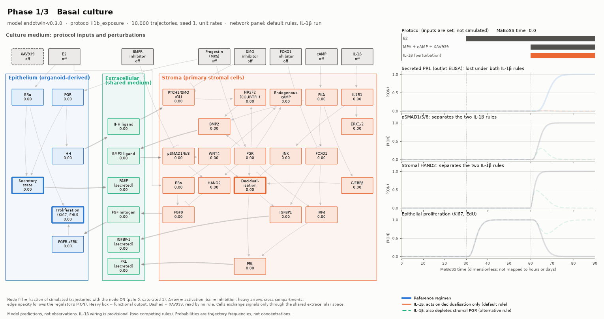
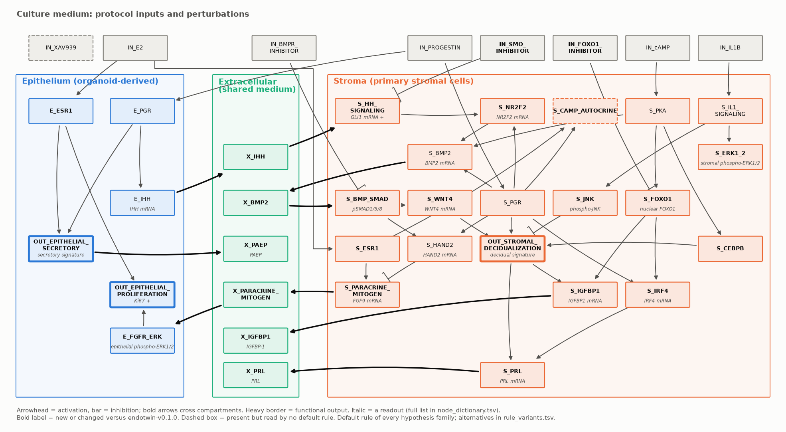

# ENDO-TWIN

**Turning competing explanations of endometrial hormonal regulation into
experimentally falsifiable predictions.**

Every month the secretory endometrium performs two coordinated switches:
progesterone halts oestrogen-driven epithelial proliferation, and the stroma
decidualises. Thousands of genes move. Which interactions actually *drive* the
switches, and how the two tissue compartments signal to each other, is still
disputed — and both switches fail in endometriosis, where decidualisation is
impaired. ENDO-TWIN encodes the leading competing explanations as alternative
rules in one executable model, then identifies the specific experiment whose
outcome separates them in ADOC, an endometrium-on-chip in which epithelium and
stroma occupy physically separate compartments.

*`endotwin-v0.3.0` through the ADOC protocol: basal culture, E2 priming, then
differentiation with IL-1β. Colour is the fraction of 10,000 MaBoSS
trajectories in which a node is ON. Epithelium and stroma communicate only
through the shared extracellular space in the middle. Model predictions in
dimensionless time; rebuild with `pixi run endotwin-figures`.*

---

## Two unresolved questions, and the experiments that decide them

**Q1 — Is BMP/SMAD signalling *necessary* for stromal decidualisation,** or can
progesterone-associated mechanisms sustain it independently? Human SMAD1/5
knockdown impairs decidualisation and BMP2 rescues it; but progesterone- and
cAMP-responsive routes could in principle carry the programme alone.

**Q2 — Does progesterone suppress epithelial proliferation through a *stromal
paracrine relay*,** or through an epithelium-autonomous mechanism? In mouse,
stromal HAND2 represses fibroblast growth factors and blocking the receptor
lowers epithelial proliferation; in human stromal cells only FGF9 responds, and
an epithelial route has never been excluded.

Both answers change what a failing endometrium means. In endometriosis the
decidual response is blunted and progesterone signalling is attenuated, but
"progesterone resistance" names the observation rather than the lesion: it does
not say whether the defect sits in the stromal programme itself, in the
epithelium, or in the paracrine conversation between them. Those three
possibilities imply different molecular targets, and Q1 and Q2 are the
discriminating form of that question. A model that only reproduces the healthy
switch cannot tell them apart; one that encodes the competing mechanisms as
alternatives can say which measurement would.

| Question | Competing explanations | Discriminating perturbation | Functional readout | Predicted split |
|---|---|---|---|---|
| **Q1** | BMP/SMAD through WNT4 is required *vs* PGR signalling suffices | BMP type-I receptor inhibitor, during differentiation | Secreted **PRL** and **IGFBP-1** | Both rules lose pSMAD1/5/8; **only the BMP-required rule loses PRL and IGFBP-1** |
| **Q2** | Stromal paracrine relay *vs* epithelium-autonomous | Stromal **HAND2** knockdown, or paracrine blockade **during E2 priming** | Epithelial **Ki67 / EdU** | Proliferation **rises** after HAND2 knockdown under the relay rule; **unchanged** under the autonomous rule |

**Timing changes the answer for Q2.** The paracrine blockade is informative only
during E2 priming; applied later, stromal HAND2 already holds the mitogen off
and both rules predict the same thing. Q1 needs pSMAD1/5/8 alongside the
functional readout, to show the inhibitor engaged its target.

These are **conditional model predictions under stated rules, rates and initial
conditions — not experimental results.** Every direction above is computed
across all 48 rule-variant scenarios
([discrimination.tsv](../endotwin/results/endotwin-v0.3.0/discrimination.tsv)).

---

## Why ADOC makes this answerable

A Boolean model alone cannot separate cell-autonomous from paracrine regulation:
in a mixed culture every signal reaches every cell. ADOC physically separates
epithelium and stroma, so a perturbation can be applied to **one** compartment
and the response read in the **other**. That is what converts Q2 from a
modelling preference into an experiment.

The combination that matters is **mechanistic model + separated compartments +
compartment-restricted perturbation + functional measurement**. The model names
which compartment to perturb, when, and which outlet protein or stain settles
it; the chip makes that perturbation physically possible.

---

## What already exists

An executable model, not a diagram: **`endotwin-v0.3.0`**, **40 nodes**, **49
regulatory dependencies** across four compartments, with **5 hypothesis
families**, **11 alternative rules** and **48 scenarios** that all run.

- **Evidence provenance per rule** — every edge carries an evidence class,
  mechanism, references and its stated assumption
  ([edges.tsv](../endotwin/models/endotwin-v0.3.0/edges.tsv),
  [rule_variants.tsv](../endotwin/models/endotwin-v0.3.0/rule_variants.tsv)).
- **Exact structural analysis** — the network is acyclic, so fixed points are
  computed exactly rather than sampled, and are provably independent of
  transition rates and initial conditions.
- **Reproducible stochastic simulation** — MaBoSS runs confirmed against those
  exact fixed points, with recorded hashes, seeds and trajectory counts.
- **Sensitivity testing** — predicted directions unchanged across random rate
  ensembles, within the ranges examined.
- **Prospective prediction freezing** — machinery to fix a prediction, its
  readouts and its agreement criteria *before* any evaluation data exist, with a
  donor-leakage guard.
- **Exhaustive candidate screening** — every single-node perturbation the
  network can express, across both regimens and all 48 scenarios
  ([wp2_candidate_screen.tsv](../endotwin/results/endotwin-v0.3.0/wp2_candidate_screen.tsv)).

**No calibration and no independent validation.** The model is computationally
verified, not biologically validated, and nothing here has been tested against
new experimental data. Results from the earlier, private ADOC prototype are kept
separate as legacy material ([docs/ORIGIN.md](ORIGIN.md)).

---

## Reproducibility

Needs [pixi](https://pixi.sh) on linux-64; `pixi.lock` pins Python 3.12 and
MaBoSS 0.8.15. Runtimes below are recorded, single-process, on the development
workstation (20-core x86-64, Linux); they will differ on other hardware.

| Command | Purpose | Recorded runtime |
|---|---|---|
| `pixi run endotwin-smoke` | Clean-clone check: model loads, every scenario runs, committed predictions recompute | **< 1 s** |
| `pixi run endotwin-test` | Active ENDO-TWIN model tests (140) | **≈ 35 s** |
| `pixi run endotwin-all` | Regenerate every result, figure and the verification report | **≈ 7 min** |
| `pixi run test` | Complete suite, legacy prototype tests included | **945 s — 15 min 45 s** |

The complete suite is **2,613 tests: 2,550 passed, 0 failed, 63 skipped.** The
63 skips are legacy checks that replay commits of the prototype's Git history,
which this repository deliberately does not carry; they passed at the source
commit ([docs/software_verification.md](software_verification.md)).
`endotwin-smoke` needs no MaBoSS, no private data and no prototype history, so a
reviewer with a fresh clone can run it immediately.

**Software correctness ≠ biological validation.** These tests show the code
computes what the stated rules say it should. They say nothing about whether the
biology is right — and a 15-minute verification suite is **not** an argument for
the project's cloud-computing budget, which concerns future simulation
ensembles, model refinement, uncertainty analysis and intervention screening.
That case is made separately, with measured, planned and illustrative workloads
kept apart, in
[docs/computational_resources.md](computational_resources.md).

---

## From uncertainty to intervention

Mechanistic uncertainty → targeted experiments → refined model → independent
prediction → intervention testing.

| | | |
|---|---|---|
| **WP1** | Refine the model and discriminate competing explanations | Qualify the regimen, run the Q1 and Q2 perturbations, freeze a model version |
| **WP2** | Evaluate a withheld prediction prospectively | Freeze one previously untested functional prediction, then test it in five independent donors |
| **WP3** | Compare induced inflammation with patient dysfunction | IL-1β exposure against endometrium from women with endometriosis |
| **WP4** | Test a model-guided intervention | Select on one dataset only, evaluate against predefined functional criteria |

The WP2 perturbation is **selected after WP1**, not now. The repository
implements the screening capability — an exhaustive single-node screen, with
compartment-restricted perturbations among the candidates it surfaces — but
final eligibility needs experimental and scientific judgement the model cannot
supply, and **no candidate has yet been established as eligible**. The analysis,
including an interpretation question that belongs to the investigators, is in
[docs/wp2_prediction_selection.md](wp2_prediction_selection.md).

---

## Limitations

- **Not calibrated, not prospectively validated.** Everything above is a
  conditional model prediction.
- **No physical timescale.** Kinetic parameters are unknown and MaBoSS time is
  not experimental time; steady states do not depend on rates, transients do.
- **Several interactions remain alternative hypotheses** rather than settled
  mechanism — that is what the five hypothesis families represent.
- **XAV939** is applied in the published regimen but is read by no rule: the
  model is *silent* about it, which is not a prediction that it does nothing.
- **The WP2 prediction is not selected**, by design.

Detail: [scientific evidence per rule](scientific_evidence.md) ·
[model construction](model_construction.md) ·
[limitations and evaluation](model_evaluation.md).

---

## Where to look next

> **[Independent scientific review — evidence, predictions and reproducibility](../REVIEWER_GUIDE.md)**
> A three-minute guide for evaluators: every claim with the file behind it.

[Origin](ORIGIN.md) ·
[foundation audit](RESEARCH_FOUNDATION_AUDIT.md) ·
[evidence per rule](scientific_evidence.md) ·
[model construction](model_construction.md) ·
[data](experimental_data.md) ·
[evaluation](model_evaluation.md) ·
[WP2 prediction](wp2_prediction_selection.md) ·
[software verification](software_verification.md) ·
[verification report](../endotwin/results/endotwin-v0.3.0/verification_report.md) ·
[compute resources](computational_resources.md) ·
[legacy prototype](legacy/README.md)

<strong>Full foundation metrics and test provenance</strong> — recomputed from the repository by <code>src/endotwin/foundation_metrics.py</code>; a test fails if these drift.

<!-- dashboard:start -->
| | |
|---|---|
| Literature | 147 papers screened (tiers A 52 / B 80 / C 15); 95 registered references, all 95 checked against Crossref; 62 read in full text; a re-audit report on a stated 163-PDF corpus, with 36 papers listed in it |
| Evidence | 276 edge-level evidence rows; 37 rows graded from full text on 27 edges; 39 citation adjudications (32 retracted, 7 attached) |
| Prototype network, v0.6.0 | 56 nodes, 89 dependencies (76 activating, 13 inhibitory); 29 distinct Boolean functions in 7 alias classes; 17 phenotype-inert nodes |
| Prototype history | 8 model versions; 25 completed analyses with results in the repository |
| ADOC data | 62 secreted-protein rows, 39 observed values (PRL, IGFBP-1, PAEP); scRNA-seq with 28,212 cells from 3 donors |
| ENDO-TWIN v0.3.0 | 40 nodes, 49 dependencies, 17 distinct Boolean functions; 5 hypothesis families, 11 rule variants, 48 scenarios; 12 protocol conditions, 9 comparisons |
| Robustness | 5,670 of 5,670 steady-state predictions unchanged under 30 random rate sets; all 1680 simulated phases reach their exact fixed points |
| Tests | 2,613 automated tests in this repository (2,550 passed, 0 failed, 63 skipped) |
<!-- dashboard:end -->

Named nodes are not the same as distinct functions, and simulation runs
are not biological replicates.

| Suite | Tests | Result |
|---|---|---|
| This repository, `pixi run test` | 2,613 | 2,550 passed, 0 failed, 63 skipped |
| of which mainline, `pixi run endotwin-test` | 140 | OK |
| Prototype at the source commit | 2,767 | 2,757 passed; the 10 others need local-only data |
| Prototype benchmark, 2026-10-16 | 2,415 | OK |

---

## References and licence

Full bibliography with DOIs in
[endotwin/evidence/references.tsv](../endotwin/evidence/references.tsv);
per-rule attribution in [scientific_evidence.md](scientific_evidence.md).

MaBoSS and PyMaBoSS are installed dependencies (`docs/THIRD_PARTY_NOTICES.md`).
Developed at the Carlos Simón Foundation for Research in Women's Health.

**This repository is public** ([github.com/FCS-BioIT/ENDO-TWIN_prototype](https://github.com/FCS-BioIT/ENDO-TWIN_prototype);
despite the remote's name this is the ENDO-TWIN mainline, and the "prototype" of
[docs/ORIGIN.md](ORIGIN.md) is a different, private repository).

**Public to read is not open source.** Copyright © 2026 Fundación Carlos Simón,
all rights reserved. [docs/LICENSE](LICENSE) grants reviewers appointed by the
Agencia Estatal de Investigación the right to consult the code and to make the
copies and run the tests needed to evaluate ENDO-TWIN in the 2026 *Proyectos de
Generación de Conocimiento* call, and nothing further: no commercial use, no use
for other purposes, no modification (not even for your own use), no
incorporation into other products, no redistribution. Anything else needs the
rights holder's prior written permission. The Spanish text of `docs/LICENSE` is the
authoritative one.

The licence covers this repository's own code and documentation. It does not
cover the installed dependencies (`docs/THIRD_PARTY_NOTICES.md`), nor `data/`, which
holds publisher PDFs, the Zaragozano manuscript files and the secreted-protein
workbook that are not the Foundation's to license. Since 2026-11-23 `data/` is
untracked (`.gitignore`): the files stay the immutable source layer on the
machines that hold them, pinned by SHA-256 in `config/data_manifest.tsv`, and a
clone obtains them out of band. Copies committed before that date remain in the
Git history; untracking does not retract them.
