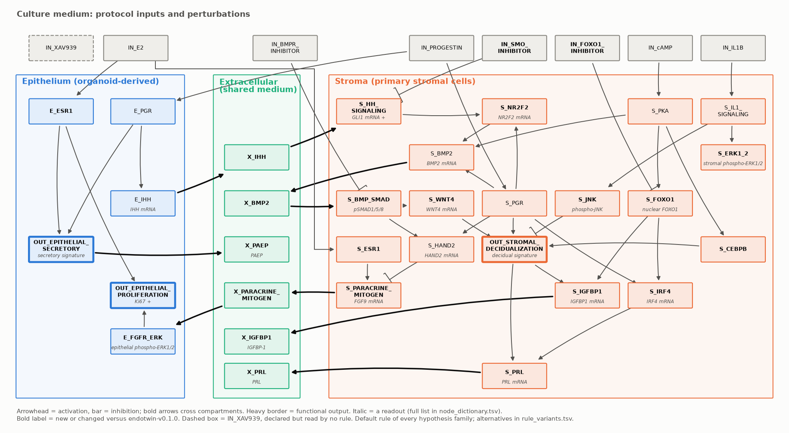

# Model construction: endotwin-v0.2.0

`endotwin/models/endotwin-v0.2.0/` is the ENDO-TWIN mainline network. It is a
hypothesis family for WP1, not a calibrated or validated model. The previous
version, `endotwin-v0.1.0` (19 nodes), stays in the repository because the v0.2.0
lineage table maps every node back to it.

## Files

| File | Content |
|---|---|
| `network.bnd` | The executable MaBoSS network: default rule of every node |
| `baseline.cfg` | Default settings: all nodes start OFF, none internal (so the joint state can be carried between phases) |
| `node_dictionary.tsv` | Compartment, layer, entity type (expression, protein activity, secreted ligand or protein, programme, condition), readouts, lineage |
| `edges.tsv` | One row per dependency (47 default, 3 variant-only) with evidence class, references, mechanism and assumption |
| `rule_variants.tsv` | Alternative rules, in four families that each own distinct nodes |
| `lineage.tsv` | Every v0.1.0 node: unchanged or modified, with the reason |
| `interface.tsv` | The nine crossings between a cell compartment and the shared extracellular space |
| `provenance.toml` | Source model and commit; `calibrated = false`, `biologically_validated = false`, `physical_time_mapping = false` |

## Architecture

39 nodes in four compartments, run as one integrated MaBoSS model:

1. **Culture medium** (8 inputs): `IN_E2`, `IN_PROGESTIN` (P4 or MPA),
   `IN_cAMP`, `IN_XAV939`, `IN_BMPR_INHIBITOR`, `IN_IL1B`, and two candidate
   perturbations that are not in the funded protocol, `IN_SMO_INHIBITOR` and
   `IN_FOXO1_INHIBITOR`.
2. **Epithelium** (6): ERα and PGR activity, IHH expression, FGFR-ERK1/2
   activity, the secretory and proliferation outputs.
3. **Shared extracellular space** (6): the ligand pools that cross the ADOC
   membrane (`X_IHH`, `X_BMP2`, `X_PARACRINE_MITOGEN`) and the secreted proteins
   measured in the outlets (`X_PAEP`, `X_PRL`, `X_IGFBP1`).
4. **Stroma** (19): ERα, PGR and cAMP/PKA; the decidual transcription module
   (C/EBPβ, FOXO1, IRF4); Hedgehog reception, NR2F2, BMP2 expression,
   BMP/SMAD activity, WNT4, HAND2 and the paracrine mitogen; IL-1 receptor
   signalling with its JNK and ERK1/2 branches; the decidualisation programme
   and its marker genes `S_PRL` and `S_IGFBP1`.

The two cell compartments never read each other directly. Every signal between
them passes through an extracellular node, so the compartment split
(`split_compartments`) gives three networks coupled only by ligand and secreted
protein pools. That is the form a per-cell or spatial coupling would need.

## What changed from endotwin-v0.1.0, and why

v0.2.0 adds mechanism only where a curated source supports it. Each addition
also has a perturbation or a readout that the project can use, so it is more
than a renamed copy of an existing node.

| Change | Evidence | What it buys |
|---|---|---|
| Extracellular compartment for IHH, BMP2 and the stromal mitogen | ADOC separates the cell types by a porous membrane (ET-020) | Ligand expression, secreted ligand and receptor activity become separate states; the BMP receptor inhibitor now acts on a receptor reading a ligand pool |
| Secreted `X_PRL`, `X_IGFBP1`, `X_PAEP` beside the expression nodes `S_PRL`, `S_IGFBP1` | Outlet ELISAs (ET-020) versus planned bulk RNA-seq | RNA and secreted-protein readouts map to different nodes, as the measurement plan does |
| Decidual module: `S_CEBPB`, `S_FOXO1`, `S_IRF4` | Tamura 2014 (ET-011); Labied 2006, Vasquez 2015, Kim 2005, Grinius 2006, Buzzio 2006, Ujvari 2017 (ET-021 to ET-027), all read in full in the prototype (PIF ledger) | cAMP acts through C/EBPβ and FOXO1; IGFBP1 needs FOXO1 in every source |
| PRL and IGFBP-1 separated; new FOX family | FOXO1 activity inhibition collapses IGFBP1 but not PRL (ET-024); FOXO1 alone is inert on the PRL enhancer (ET-026); IRF4 knockdown attenuates PRL (ET-027) | A cheap discriminating experiment: FOXO1 inhibitor, read by the existing PRL ELISA |
| `S_WNT4` between BMP/SMAD and decidualisation | BMP2 raises WNT4 (ET-008); SMAD1/5 knockdown lowers WNT4 (ET-013) | Q1's BMP route has a transcript readout |
| Hedgehog reception `S_HH_SIGNALING` and `IN_SMO_INHIBITOR` | Human IHH targets (ET-009); stromal Smo in mouse (ET-028) | The prototype refused this node as an exact alias of IHH; the inhibitor gives it a determinant, and the `S_PKA -> S_BMP2` edge is no longer absorbed |
| ERα in both compartments; the mitogen needs stromal ERα | Stromal ERα mediates E2's mitogenic effect on the epithelium (Cooke 1997, ET-029, abstract level) | The paracrine model of E2 action, which Q2 is about, is explicit |
| Epithelial `E_FGFR_ERK` | FGFR blockade lowers epithelial phospho-ERK1/2 and Ki67 in Hand2-deficient mouse uterus (ET-005) | A receptor step and a readout (epithelial phospho-ERK1/2) for the paracrine route |
| IL-1β split into JNK and ERK1/2 | JNK route (ET-016); ERK1/2-dependent PR depletion (ET-015) | The two INF hypotheses now name their kinase; NF-κB was not added because the only source is not endometrial (ET-017) |

Every rule in `lineage.tsv` marked `unchanged` is identical to v0.1.0, and every
modified rule records its reason; both are tested.

The step from the prototype to v0.1.0 (embryo-adhesion module not carried, BMP
ligand separated from SMAD activity, the stromal FGF node renamed, marker
aliases merged) is recorded in v0.1.0's own `lineage.tsv`. The grant measures no
adhesion, and the published adhesion arms cannot separate any ENDO-TWIN
hypothesis (`docs/experimental_data.md`, section 3).

## Rule-variant families

| Family | Node | Variants | Question |
|---|---|---|---|
| Q1 | `OUT_STROMAL_DECIDUALIZATION` | `Q1_bmp_required` (default), `Q1_pgr_sufficient` | Is BMP/SMAD activity, through WNT4, necessary for hormone-induced decidualisation? |
| Q2 | `OUT_EPITHELIAL_PROLIFERATION` | `Q2_stromal_relay` (default), `Q2_relay_plus_direct_v051`, `Q2_epithelial_autonomous` | Does progesterone suppress epithelial proliferation through stromal paracrine signalling? |
| INF | `S_PGR` | `INF_decidual_only` (default), `INF_pgr_depletion` | Does IL-1β act on decidualisation only (JNK), or also deplete stromal PGR (ERK1/2)? |
| FOX | `S_PRL` | `FOX_prl_foxo1_dependent` (default), `FOX_prl_foxo1_independent` | Does PRL induction need FOXO1, or only IGFBP1? |

Families own disjoint nodes, so any combination is well defined: 2 x 3 x 2 x 2 =
24 scenarios, all executable (`Model.scenarios()`). A default is only the variant
written in `network.bnd`, not a preferred conclusion.

## Exact structure (default variants)

From `endotwin/results/endotwin-v0.2.0/structure.json`, by exhaustive
enumeration of the 2^8 input assignments:

- 39 nodes, 47 dependencies (42 activating, 5 inhibitory), 17 distinct Boolean
  functions.
- No absorbed dependency and no inhibition that never binds (v0.1.0 had one
  absorbed edge).
- Only `IN_XAV939` is readout-inert: every other node can change some readout.
- Ten multi-node alias classes. They are deliberate, and the table says why each
  member is kept as its own node:

| Alias class | Why the members stay separate |
|---|---|
| `IN_E2`, `E_ESR1`, `S_ESR1` | Receptor activity per compartment; a compartment-specific ERα perturbation would separate them |
| `IN_PROGESTIN`, `E_PGR`, `E_IHH`, `X_IHH`, `S_PGR`, `S_HAND2` | The inherited progesterone class: one progestin input drives them all (stromal HAND2 knockdown and the SMO inhibitor act downstream of it) |
| `IN_cAMP`, `S_PKA`, `S_CEBPB` | C/EBPβ is the curated mediator of cAMP's effect on the decidual genes |
| `IN_IL1B`, `S_IL1_SIGNALING`, `S_JNK`, `S_ERK1_2` | The two kinase routes are what the INF hypotheses differ on; ERK1/2 is read only by the alternative rule |
| `S_PARACRINE_MITOGEN`, `X_PARACRINE_MITOGEN`, `E_FGFR_ERK`, `OUT_EPITHELIAL_PROLIFERATION` | Expression (FGF9 mRNA), ligand, receptor activity (epithelial phospho-ERK1/2) and Ki67/EdU are different measurements |
| `OUT_EPITHELIAL_SECRETORY`, `X_PAEP` | Programme versus secreted protein |
| `S_BMP2`, `X_BMP2` | Expression versus secreted ligand |
| `S_PRL`, `S_IGFBP1`, `X_PRL`, `X_IGFBP1` | Same function in the default rules; the FOXO1 inhibitor separates IGFBP-1 from PRL, and RNA from secreted protein is a measurement distinction |
| `S_HH_SIGNALING`, `S_NR2F2` | Reception (GLI1/PTCH1) versus its target |
| `S_BMP_SMAD`, `S_WNT4` | Pathway activity (pSMAD1/5/8) versus target transcript |

Relay nodes never change a steady state. They do add time: the HAND2 relay delay
grows from v0.1.0 to v0.2.0 because the paracrine signal now crosses the
extracellular space and an epithelial receptor step (README, HAND2 example).

## Protocols, timing and simulation semantics

`endotwin/config/protocols.yaml` defines the published supplemented regimen (E2
priming, then E2 + MPA + 8-Br-cAMP + XAV939), a hormone-only regimen for the
Task 1.1 qualification, 12 conditions and 9 matched comparisons. Three
comparisons are candidate WP2 perturbations outside the funded protocol (FOXO1
inhibition; Smoothened inhibition under both regimens). A perturbation's timing
is the phase in which it appears. Interventions
(`endotwin/config/interventions.tsv`: stromal HAND2 knockdown, neutralisation of
the mitogen in the extracellular space) pin a node through its rates, so they
have a dynamic onset.

`src/endotwin/simulate.py` runs each phase as one MaBoSS run and carries the
full joint distribution of the non-input nodes across phase boundaries. Nothing
restarts at a boundary, unlike the prototype protocol layer, which re-initialised
non-memory nodes. Each phase runs to its fixed point (relative duration 30,
unit rates; convergence is checked and recorded). The deeper v0.2.0 network
needed longer phases than v0.1.0 (20): with 20, the longest chains (IL-1β under
PGR depletion, progestin withdrawal) had not settled. Phase and replicate seeds
are spaced by at least the trajectory count, because consecutive MaBoSS seeds
share trajectories (`docs/maboss_estimator_semantics.md`).

## Open questions carried into WP1

| Id | Question | Why it is not resolved in the model |
|---|---|---|
| OQ-01 | Where does XAV939 act in ADOC, and what does it do? | `IN_XAV939` is read by no rule. WNT inhibition promotes secretory differentiation in organoids (ET-019), but no evidence fixes the compartment it reaches in the chip. If decidualisation needed canonical WNT4 signalling, XAV939 in the regimen would be expected to oppose it; the model does not encode WNT4 signalling mode |
| OQ-02 | Is decidualisation BMP/SMAD-dependent in ADOC? | Q1, to be tested in Task 1.4 |
| OQ-03 | Which stromal paracrine route, if any, controls epithelial proliferation in human ADOC? | Q2; ligand identity unresolved |
| OQ-04 | How much of the secretory response is due to the progestin rather than cAMP and XAV939? | The published regimen applies them together; the hormone-only arm of Task 1.1 can separate them |
| OQ-05 | By which route does IL-1β impair decidualisation? | INF family; to be revised with G2 data |
| OQ-06 | Does PRL need FOXO1? | FOX family; the sources disagree (ET-022, ET-027 versus ET-024, ET-026) |
| OQ-07 | Is Hedgehog reception needed for NR2F2 in human stroma? | No human evidence (the prototype's GAP-014); the SMO inhibitor comparison under the hormone-only regimen would test it |
| OQ-08 | Which rates and initial conditions apply? | None estimated; steady-state predictions are rate-invariant, transients are not |
