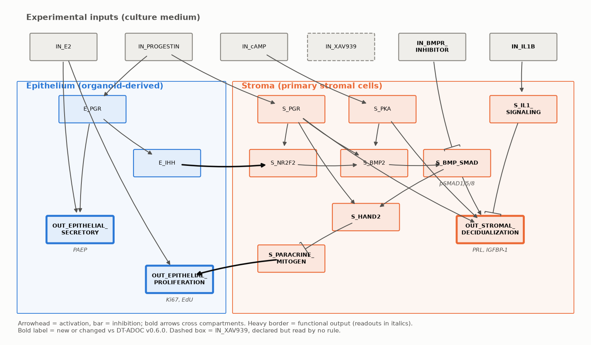

# Model construction: endotwin-v0.1.0

`endotwin/models/endotwin-v0.1.0/` is the ENDO-TWIN mainline network. It is an
initial hypothesis family for WP1, not a calibrated or validated model.

## Files

| File | Content |
|---|---|
| `network.bnd` | The executable MaBoSS network: default rule of every node |
| `baseline.cfg` | Default settings: all nodes start OFF, none internal (so the joint state can be carried between phases) |
| `node_dictionary.tsv` | Compartment, layer, entity type (expression, protein activity, programme, condition), readouts, v0.6.0 lineage |
| `edges.tsv` | One row per dependency (23 default, 3 variant-only) with evidence class and references |
| `rule_variants.tsv` | Alternative rules, in three families that each own distinct nodes |
| `lineage.tsv` | Every v0.6.0 node: carried unchanged, renamed, modified, merged, or left in the legacy model |
| `interface.tsv` | The two epithelial-stromal signals |
| `provenance.toml` | Source model and commit; `calibrated = false`, `biologically_validated = false`, `physical_time_mapping = false` |

## Architecture

The network is organised into five layers, and still runs as one integrated
MaBoSS model:

1. **Experimental inputs** (6): `IN_E2`, `IN_PROGESTIN` (P4 or MPA), `IN_cAMP`,
   `IN_XAV939`, `IN_BMPR_INHIBITOR`, `IN_IL1B`.
2. **Epithelial intracellular**: `E_PGR`.
3. **Stromal intracellular**: `S_PGR`, `S_PKA`, `S_NR2F2`, `S_BMP2`,
   `S_BMP_SMAD`, `S_HAND2`, `S_IL1_SIGNALING`.
4. **Intercompartmental signals**: `E_IHH` (epithelium to stroma) and
   `S_PARACRINE_MITOGEN` (stroma to epithelium), declared in `interface.tsv`.
5. **Functional outputs** (the grant's three readout-bearing nodes):
   `OUT_EPITHELIAL_SECRETORY` (PAEP), `OUT_EPITHELIAL_PROLIFERATION`
   (Ki67, EdU), `OUT_STROMAL_DECIDUALIZATION` (PRL, IGFBP-1).

`S_BMP_SMAD` also carries a readout (pSMAD1/5/8).

## What changed from the prototype v0.6.0

- **Not carried:** the embryo-adhesion and receptivity module (37 nodes,
  including `OUT_STABLE_ADHESION`, the typed-in interface relays and the inputs
  `IN_HCG` and `IN_EMBRYO_CONDITIONED_SIGNAL`, which no rule read). It remains
  executable in `models/superset/`. The grant measures no adhesion, and the
  published adhesion arms cannot separate any ENDO-TWIN hypothesis
  (`docs/experimental_data.md`, section 3).
- **BMP:** ligand expression (`S_BMP2`) is now separate from receptor/SMAD
  activity (`S_BMP_SMAD`), which a receptor inhibitor can switch off. BMP2 acts
  on decidualisation and HAND2 only through `S_BMP_SMAD`.
- **Paracrine relay:** `S_FGF_MITOGENIC` was renamed `S_PARACRINE_MITOGEN`; its
  rule is unchanged.
- **Outputs:** `E_SECRETORY_STATE` and its exact alias `E_PAEP` became
  `OUT_EPITHELIAL_SECRETORY`. `S_DECIDUALIZED`, with its exact aliases `S_PRL`,
  `S_IGFBP1` and `OUT_STROMAL_DECIDUALIZED`, became
  `OUT_STROMAL_DECIDUALIZATION`. `E_ESTROGENIC_PROLIFERATION` became
  `OUT_EPITHELIAL_PROLIFERATION`.
- **New inputs:** `IN_BMPR_INHIBITOR` and `IN_IL1B`, with `S_IL1_SIGNALING`.

Every unchanged rule is checked byte-for-byte against v0.6.0 by
`tests/mainline/test_model_integrity.py`.

## Rule-variant families

| Family | Node | Variants | Question |
|---|---|---|---|
| Q1 | `OUT_STROMAL_DECIDUALIZATION` | `Q1_bmp_required` (default), `Q1_pgr_sufficient` | Is BMP/SMAD activity necessary for hormone-induced decidualisation? |
| Q2 | `OUT_EPITHELIAL_PROLIFERATION` | `Q2_stromal_relay` (default), `Q2_relay_plus_direct_v051`, `Q2_epithelial_autonomous` | Does progesterone suppress epithelial proliferation through stromal paracrine signalling? |
| INF | `S_PGR` | `INF_decidual_only` (default), `INF_pgr_depletion` | Does IL-1beta act on decidualisation only, or also through stromal PGR? |

Families own disjoint nodes, so any combination is well defined: 2 x 3 x 2 = 12
scenarios, all executable (`Model.scenarios()`). A default is only the variant
written in `network.bnd`, not a preferred conclusion.

## Exact structure (default variants)

From `endotwin/results/endotwin-v0.1.0/structure.json`, by exhaustive
enumeration of the 2^6 input assignments:

- 19 nodes, 23 dependencies (20 activating, 3 inhibitory), 11 distinct
  Boolean functions.
- Alias classes: {`IN_PROGESTIN`, `E_PGR`, `E_IHH`, `S_PGR`, `S_NR2F2`,
  `S_BMP2`, `S_HAND2`}, {`IN_cAMP`, `S_PKA`}, {`IN_IL1B`, `S_IL1_SIGNALING`}.
  `S_BMP_SMAD` is not in the progesterone class: receptor inhibition separates
  it.
- 1 absorbed dependency (`S_PKA -> S_BMP2`); no inhibition that never binds.
- Phenotype-inert nodes: `IN_XAV939`, `E_IHH`. `E_IHH` cannot change a
  functional output because decidualisation already requires cAMP, but it does
  change pSMAD1/5/8 under the hormone-only regimen (no cAMP), so only
  `IN_XAV939` is readout-inert.

## Protocols, timing and simulation semantics

`endotwin/config/protocols.yaml` defines the published supplemented regimen (E2
priming, then E2 + MPA + 8-Br-cAMP + XAV939), a hormone-only regimen for the
Task 1.1 qualification, 9 conditions and 6 matched comparisons. A perturbation's
timing is the phase in which it appears. Interventions
(`endotwin/config/interventions.tsv`: stromal HAND2 knockdown, paracrine-route
block) pin a node through its rates, so they have a dynamic onset.

`src/endotwin/simulate.py` runs each phase as one MaBoSS run and carries the
full joint distribution of the non-input nodes across phase boundaries. Nothing
restarts at a boundary, unlike the prototype protocol layer, which re-initialised
non-memory nodes. Each phase runs to its fixed point (relative duration 20,
unit rates; convergence is checked and recorded). Phase and replicate seeds are
spaced by at least the trajectory count, because consecutive MaBoSS seeds share
trajectories (`docs/maboss_estimator_semantics.md`).

## Open questions carried into WP1

| Id | Question | Why it is not resolved in the model |
|---|---|---|
| OQ-01 | Where does XAV939 act in ADOC, and what does it do? | `IN_XAV939` is read by no rule. WNT inhibition promotes secretory differentiation in organoids (ET-019), but no evidence fixes the compartment it reaches in the chip |
| OQ-02 | Is decidualisation BMP/SMAD-dependent in ADOC? | Q1, to be tested in Task 1.4 |
| OQ-03 | Which stromal paracrine route, if any, controls epithelial proliferation in human ADOC? | Q2; ligand identity unresolved |
| OQ-04 | How much of the secretory response is due to the progestin rather than cAMP and XAV939? | The published regimen applies them together; the hormone-only arm of Task 1.1 can separate them |
| OQ-05 | By which route does IL-1beta impair decidualisation? | INF family; to be revised with G2 data |
| OQ-06 | Do PRL and IGFBP-1 report the same decidual state? | They map to one node; their observed onset order cannot be represented (the prototype's TI-04) |
| OQ-07 | Which rates and initial conditions apply? | None estimated; steady-state predictions are rate-invariant, transients are not |
