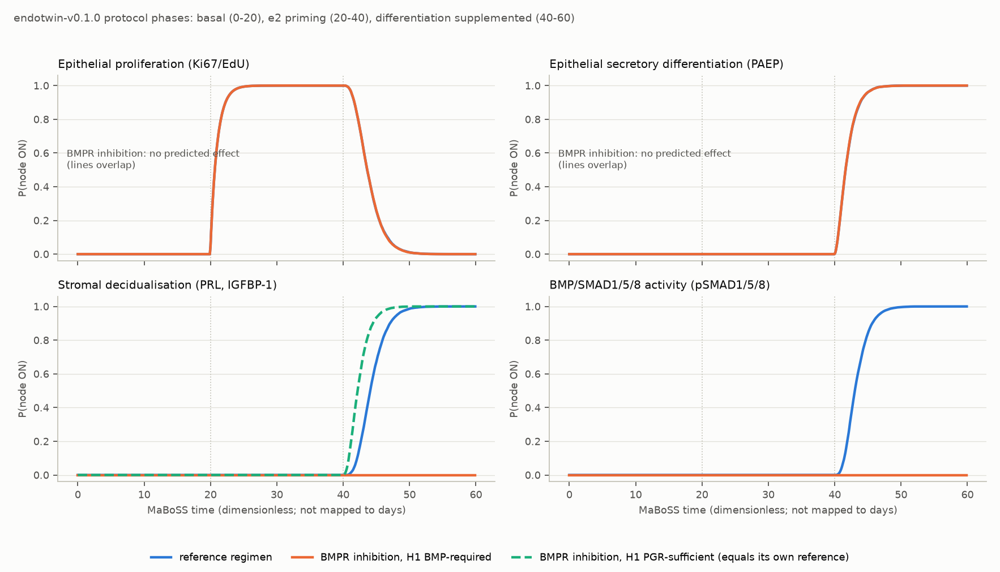
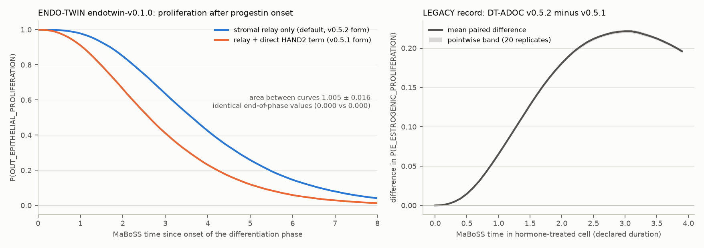

# Model evaluation: methods, metrics and findings

Evaluation in this repository is of five distinct kinds. They must not be
conflated.

| Category | Meaning | Done in the prototype | Done in ENDO-TWIN v0.1.0 |
|---|---|---|---|
| Structural verification | Internal properties of the model (aliases, absorbed edges, identifiability) | Yes, extensively | Yes |
| Software verification | Correct, reproducible execution | Yes (`docs/software_verification.md`) | Yes |
| Exploratory biological comparison | Consistency with available measurements | Yes, ordinal and directional only | Not yet (no ENDO-TWIN data) |
| Calibration | Parameters or assumptions adjusted to observations | **No.** The adhesion objective was demoted to an ordinal diagnostic; no magnitude is fitted | **No** |
| Independent validation | Predictions tested on data withheld from development | **No** | **No.** The freezing workflow exists; no prediction is frozen |

No accuracy, correlation, R-squared, AUC or confidence interval for model fit
has been computed anywhere in this repository, because no quantitative fit
exists.

## Metrics actually implemented

| Metric | What it measures | Analysis, version, data | Result |
|---|---|---|---|
| Distinct composed Boolean functions; alias classes | Whether named nodes are distinct hypotheses | The prototype's U5 (v0.5.0), stage 3 (v0.6.0); ENDO-TWIN structure | v0.6.0: 56 nodes, 29 functions, 7 classes; endotwin-v0.1.0: 19 nodes, 11 functions, 3 classes |
| Absorbed and never-binding dependencies | Declared edges that cannot change their target | same | v0.6.0: 20 of 89; endotwin-v0.1.0: 1 of 23 |
| Phenotype-inert nodes | Nodes that cannot change any output | same | v0.6.0: 17 (including the model nodes of all three ELISA analytes); endotwin-v0.1.0: 2 (1 readout-inert) |
| Latent observation classes | What a matched-unit design could identify | U5 identifiability, v0.5.0 | 8 of 32 latent classes reachable with every proposed arm and readout |
| Design-effective states | States distinguishable under a planned design | design alias, v0.4.0 | 19 of 35 (as declared); PAEP and IGFBP-1 carry the same design information |
| Rule-variant discriminability | Whether competing rules predict different readouts | Gate 3a, v0.4.0; ENDO-TWIN discrimination table | Gate 3a: 9 pairs, no usable assay node; ENDO-TWIN: every family has a robust discriminating comparison (below) |
| Concordance classes | Curated comparison with published results | concordance, v0.4.0, 60 rows | 3 directional, 1 partial, 1 disagreement, 4 calibration-circular, 36 not expressible, 15 not assessable, 0 quantitative |
| Ordinal agreement | Ordering of arms | functional endpoint, v0.5.0, adhesion counts (prototype only; not ENDO-TWIN data, `docs/experimental_data.md` section 3) | untreated < HT > mifepristone at the converged horizon only; observed 9/19 (Wilson 95% 0.27-0.68) excludes the converged 0.82 |
| RNA-endpoint verdicts | Predicted CNT -> HT switch vs end-of-treatment RNA | v0.5.1, E-MTAB-15842 | 0 concordant, 0 discordant of 27 nodes |
| Paired transient difference bands | Effect of a rule change on dynamics | U5b (v0.5.1), C5 (v0.5.2), 20 replicates on disjoint seed blocks | C5: proliferation +0.043 to +0.167 (phase mean), 7 of 7 hormone-exposed cells beyond tolerance |
| Seed reproducibility | Run-to-run spread and seed structure | seed probe, v0.5.0; endpoint replicates | consecutive seeds give stratified, overlapping draws (an estimator caution, not biology) |
| Initial-condition sensitivity | Dependence on uncertain priors | KLF12 prior sweep, v0.4.0 | exactly linear; partial |
| Transition-rate sensitivity | Dependence on unknown rates | **not done in the prototype**; ENDO-TWIN v0.1.0 | 30 random rate sets: 720 of 720 steady-state directions unchanged |
| Convergence to exact fixed points | Whether stochastic runs reach the Boolean fixed point | ENDO-TWIN v0.1.0 | 312 of 312 phases converged; maximum deviation 0.002 |

The model nodes of the three ELISA analytes were phenotype-inert in v0.6.0.
That is itself a finding: those measurements could not test any output of the
adhesion model.

## ENDO-TWIN v0.1.0 findings (model predictions, not observations)

From `endotwin/results/endotwin-v0.1.0/discrimination.tsv`. "Robust" means the
two variants predict different directions whatever variants the other families
take.

| Perturbation (comparison) | Readout | Hypotheses separated | Predicted directions | Verdict |
|---|---|---|---|---|
| BMP receptor inhibition during differentiation | PRL, IGFBP-1 | Q1 BMP-required vs PGR-sufficient | down vs no change | robust |
| Stromal HAND2 knockdown during differentiation | Ki67, EdU | Q2 stromal (relay or relay plus direct) vs epithelial-autonomous | up vs no change | robust |
| Paracrine-route block during E2 priming | Ki67, EdU | Q2 stromal vs epithelial-autonomous | down vs no change | robust |
| Paracrine-route block during differentiation | Ki67, EdU | none | no change in all | uninformative |
| IL-1beta during differentiation | pSMAD1/5/8 | INF decidual-only vs PGR-depletion | no change vs down | robust |
| IL-1beta during differentiation | Ki67, EdU | INF routes | no change vs up (only if Q2 is stromal) | conditional |

Further predictions:

- **BMP inhibition** leaves pSMAD1/5/8 down and proliferation unchanged under
  both Q1 hypotheses, so target engagement does not discriminate Q1; the
  decidual readouts do.
- **Hormone-only regimen** (no cAMP): decidualisation stays off under every
  hypothesis, while pSMAD1/5/8 still rises through the epithelial IHH relay.
- **The HAND2 relay example.** The relay and relay-plus-direct
  representations compute the same Boolean function (exhaustive check), so
  their steady states are identical. After progestin onset the relay keeps
  proliferation higher for longer: area between curves 1.005 +/- 0.016 over 10
  paired replicates of 5,000 trajectories (all positive); half-times 3.7 vs 2.7
  dimensionless time units; end-of-phase values both 0.000. Under 20 random
  rate sets the delay persists in every sample (area 0.07 to 9.5). Only a
  time-resolved epithelial proliferation measurement after progestin onset could
  separate the two representations, and the proposal plans no such time course.
  This reproduces the recorded prototype result (v0.5.1 vs v0.5.2) in the new
  model, with the converged-horizon check the prototype lacked.

## How agreement will be judged (WP2, WP4)

`src/endotwin/observations.py` and the frozen spec fix these rules before any
data exist:

- the unit is the donor; the effect is the within-donor log2(perturbed/control);
- a predicted change is **concordant** when at least `min_consistent_donors`
  move beyond `min_effect_log2` in the predicted direction, **discordant** when
  as many move the other way, otherwise **inconclusive**;
- a predicted no-change is concordant only if every evaluable donor lies within
  an equivalence margin. A non-significant difference alone never confirms it;
- comparisons failing viability, integrity or target-engagement criteria are
  not evaluable, decided independently of the prediction.

## Limitations of evaluation

- Steady-state predictions are rate-invariant; transient predictions are not,
  and no rate has been estimated.
- MaBoSS time is dimensionless and is not mapped to the 48 h and 96 h phases.
- Directional predictions on Boolean outputs cannot express graded or partial
  responses (for example, partial loss of decidualisation under BMP inhibition).
- Several inherited edges have weak per-edge evidence (`docs/scientific_evidence.md`).
